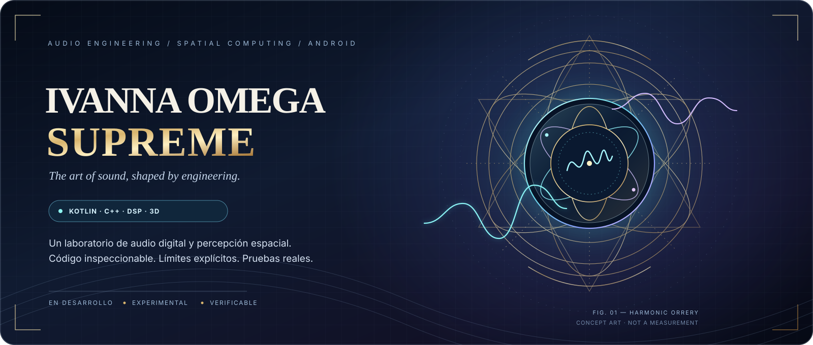
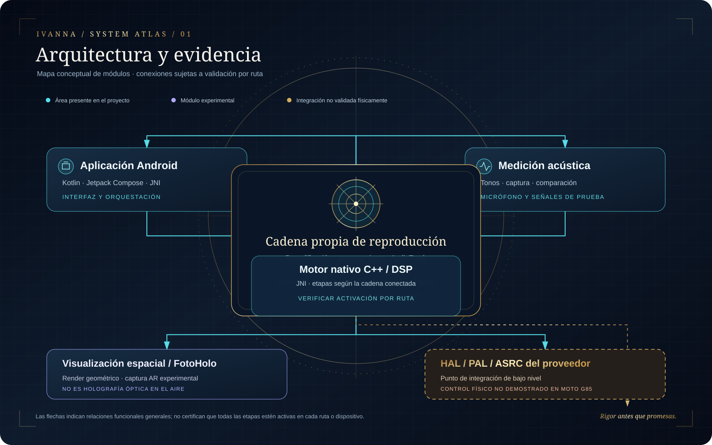

# IVANNA OMEGA SUPREME

### Una guía visual y honesta para entender el proyecto

[README técnico](README.md) · [English quick start](README.en.md) · [Arquitectura](docs/release_media/architecture-map.svg) · [Estado de compilación](https://github.com/luisurielpimentelperez814-design/IVANNA-OMEGA-SUPREME/actions) · [Versiones](https://github.com/luisurielpimentelperez814-design/IVANNA-OMEGA-SUPREME/releases)

---

## Explora IVANNA

| **Conocer** | **Entender** | **Comprobar** |
|:---:|:---:|:---:|
| [Áreas principales](#las-tres-áreas-principales) | [Mapa de arquitectura](#cómo-se-relacionan-las-piezas) | [Plan Moto G85](docs/PLAN_10D_MOTO_G85_ACCEPTANCE.md) |
| [README técnico](README.md) | [Ficha de ingeniería](docs/ENGINEERING.md) | [Pruebas y CI](https://github.com/luisurielpimentelperez814-design/IVANNA-OMEGA-SUPREME/actions) |

> **El arte inspira la experiencia; la evidencia define los límites de cada promesa.**

## ¿Qué es?

IVANNA OMEGA SUPREME es un proyecto de software para Android que reúne una aplicación, componentes de procesamiento digital de audio y herramientas experimentales de medición y visualización espacial.

La meta es construir un sistema que permita controlar el procesamiento, realizar mediciones cuando el dispositivo lo permite y verificar los resultados. El proyecto está en desarrollo: **tener código para una función no significa automáticamente que esté conectada, que funcione en cualquier teléfono o que ya haya superado una prueba física.**

## Las tres áreas principales

<table>
<tr>
<td width="33%" valign="top">

### 🎚️ Audio

La aplicación incluye una ruta de reproducción propia. En esa ruta, un PLL software puede ajustar el resampler a partir de una estimación de la cola de AudioTrack.

**Límite:** no controla directamente el reloj físico del DAC, Bluetooth ni el HAL global. Hace falta probar cada salida en el dispositivo.

</td>
<td width="33%" valign="top">

### 📏 Medición

El proyecto incluye herramientas que reproducen tonos de prueba, graban con el micrófono y comparan mediciones antes y después de un ajuste.

**Límite:** el micrófono del teléfono no está calibrado como instrumento de laboratorio. Una métrica interna no garantiza una mejora audible universal.

</td>
<td width="33%" valign="top">

### 🧭 FotoHolo / 3D

Hay un renderizador geométrico y una ruta experimental de captura espacial con ARCore, seguimiento y exportación de puntos.

**Límite:** una nube de puntos no es una malla completa ni una medición acústica de la habitación. La calidad depende del dispositivo y del entorno.

</td>
</tr>
</table>

## Atlas visual: cómo se relacionan las piezas

PLANO 01 · MAPA CONCEPTUAL · LA VALIDACIÓN REAL SIGUE SIENDO OBLIGATORIA

El mapa muestra las relaciones generales del código. El bloque HAL/PAL representa un punto de integración documentado, no una prueba de que el hardware de un teléfono esté controlado por IVANNA.

## Estado de las funciones

| Función | Estado que podemos describir | Qué falta para afirmar que está validada |
|---|---|---|
| Aplicación Android y motor nativo | Hay código Kotlin, C++ y puentes entre componentes. | Probar las rutas concretas en la versión que se distribuya. |
| PLL software de reproducción | Implementado en la ruta del reproductor propio para ajustar el resampler con límites definidos. | Pruebas físicas de estabilidad, clics, tono, latencia y underruns. |
| Cadena de reproducción propia | El reproductor decodifica, procesa y escribe en `AudioTrack`; si el DSP nativo está cargado, él ejecuta la cadena maestra y no se apilan procesadores duplicados. | Escucha controlada y registros en el Moto G85. Solo afecta al audio que reproduce IVANNA, no al de otras apps. |
| Motor predictivo (Módulo 1) | Analiza el audio en C++ y publica confianza y transitorios hacia la interfaz y las métricas. | Es un observador: hoy produce telemetría y **no cambia el sonido**. La ventana de 5–10 ms es un objetivo de diseño sin medición en teléfono. |
| HRTF / SOFA / SAF | Los archivos del APK y del módulo Magisk coinciden y están íntegros (verificado automáticamente). | Escucha controlada para confirmar que la espacialización binaural se oye bien; una HRTF genérica no es la de cada persona. |
| Anti-Dolby (clasificador) | Un modelo clasifica el contenido en voz, música, bajos y silencio, y la lógica nativa lo usa. | No es un modelo de política acústica universal; hacen falta mediciones con material de referencia para afirmar un resultado concreto. |
| Medición de sala | Hay flujo de tonos, captura, comparación y lógica de restauración. | Mediciones repetidas con equipo, salas y salidas diferentes. |
| Captura AR | Hay actividad de captura y exportación basada en ARCore. | Confirmar cámara, seguimiento, ciclo de vida y exportación en cada equipo objetivo. |
| Renderizador geométrico | Dibuja una geometría configurada y admite imágenes de hasta 3840 × 2160 píxeles. | Verificar rendimiento y recordar que no es un escaneo automático ni una simulación acústica validada. |
| SAFMUS / ACSR / HAL-PAL | Existen componentes y contratos de integración en el repositorio. | Demostrar la conexión con el proveedor y el hardware, con lectura de retorno y prueba real. |
| Wi-Fi / CSI | Hay políticas conservadoras para tratar observaciones de radio como indicios. | Hardware/proveedor compatible y adquisición real; Wi-Fi común no equivale a CSI. |

## ¿Necesita una API key de Google?

Las funciones locales que no llaman a servicios externos deben poder operar sin una clave de Google. Una clave solo es necesaria para una función opcional si esa función utiliza un servicio externo que la requiere. Que exista un campo de configuración no demuestra que el servicio esté conectado o activo.

## Guía rápida: qué salida usar

- **Audífonos:** empieza con estéreo normal. Activa HRTF/binaural cuando quieras una escena espacial con contenido estéreo; la sensación depende de la anatomía y del ajuste personal. WFS está pensado para arreglos de altavoces compatibles, no para reemplazar HRTF en audífonos.
- **Estéreo por AUX:** usa el modo estéreo y comienza con EQ neutra. Sube el volumen desde el equipo de reproducción y evita combinar varios realces de graves si oyes distorsión.
- **DAC USB-C:** conecta el DAC antes de iniciar la reproducción de IVANNA. El Profiler muestra el dispositivo solicitado y la lectura de `AudioTrack.routedDevice` cuando Android la expone. Si no coincide, desconecta y vuelve a conectar el DAC y comprueba la salida del sistema. Esa lectura confirma la ruta de la app, no el reloj físico del DAC.
- **Bluetooth:** el códec y la latencia los negocian Android y el receptor. Para música, prioriza estabilidad; para juegos o vídeo, prueba el modo de baja latencia que realmente soporte tu dispositivo.
- **Receptor 5.1/7.1:** confirma que la conexión transporta el número de canales esperado. Una salida USB-C estéreo o un cable AUX estéreo no se convierte automáticamente en multicanal por seleccionar un preset.

## Calibración WFS: cuatro controles

1. **X — ancho:** mueve el punto de escucha a izquierda/derecha.
2. **Y — altura:** ajusta la altura aproximada de los oídos respecto al suelo.
3. **Z — fondo:** indica la distancia desde el frente de la sala.
4. **Orientación — giro horizontal:** rota el marco de referencia del oyente; 0° conserva el frente original.

El preset 7ch reenvía la distribución virtual de siete altavoces; Centrar recupera una posición de referencia. El mensaje de envío no sustituye una escucha controlada ni una medición con micrófono/equipo adecuados.

## ¿Cómo sé si una versión está lista?

Consulta [GitHub Actions](https://github.com/luisurielpimentelperez814-design/IVANNA-OMEGA-SUPREME/actions) y las [versiones publicadas](https://github.com/luisurielpimentelperez814-design/IVANNA-OMEGA-SUPREME/releases). Antes de instalar, comprueba:

- [ ] La compilación corresponde al commit que se quiere probar.
- [ ] Las pruebas automáticas terminan correctamente.
- [ ] APK y módulo Magisk proceden del mismo commit.
- [ ] Se verificaron los hashes y el contenido de los artefactos.
- [ ] Se instaló y probó en el teléfono objetivo.
- [ ] Se anotaron los errores, límites y resultados reales.

Un CI verde no demuestra por sí solo calidad sonora ni compatibilidad física. Para el Moto G85 con Android 15, consulta el [plan de aceptación y sus pruebas pendientes](docs/PLAN_10D_MOTO_G85_ACCEPTANCE.md).

## Seguridad y privacidad

- Otorga permisos de cámara y micrófono solo a las funciones que los necesitan.
- No compartas claves, tokens, datos personales ni grabaciones privadas en los informes.
- No instales un módulo que requiera root sin comprender sus efectos y disponer de una forma de recuperación.
- No confundas una medición del teléfono con una medición certificada.
- Revisa las licencias de bibliotecas, modelos y datasets de terceros antes de redistribuir.

## Documentación y contacto

- [README técnico](README.md) — arquitectura, pruebas, compilación y límites.
- [Ficha de ingeniería](docs/ENGINEERING.md) — notas técnicas.
- [Plan de aceptación Moto G85](docs/PLAN_10D_MOTO_G85_ACCEPTANCE.md) — pruebas físicas requeridas.
- [Registro de cambios](CHANGELOG.md) — historial de versiones.
- [Reportar un problema](https://github.com/luisurielpimentelperez814-design/IVANNA-OMEGA-SUPREME/issues) — pasos reproducibles y logs depurados.

## Propiedad intelectual

IVANNA OMEGA SUPREME se presenta como un producto propietario. El acceso público al repositorio no concede por sí solo permiso para reutilizar el código propio. Los componentes de terceros mantienen sus licencias y avisos; las concesiones expresas aplicables a versiones anteriores siguen sujetas a sus términos.

**Ingeniería verificable antes que promesas.**

El código, las pruebas reproducibles y la validación física prevalecen sobre cualquier afirmación de marketing.

