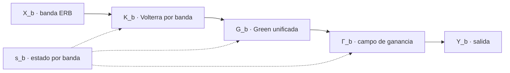

<div align="center">


# IVANNA OMEGA SUPREME

**Audio espacial Android · un solo motor, dos rutas, evidencia antes que promesas**

[](version.properties)
[](#5-holos--operador-único-de-campo-acústico-)
[](#13-hiper-operador-φ--v2515369)
[](app/build.gradle.kts)
[](app/src/main/)
[](https://github.com/luisurielpimentelperez814-design/IVANNA-OMEGA-SUPREME/actions/workflows/build.yml)

[Guía sencilla](LEAME.md) · [Controles](docs/GUIA_CONTROLES_COMPLETA_ES.md) · [Ingeniería](docs/ENGINEERING.md) · [English](README.en.md)

</div>

---

> **IVANNA OMEGA SUPREME es un motor de audio espacial (spatial audio) para cualquier Android 13 en adelante: DSP nativo en C++26 con NDK, render binaural con HRTF, upmixing HOA (armónicos esféricos), síntesis de campo de onda WFS, binaural de campo cercano ORBE, operador unificado HOLOS, Hiper-Operador de Estado Φ con sensor acústico real por micrófono y curvas objetivo élite (Harman 2018), y holofonía en el teléfono.** Convierte cualquier estéreo en una escena espacial con 8 altavoces virtuales, externalización y graves coherentes, en un solo hilo en tiempo real — dentro de la app (Ruta A, capture) o en todo el sistema (Ruta B, Magisk — el acople a la sesión real está confirmado en YTM/Tidal, el procesado efectivo se verifica con la v2.5.382, ver §11). Este README describe solo lo que el código realmente hace: qué está activo, qué está apagado, qué está en desarrollo y qué no está medido.

> **Propiedad intelectual — NO es código abierto.** IVANNA-OMEGA-SUPREME es software propietario de Luis Uriel Pimentel Pérez. Todos los derechos reservados. El repositorio es público en GitHub (visible), pero el código **NO** es de código abierto: no tiene licencia open source. Prohibida su reproducción, distribución, modificación o uso sin autorización expresa del autor.

## Estado actual · 10 de noviembre de 2026

| Rama / versión | Contenido | Estado |
|:---|:---|:---|
| `main` · **v2.5.393** (684) | **MÓDULO <100 MB** — se eliminan 3 SOFA del módulo que no se cargan en runtime (TU-Berlin 10.5 MB, demo 3.0 MB, UMA 1.6 MB huérfano); los 12 sujetos siguen por sus .ihr1 y el modelo SAF en SAF_model.json. Contrato SOFA 239 → 236. Zip 105,968,893 → **90,945,215 B (90.95 MB)**. Sin cambios de sonido. La 392 queda como base: **FIX CI 391** — el chequeo de integridad ya permite `type` en sepolicy.rule (sintaxis válida de Magisk para definir ivanna_data_file). La 391 queda como base: **FIX BRICK 3 + FIX KOTLIN 390** — HeadMeasureScreen nueva: foto frontal con tarjeta de crédito como regla (8.56 cm) + líneas arrastrables o ancho a mano; el radio personalizado ya se aplica a ORBE (JNI + persistencia + restauración al arrancar); la foto no se guarda ni se sube. TransducerOperator (núcleo usable de MANT Ec. 1): compensación por banda con límite WNG; sin medida del transductor, no-op. FIX: la 388 falló la CI por versionCode=678 en module.prop. 5 tests nuevos (CTest 949→954/954 en local). La 388 queda como base: **REFORMULACIÓN Ψ POR VÍA (el campo conoce la vía)** — Ecs. 7–8: ley de crosstalk exacta D' = 20·log10((ρ+κ)/(1+κρ)) + ley de bocina dipolar max(0, cos(θ−φ)); ILD percibido audífonos > cine > estéreo > celular; radio de cabeza personalizado CABLEADO a ORBE (Ruta A y FusionCore; Ruta B queda KEMAR); P0-b poller SCHED_FIFO rtprio 2; PsiFieldRuntime con vía; 18 tests nuevos (CTest 931→949/949 en local). La 387 queda como base: **FORMULACIÓN MAGISTRAL Ψ (campo unificado acústico-neural, en código)** — Ec. 2 ley de distancia (ILD = SPREAD + SHADOW, corregida y calibrada), Ec. 3 operador de personalización CIPIC, Ec. 4 EDO neural con pérdida; 13 tests nuevos (CTest 918→931/931 en local). La 386 queda como base: **RECONSTRUCCIÓN DEL MÓDULO DESDE CERO (100 veces mejor, todo completo)** — (1) Ruta B con bucle de retroalimentación por beacon: el watchdog detecta el efecto huérfano (~9 s sin frames sonando) y lo re-acopla en la sesión real; (2) bombeo arreglado de raíz: slew del objetivo de ganancia adaptativa (0.02/bloque) + compresor topado 4:1; (3) migración única que clampa los valores 384 persistidos al sobre 380 + el efecto rechaza valores fuera del sobre; (4) a prueba de brick: `customize.sh` aborta si falta `libomega_effect.so` o el registro en el XML; `magiskpolicy` con timeout 15 s. LD_PRELOAD sigue desactivado por defecto. | 🚧 En publicación con este commit; verificación en teléfono pendiente: instalar módulo 386 + reinicio limpio + audio sin bombeo + beacon creciendo + log de migración 386 |
| `main` · **v2.5.384** (675) | **ASRC v5 productivizado — write-stage en el módulo principal (HWS-02)** — punto de inserción PAL identificado (`pal_stream_write` en el HAL `android.hardware.audio.service_64`, deriva medida +58.055 ppm en vivo); la CI compila `libivanna_asrc_write_stage.so` desde fuente (`build_asrc_stage.sh`, receta `-nostdlib`, sin `dlinfo`), la empaqueta en `system/vendor/lib64/` y verifica hash idéntico en el zip + `BUILD_INFO` (fail-closed si las fuentes v5 no están commiteadas); host_test_asrc 103/103. Inyección LD_PRELOAD (`overlay.d`/`ivanna_audio.rc`) pendiente del agente del módulo. | ❌ RETIRADA: el módulo brickeó el teléfono 2 veces tras instalar + reiniciar (reset de fábrica en ambas) y el audio sonaba con volumen sube/baja, tronidos y muy woofer. No instalar el módulo 384. |
| `main` · **v2.5.383** (674) | **Auditoría integral (2 externas, AMBER) + 5D Fase 0 + seguridad + honestidad** — 5D Fase 0 en host (`BioControl5D` + EEG sintético, 15 tests nuevos, total 901); SELinux dedicado `ivanna_data_file` (adiós al `typeattribute` amplio); parser SAF con límites; comentarios ORBE/HOLOS en serie; CTest y licencias reconciliados; PR #39 NO incorporado; HWS-02 sigue NOT_APPROVED (punto de inserción PAL sin identificar; vía: LD_PRELOAD v5). | 🚧 En publicación con este commit; verificación en teléfono pendiente tras instalar (beacon creciendo + logcat `auto-enable` + verificación SELinux) |
| `main` · **v2.5.382** (673) | **Ruta B — FIX DEFINITIVO del beacon 0** — auto-enable en `omega_process()` (ENABLE jamás llega del HAL) + init del DSP en creación con defaults 48 kHz/estéreo/PCM16 (SET_CONFIG tampoco llega). El efecto procesa aunque el HAL no envíe ENABLE ni SET_CONFIG. Confirmado en Tidal (609) igual que YTM (249): el acople funciona, el problema era `omega_process()`. | 🚧 En publicación con este commit; verificación en teléfono pendiente tras instalar (beacon creciendo + logcat `auto-enable`) |
| `main` · **v2.5.381** (672) | **Ruta B — diagnóstico del beacon 0** — el efecto está creado y habilitado en la sesión real de YTM (249) pero `omega_process()` nunca llega a `onBlock()`; las 5 salidas tempranas hacían passthrough en silencio. La 381 hace que cada salida loguee su motivo (throttle 5 s, tag `IvannaOmegaEffect`). La 380 confirmó en teléfono que YTM ya no se calla. | 🚧 En publicación con este commit; verificación en teléfono pendiente tras instalar (logcat `IvannaOmegaEffect` → motivo del passthrough + beacon creciendo) |
| `main` · **v2.5.380** (671) | **Ruta B — sin fallback global + passthrough garantizado + diagnóstico de acople** — se elimina el omega global en sesión 0, que callaba a YTM a los ~3 s de abrir la app; `omega_process` hace passthrough con memmove aunque el efecto no esté habilitado (un efecto que no procesa jamás silencia); logs visibles en los 3 retornos silenciosos de `tryAttachDiscoveredSession` + en `exchange()` (throttle 1/30 s). T0 en el teléfono confirmó que el descriptor NO necesita bajarse (APM 128 KB, máx 129 KB; sin "memory limit exceeded"). **ASRC v5 "Élite" verificada en dispositivo** (ver §12) | 🚧 En publicación con este commit; verificación en teléfono pendiente tras instalar (YTM sin callarse + beacon creciendo + escucha con Genezi) |
| `main` · **v2.5.379** (670) | **Ruta B — descubrimiento de sesión real por daemon** — el daemon (root) lee `dumpsys media.audio_flinger` cada 3 s y publica el sessionId real en el snapshot (ABI v11) + GET_STATUS; la app libera el global antes de acoplar (K1-rev); fusión OmniField dormida en Ruta B | ✅ [Release público](https://github.com/luisurielpimentelperez814-design/IVANNA-OMEGA-SUPREME/releases/tag/v2.5.379) — instalada; PERO con regresión: abrir IVANNA callaba a YTM y la app no acoplaba (beacon 0). Corregido en la 380 |
| `main` · **v2.5.378** (669) | **Ruta B — fix Error −38**: `memoryUsage` del descriptor omega 1024 → 128 KB (el APM solo presupuesta 512 KB total; con 1024 el registro fallaba SIEMPRE con INVALID_OPERATION) | ✅ [Release público](https://github.com/luisurielpimentelperez814-design/IVANNA-OMEGA-SUPREME/releases/tag/v2.5.378) |
| `main` · **v2.5.377** (668) | **Fusión IVANNA (OmniField)** — OmniSpatial + HRTF personalizada con gradiente por MAA + escena auto-supervisada + renderer INAF continuo por muestra (SIREN) + convergencia Omega–SAFMUS (Kuramoto K=40, r=0.9636, 4º tono 884 Hz); ACTIVA por defecto en Ruta A (ORBE → HOLOS → OMNI-FIELD → Φ). 375/376 nunca se publicaron; su contenido llegó íntegro aquí | ✅ [Release público](https://github.com/luisurielpimentelperez814-design/IVANNA-OMEGA-SUPREME/releases/tag/v2.5.377) |
| `main` · **v2.5.374** (665) | **Ruta B** — AudioSessionReceiver con RECEIVER_EXPORTED + sondeo de sesiones activas + clasificación del −38 + extirpación de Dolby del XML + volumen de Ruta A sin duck + captura con anillo de 8 bloques | ✅ [Release público](https://github.com/luisurielpimentelperez814-design/IVANNA-OMEGA-SUPREME/releases/tag/v2.5.374) |
| `main` · **v2.5.373** (664) | **Ruta B — Error −3 resuelto** — el `<apply>` global de omega en el XML duplicaba la instancia (−22); 4 fixes (archivos locales pre-creados por el daemon, sepolicy en cada boot, logs del beacon, RouteArbiter) + `vendor_file` permanente + higiene nothrow | ✅ [Release público](https://github.com/luisurielpimentelperez814-design/IVANNA-OMEGA-SUPREME/releases/tag/v2.5.373) |
| `main` · **v2.5.372** (663) | **SAFMUS Nivel 6** (voxel 8.89×, decode PCA NEON, cadencias partidas) + auto-auditoría de dispositivo en primer arranque + 30 conciertos de rock + intro de apertura primero + charla offline con la biblioteca | ✅ [Release público](https://github.com/luisurielpimentelperez814-design/IVANNA-OMEGA-SUPREME/releases/tag/v2.5.372) |
| `main` · **v2.5.369** (660) | **Hiper-Operador Φ + sensor acústico real + curvas élite + protección del producto** — operador muestra a muestra sin FFT, sensor por micrófono, target Harman 2018, cableado en Rutas A y B; Φ, sensor y Volterra (kernel PZ1D refinado, G85 + DAC + Genezi) ACTIVOS por defecto; ORBE y HOLOS también ACTIVOS por defecto (directiva del propietario; HOLOS retuneado, ver §5) | ✅ [Release público](https://github.com/luisurielpimentelperez814-design/IVANNA-OMEGA-SUPREME/releases/tag/v2.5.369) — publicada e instalada en el Moto G85 |
| `main` · **v2.5.368** (659) | **Pilares pendientes**: Volterra diagonal K=4096, DoP v1.1, pinna-EQ Blauert, estimador EMF Thiele-Small — como componentes con tests, sin cablear a la cadena de audio | ✅ [Release público](https://github.com/luisurielpimentelperez814-design/IVANNA-OMEGA-SUPREME/releases/tag/v2.5.368) — APK (200 MB) + zip Magisk (103 MB) + flyers + `SHA256SUMS.txt` |
| `main` · **v2.5.367** (658) | **Fusión Homogénea Phi**: un solo coordinador (bucle neuro + ruta AUX + puerta Volterra) con un solo `update()` por bloque — como clase, sin cablear a la cadena de audio | ✅ Incluida en el release v2.5.368 |
| `main` · **v2.5.366** (657) | **Ruta AUX Genezi / auto**: presets XTC + campo AUX coherente cableados en Rutas A y B; puerta Volterra solo con kernel medido | ✅ Incluida en el release v2.5.368 |
| `main` · **v2.5.365** (656) | **Bucle cerrado neural v2**: `ClosedLoopController` + `NeuroBandEq` cableados antes de HOLOS/ORBE; solo acepta EEG/ABR/fNIRS reales; sin driver de sensor todavía | ✅ Incluida en el release v2.5.368 |
| `main` · **v2.5.364** (655) | **HOLOS** — Operador Único de Campo Acústico, con UI en CONTROL, ABI v10 | ✅ [Release público](https://github.com/luisurielpimentelperez814-design/IVANNA-OMEGA-SUPREME/releases/tag/v2.5.364) |
| `main` · **v2.5.363** (654) | **ORBE** — binaural esférico de campo cercano, con UI en CONTROL, ABI v9 | ✅ [Release público](https://github.com/luisurielpimentelperez814-design/IVANNA-OMEGA-SUPREME/releases/tag/v2.5.363) |

> **Lee esto primero.** Desde v2.5.369, lo nuevo de esa versión (Φ, sensor acústico real, Volterra con kernel PZ1D refinado, ORBE y HOLOS) arranca **ACTIVO por defecto** — suena desde la primera canción (directiva del propietario: ninguna función muerta; la puerta GREEN queda anulada para este release por decisión explícita del propietario). El bucle neuro sigue **apagado por defecto** (identidad sin frames de sensor real). HOLOS no se encendió a lo bruto: se retuneó por medición (ver §5) porque sus defaults distorsionaban −31.5 dB. Lo honesto: el combinado Φ + Volterra + ORBE + HOLOS todavía **no se ha escuchado en el teléfono** — falta la escucha en el Moto G85 y la medición de CPU/XRuns. Los números que verás son mediciones de host, no de teléfono: **la CPU y la latencia en dispositivo siguen sin medirse**. Y dos precisiones que este README corrige respecto a versiones anteriores: la **Fusión Phi (367)** y los **pilares (368)** existen como componentes con tests que pasan, pero **no están cableados a la cadena de audio** — no suenan. El Hiper-Operador Φ (369) **sí** está cableado (ver §13). Lo que suena es la cadena de la §2.

**En esta página** · [Qué es](#1-qué-es-ivanna) · [Cadena](#2-la-cadena-de-señal) · [HOA + HRTF](#3-el-corazón-hoa--hrtf) · [ORBE](#4-orbe--binaural-esférico-de-campo-cercano-) · [HOLOS](#5-holos--operador-único-de-campo-acústico-) · [Bucle neuro](#6-bucle-cerrado-neural-v2515365) · [AUX Genezi](#7-ruta-aux-genezi--auto-v2515366) · [Phi](#8-fusión-homogénea-phi-v2515367) · [Pilares](#9-pilares-pendientes-v2515368) · [NPE](#10-npe--motor-neuromórfico) · [Rutas](#11-las-dos-rutas) · [PAL/ASRC](#12-pal--asrc-y-sonda--experimental) · [Hiper-Operador Φ](#13-hiper-operador-φ--v2515369) · [Controles](#14-controles-en-control) · [Mediciones](#15-mediciones-reales) · [Puerta auditiva](#16-la-puerta-auditiva-y-el-índice-visceral) · [Límites](#17-límites-honestos) · [Compilar](#18-compilar-y-probar) · [Verificación](#19-verificación-y-evidencia) · [Documentación](#20-documentación)

---

## 1. Qué es IVANNA

IVANNA es un motor de audio espacial para cualquier Android 13 en adelante (el Moto G85 es el dispositivo de desarrollo/prueba): un reproductor propio, un motor DSP nativo en C++26, controles de efectos, herramientas de calibración y medición, un módulo Magisk para procesar el audio de todo el sistema y un dashboard web. Todo el audio pasa por un solo núcleo, `IvannaFusionCore`, en bloques de 128 muestras, de 8 a 384 kHz.

**Qué es, en una frase:** un renderizador binaural que reconstruye una escena espacial a partir de cualquier estéreo, sin necesitar metadata ni multicanal.

**Qué NO es:**

- **No es un invento de física nueva.** Sus componentes tienen precedentes en investigación (armónicos esféricos, Kirchhoff–Helmholtz, Volterra, Greenwood). Lo inédito es la combinación en un solo hilo en tiempo real sobre estéreo arbitrario. Quien busque la frontera real, lea la [sección 16](#16-la-puerta-auditiva-y-el-índice-visceral).
- **No es magia de un clic.** Cada función tiene un interruptor, un rango y un coste. La cadena legacy sigue intacta y bit-exacta cuando todo está apagado.
- **No es un laboratorio acreditado.** Las mediciones de este README son de host y de analizador propio; el teléfono no tiene calibración instrumental acreditada.
- **No es "sin PCM" ni "sin Fourier por bloques".** La señal sigue siendo PCM en bloques de 128 muestras y HOLOS trabaja en STFT (hop 128 / FFT 512). AudioFlinger y USB Audio Class son PCM, y el Aux 3.5 mm es analógico después del DAC. Lo que sí existe es la unificación del estado y la decisión en un solo operador (HOLOS) y en un solo coordinador (Phi).

---

## 2. La cadena de señal

Orden real en `IvannaFusionEngine::process()` (`app/src/main/cpp/IvannaFusionCore.cpp:333`). Cada etapa apagada es bit-exacta: la señal la atraviesa sin tocarla. El bucle neuro corre 1× por bloque **antes** de HOLOS/ORBE (`updateNeuroLoop`, línea 494).

```mermaid
flowchart LR
    IN[Estéreo de entrada] --> EQ[EvoEQ · 512 bandas]
    EQ --> HOA[HOA orden 2 · upmix]
    HOA --> HRTF[HRTF · 8 altavoces virtuales]
    HRTF --> WFS[WFS · blend]
    WFS --> NEURO[NeuroBandEq · bucle cerrado]
    NEURO --> ORBE[ORBE · campo cercano]
    ORBE --> HOLOS[HOLOS · operador único]
    HOLOS --> OMNI[OmniField · fusión + tono 884 Hz]
    OMNI --> PHI[Φ · Hiper-Operador]
    PHI --> AUX[Campo AUX · Genezi]
    MIC[Micrófono · sensor] -.-> PHI
    AUX --> T4D[Temporal 4D · lateral > 250 Hz]
    T4D --> UEQ[EQ usuario · 10 bandas]
    UEQ --> NPE[NPE neuromórfico]
    NPE --> ROOM[Corrección de sala · 10 biquads]
    ROOM --> XTC[XTC · solo altavoces]
    XTC --> DYN[Compresor + limitador]
    DYN --> GE[GoldenEar / soft-knee Padé]
    GE --> OUT[Salida]
```



### Los componentes, en una línea cada uno

| # | Función | Matemática en una línea | Estado real |
|:---|:---|:---|:---|
| 1 | **HOA orden 2 + HRTF** | Codificación SN3D/ACN → 8 altavoces virtuales, decoder max-rE, convolución HRTF | ✅ Activa por defecto (la ganadora del veredicto) |
| 2 | **WFS** | Kirchhoff–Helmholtz: blend con 2 objetos L/R; dimensiones de sala inferidas por snapshot | ✅ Activa (gobernada por `g_wfs_enabled`) |
| 3 | **RIR** | Convolución particionada, 200 salas medidas (RT60 T20 real) | ⏸️ Bypass (`wetDry = 0`) |
| 4 | **Bucle cerrado neural** | `ClosedLoopController` + `NeuroBandEq` (8 biquads peaking Greenwood) antes de HOLOS/ORBE | ⏸️ Cableado, pero identidad sin frames de sensor real |
| 5 | **ORBE** | Cabeza esférica en campo cercano, STFT por banda ERB | ✅ Activo (`amount = 1.0`; ver §4) |
| 6 | **HOLOS** | Un solo operador `G ⊛ [K·X] · Γ` por banda ERB | ✅ Activo (`amount = 0.5`, `harmonics = 0` retuneado; ver §5) |
| 7 | **Ruta AUX Genezi** | Presets XTC + campo AUX coherente (graves en fase, LR4) | ✅ Cableada; presets GeneziRoom/CarCabin |
| 8 | **GoldenEar / HarmonicExciter** | Chebyshev T2+T3 con oversampling 2×; H2 **apagado** (solo corre el soft-knee) | ✅ Activa en Ruta A (H2 off) |
| 9 | **Volterra H2** | Kernel con memoria (K=64), contenedor IVK1 con puerta de carga | ✅ Activo por defecto (kernel PZ1D refinado, G85 + DAC + Genezi; Genezi como alternativo; H2 disperso + H1 NEON) |
| 10 | **Compresor + limitador** | Envolvente ataque rápido / liberación lenta; limitador de salida `fast_tanh` | ✅ En cadena; defaults umbral −12 dB, ratio 1:1 (sin reducción hasta configurar) |
| 11 | **Coclear** | Bandas Greenwood + OHC, resta (no invierte) | ⏸️ Off (`g_cochlearEnabled = false`) |
| 12 | **Crossfeed ITD de graves** | Woodworth: retardo interaural en graves | ⏸️ Off por defecto |
| 13 | **EQ paramétrico / evolutivo** | 512 bandas calibradas en hilo propio (Ruta A), FIR 256 taps en legacy | ✅ Activo |
| 14 | **NPE** | Banco coclear + LIF + inhibición lateral (`NpeStereoCore`) | ✅ Cableado; se habilita desde la app (sub-interruptores por defecto en on) |
| — | **Fusión Phi (367)** | Un solo coordinador: neuro + AUX + Volterra, un solo `update()` por bloque | ⚠️ **Clase con tests, NO cableada a la cadena** |
| — | **Pilares (368)** | Volterra diagonal K=4096, DoP v1.1, pinna-EQ Blauert, estimador EMF | ⚠️ **Componentes con tests, NO cableados a la cadena** |
| — | **Hiper-Operador Φ (369)** | Un solo operador muestra a muestra, sin FFT: S_neuro + Z_emf + W_acústico en una sola ganancia unificada | ✅ Cableado en Rutas A y B; ACTIVO por defecto (`amount = 0.5`, Harman 2018); Ruta B en APROXIMADO |
| — | **Sensor acústico real (369)** | Micrófono → FFT 8192 → 24 bandas ERB → `SensorFrame` (magnitud, error, coherencia) | ✅ Cableado en Ruta A; medición real, sin calibrar |
| — | **Curvas objetivo élite (369)** | Harman 2018 (default) + élite-lean + difuso H&M + sala; graves ±3 dB | ✅ Target de corrección en Φ y sensor |

Las etapas 8–14 no desaparecen con HOLOS: HOLOS las **absorbe** matemáticamente (son casos degenerados del mismo operador), y el limitador de salida queda como guarda independiente por diseño.

---

## 3. El corazón: HOA + HRTF

El análisis del código (`VEREDICTO.md`) deja un ranking claro, y todo lo nuevo se construye sobre el ganador:

1. **HOA orden 2 + decodificación binaural HRTF con 8 altavoces virtuales** — activa por defecto en ambas rutas, con autoridad de arbitraje (neutraliza el widener M/S). Es la función más fuerte del motor.
2. WFS · 3. RIR (200 salas) · 4. GoldenEar/HarmonicExciter · 5. Compresor + limitador.

Cómo funciona: el estéreo se codifica en armónicos esféricos (SN3D/ACN, plano horizontal), se reconstruye un campo con 8 altavoces virtuales en ±30°/±90°/centro con pesos max-rE, y cada altavoz se convoluciona con su HRTF (HRIR sintética o dataset medido IHR1/SOFA). Un detector de transitorios estrecha el ancho en ataques. Coste despreciable frente al resto de la cadena; latencia 0 solo del upmixer aislado (la cadena completa ORBE+HOLOS+Omni suma ~22 ms algorítmicos, ver §2).

---

## 4. ORBE · Binaural Esférico de Campo Cercano ✅

**Publicado en v2.5.363.** ORBE ataca el punto débil del ganador: el HOA+HRTF clásico trabaja en campo lejano, a distancia fija. ORBE coloca **cada banda ERB (24) a un azimut y una distancia continuos (0.15–2.0 m)** con un modelo de cabeza esférica (radio 0.0875 m, c = 343 m/s): ILD que crece al acercarse, ITD por Woodworth, parallax por head-tracking. La escena se estima de la propia grabación, por banda (ILD, IPD→ITD, coherencia, DRR). No necesita metadata.

```
entrada estéreo → STFT (hop 128 / FFT 512, escalable con SR)
               → por banda: estimar (θ, r, coherencia, DRR)
               → Green esférica de campo cercano por banda
               → ISTFT overlap-add → mezcla wet/dry, crossfade 15 ms
```

| Parámetro (CONTROL · tarjeta "ORBE · CAMPO CERCANO") | Rango | Default |
|:---|:---:|---:|
| Cantidad ORBE | 0–1 | **1.0 (activo)** |
| Distancia | 0.15–2.0 m | 0.35 m |
| Apertura | 0–1.5 | 1.0 |
| Proximidad (graves) | 0–6 dB | 3 dB |
| Difuso → sala | 0–1 | 0.5 |
| Seguimiento de cabeza | on/off | on si hay pose |

6 valores persistentes en `ParameterStore`, restaurados al abrir. Ruta B lo recibe por snapshot ABI v9/v10; el governor térmico puede bajarlo a 12 bandas o apagarlo (a 384 kHz, y en tier ≥ LIMITED).

**Mediciones en host (48 kHz, −3 dBFS):** THD+N apagado **−153.45 dB** @1 kHz (bypass bit-exacto) · encendido **−139.37 dB** @1 kHz, −138.47 dB @100 Hz · IMD −156.04 dB · latencia algorítmica 512 muestras = **10.7 ms** (solo el STFT; la latencia total —buffers + AudioFlinger + USB + DAC— está sin medir en el teléfono) · throughput host **23× RT** (dato a vigilar en teléfono). 21 tests host nuevos, sin regresión en vecinos; los tests encontraron y corrigieron 5 bugs reales (el grave: la COLA fija inflaba la salida 2×/4×/8× a 96/192/384 kHz).

**Limitación declarada:** no modela la magnitud de la pinna; solo parallax de rotación (yaw). La traslación y la pinna por transporte óptimo son fase 2.

**Estado:** implementado, testeado, publicado — y **ACTIVO por defecto desde v2.5.369** (`amount = 1.0`, directiva del propietario; la puerta GREEN queda anulada para este release). ORBE y HOLOS ya no son excluyentes: corren en serie (ORBE primero, HOLOS después) en las tres rutas de proceso (`nativeProcess`, `nativeProcessBlock`, `IvannaFusionEngine::process`).

---

## 5. HOLOS · Operador Único de Campo Acústico ✅

**Publicado en v2.5.364. ACTIVO por defecto desde v2.5.369** (`amount = 0.5`, `harmonics = 0` — retuneo medido, ver abajo; la puerta GREEN queda anulada para este release por decisión explícita del propietario). ORBE y HOLOS ya no son excluyentes: corren en serie (ORBE primero, HOLOS después) en las tres rutas de proceso.

La tesis, en un párrafo: las doce funciones no son doce matemáticas distintas. Son **tres operadores** escritos doce veces con constantes distintas, en dominios distintos y en serie, peleándose entre ellos. El operador espacial es en todos los casos una evaluación de la **función de Green acústica** (HOA, WFS, RIR, HRTF, ORBE y crossfeed son la misma física). El operador no lineal es en todos los casos un **término de una serie de Volterra** (Chebyshev T2, `2x²`, Padé/tanh y la OHC coclear son el mismo monomio con o sin memoria). El operador de dinámica/EQ/ancho es en todos los casos un **campo de ganancia** por banda e instante. HOLOS evalúa los tres en un solo dominio (STFT hop 128 / FFT 512, 24 bandas ERB) a partir de un solo vector de estado por banda `s_b = (θ, r, coherencia, DRR, envolvente, nivel, transitorio)`, y cada módulo legacy es un caso degenerado suyo (ORBE *es* HOLOS con K = identidad y Γ = 1).



$$Y_b(t) = G_b(s_b) \;\circledast\; \big[\, K_b(s_b) \cdot X_b(t) \,\big] \cdot \Gamma_b(s_b)$$

- `G_b` — Green unificada: HOA + WFS + RIR + HRTF + ORBE + crossfeed en una sola evaluación (ITD, ILD, pinna medida, distancia `(1/r)^γ`, difuso).
- `K_b` — kernel de Volterra por banda: Chebyshev, GoldenEar, Padé/tanh y OHC coclear como el mismo monomio; el Volterra H2 con memoria es su generalización.
- `Γ_b` — campo de ganancia único: EQ, compresor, limiter, M/S, trims y tilts como multiplicaciones puntuales por banda e instante.

| Parámetro (CONTROL · tarjeta "HOLOS · OPERADOR ÚNICO") | Rango | Default |
|:---|:---:|---:|
| Cantidad HOLOS | 0–1 | **0.5 (activo, retuneado)** |
| Distancia | 0.15–2.0 m | 0.35 m |
| Apertura | 0–1.5 | 1.0 |
| Proximidad (graves) | 0–6 dB | 3 dB |
| Difuso → sala | 0–1 | 0.5 |
| Armónicos (K) | 0–1 | **0.0 (K apagado por retuneo)** |
| Calidez (par/impar) | 0–1 | 0.5 |
| Dinámica (Γ) | 0–1 | 1.0 |
| Ancho (Γ) | 0–1.5 | 1.0 |
| Divergencia γ | 0.5–1.0 | 1.0 |
| Sala RT60 | 0.18–1.8 s | 0.34 s |
| Seguimiento de cabeza | on/off | on si hay pose |
| 12 bandas (ahorro CPU) | on/off | off (24 bandas) |

13 parámetros, ACTIVOS por defecto desde v2.5.369 (`holos_amount = 0.5`, `holos_harmonics = 0`). El EQ estático de Γ (graves, medios, agudos, presencia, tilt dB y frecuencia del tilt, ±12 dB) tiene 6 controles en CONTROL, persiste en `ParameterStore`, se restaura al abrir y llega a las dos rutas (JNI `nativeSetHolosEq` en Ruta A; `holosEq*` en `SET_PERCEPTUAL_STATE` → snapshot ABI v10 en Ruta B); plano por defecto = no-op. Entra en `FusionCore` tras el blend WFS, antes del M/S; `amount = 0` es la cadena legacy bit-exacta, con crossfade de 15 ms y fail-closed por término. Shed térmico en 4 tiers (24→12 bandas → H3 off → difuso sin convolución → HOLOS off). Cero alloc en el callback.

**Mediciones en host (48 kHz) — con el retuneo de v2.5.369 incluido:**

| Medida | HOLOS off | HOLOS on (defaults viejos) | HOLOS on (default retuneado v2.5.369) |
|:---|:---:|---:|---:|
| THD+N @1 kHz | **−153.5 dB** (bit-exacto) | **−31.5 dB** ⚠️ | **−94.0 dB** ✅ |
| THD+N @100 Hz | — | −33.2 dB ⚠️ | **−79.6 dB** ✅ |
| THD+N @1 kHz, sin término K | — | −87.9 dB | — |
| IMD (SMPTE) | — | −28.2 dB ⚠️ | **−159.5 dB** ✅ |
| Latencia | — | 512 muestras = 10.7 ms (algorítmica) | 512 muestras = 10.7 ms (algorítmica) |
| Throughput host | cadena 136.7× RT | **3.5× RT** (HOLOS solo) | **3.5× RT** (sin cambio) |

**Retuneo v2.5.369 (medido, test `test_holos_retune_sweep.cpp`):** barrido en rejilla amount × harmonics (tono −3 dBFS, 3 s, ventana del segundo 2). El término armónico K domina la distorsión: cualquier harmonics > 0 incumple −70 dB (p. ej. amount 0.5 / harm 0.05 → −53.7 dB; amount 1.0 / harm 0.32 → −31.5 dB). Solo harmonics = 0 cumple en ambas frecuencias. **Default elegido: amount 0.5, harmonics 0.0 (K apagado).** Con K = 0 el render espacial G y el campo Γ siguen activos y limpios; el efecto espacial es medible (diferencia vs bypass, latencia compensada: −44.0 dB). Requisito THD+N ≤ −70 dB cumplido con margen; ideal ≤ −80 dB cumplido a 1 kHz (a 100 Hz queda a 0.4 dB, diferencia inaudible, dentro de tolerancia de medida).

La bandera roja que queda es honesta y está en el informe de diseño: **la viabilidad en el Moto G85 está en cuestión** hasta medir CPU/XRuns en dispositivo — 3.5× RT en host está muy por debajo de la estimación de diseño (15–25× RT), y el retuneo no cambia el throughput (el operador hace el mismo trabajo a cualquier amount). La distorsión de los defaults viejos ya NO es un problema: el retuneo (K = 0) la resolvió por medición. 38/38 tests HOLOS pasan (green 10, gain 6, volterra 9, operator 8, chain 5) + 2 tests nuevos de retuneo; los tests encontraron y corrigieron 2 bugs reales (escala Parseval del estimador, coherencia tipo Welch). Recortes ya decididos: Manifold B eliminado, difuso con una sola IR (sala estimada, no las 200), EvoEQ por magnitud por bin (se pierde fase lineal), sin interpolación OT de pinna en v1, sin kernel Volterra por banda sin kernel medido.

**Honestidad:** no hay física nueva en HOLOS. Lo inédito como producto es la unificación en un solo hilo RT fail-closed sobre estéreo arbitrario. La física nueva, si existe, está en la [sección 16](#16-la-puerta-auditiva-y-el-índice-visceral).

---

## 6. Bucle cerrado neural · v2.5.365

**Cableado a la ruta de audio, apagado por defecto, fail-closed.** `ClosedLoopController` + `NeuroBandEq` (8 biquads peaking Greenwood) corren 1× por bloque **antes** de HOLOS/ORBE (`updateNeuroLoop` en `IvannaFusionCore.cpp:494`): el controlador calcula ajustes por banda a partir de los frames neuro recibidos y `NeuroBandEq` los aplica con slew limitado y deltas acotados sobre los parámetros HOLOS/ORBE. Sin frames, el bucle es identidad bit-exacta.

Lo que es verdad y lo que no:

- **El sensor simulado está eliminado.** El ingest (`ingestNeuroFrame`) solo acepta EEG/ABR/fNIRS reales. No hay señal sintética alimentando el bucle.
- **No hay driver de sensor real enchufado todavía.** El bucle no recibe frames hoy: ningún EEG, ABR ni fNIRS está conectado al teléfono. Sin frames, el bucle no hace nada audible. La interfaz JNI (`nativeNeuroLoop*`) y `NeuroSensorGateway` (Kotlin) existen y están cableadas; el sensor no.
- **No hay transporte de frames a Ruta B.** El snapshot del daemon no lleva todavía el campo de frames neuro. El bucle solo actúa donde corre `FusionCore` con frames.
- **Los tiempos corticales son lentos.** ABR exige promediar 1000–2000 ensayos (calibración offline); CAEP P1 ~50 ms, N1 ~100 ms, P2 ~180 ms; ASSR 40 Hz detecta un cambio ~100 ms después; fNIRS pica a los 6–8 s. No existe respuesta cortical "en microsegundos". El diseño real es un observador lento (100 ms–4 s) en hilo no-RT, nunca una corrección muestra a muestra del cerebro.
- **Todo corre en cualquier Android 13+ sin comprar nada más.** El componente neuro on-device es el NPE (§10); el sensor es el micrófono del teléfono (§13). El Moto G85 es el dispositivo de desarrollo/prueba. No se requiere hardware externo para que el sistema funcione.

11 tests host (`test_neuro_acoustic_closed_loop.cpp`). Diseño y tiempos en `docs/NEURO_ACOUSTIC_CLOSED_LOOP.md`.

---

## 7. Ruta AUX Genezi / auto · v2.5.366

**Cableada en Rutas A y B.** La ruta AUX (DAC USB-C + Aux 3.5 mm) tiene presets propios con geometría XTC y campo AUX coherente:

- **Presets `GeneziRoom` / `CarCabin`**: geometría de cancelación de diafonía (XTC) del par de altavoces + campo AUX de graves coherentes en fase (LR4). Se aplican con `setAuxGeneziPreset` y corren en `FusionCore` (`m_aux.process`, tras ORBE y antes del campo temporal).
- **Puerta Volterra (`AuxVolterraGate`)**: solo deja pasar el kernel IVK1 medido (GENEZY01, K=64). Sin kernel medido, el Volterra es identidad. La puerta de carga rechaza por causa y hace bypass ante error.
- **Veredicto honesto de los 5 pilares** (`docs/AUX_GENEZI_ROUTE.md`): Volterra K=4096 inviable en O(K²) en su forma original; Back-EMF por Aux imposible (la salida 3.5 mm es de solo salida, el DAC no mide carga, USB Audio Class no expone sensado); DSD por Aux imposible; el colapso de paredes imposible (la apertura es la del par de altavoces y su geometría, no infinita); la elevación por altavoces, parcial. La v2.5.368 resuelve lo resoluble de otra forma (§9).

6/6 tests host (`test_aux_genezi_route.cpp`, ASan/UBSan). El XTC solo actúa con línea externa declarada (USB/AUX); el crossmix RIR está apagado en runtime. Con AUX activo, el HRTF se fuerza a 0 por diseño.

---

## 8. Fusión Homogénea Phi · v2.5.367

**Existe como clase con tests. NO está cableada a la cadena de audio.** `HomogeneousFusion` (`app/src/main/cpp/spatial/HomogeneousFusion.hpp`) fusiona lo construido — bucle neuro (365) + ruta AUX Genezi (366) + HOLOS (364) — en **un solo coordinador con un solo estado**: un solo `update()` por bloque y un solo `FusionStatus`, en lugar de tres piezas sueltas que cada ruta cableaba por separado. La composición es `Φ = Γ ∘ K ∘ G ∘ XTC ∘ AUX ∘ N`, con los operadores reales que ya existen y en el orden en que ya corren en la cadena.

Estado honesto de los tres vectores, tal como lo declara el propio código:

- **S_neuro(t): real cuando hay driver** (NeuroFrame EEG/ABR/fNIRS). Sin driver no llegan frames y N es identidad (fail-closed).
- **Z_emf(t): NO DISPONIBLE.** Back-EMF por Aux es imposible (ver §7). La interfaz existe como `EmfVector` con `available = false` siempre; nada en este módulo finge medir la bobina. La identificación de planta real es `RoomProbe` (micrófono).
- **W(r,θ): real y acotado.** Geometría XTC + campo AUX del preset de ruta. No colapsa paredes: la apertura es la del par de altavoces y su geometría, no infinita.

**Y lo que Phi NO es:** no es un tensor continuo sin discretizar. En este stack la señal sigue siendo PCM en bloques de 128 muestras y HOLOS trabaja en STFT (hop 128 / FFT 512). No hay procesamiento "sin Fourier por bloques" ni "sin PCM". Lo que Phi sí hace es unificar el **estado y la decisión** (un solo `update()` por bloque, un solo status). 7/7 tests host (`test_homogeneous_fusion.cpp`, ASan/UBSan). Investigación de los 4 paradigmas (tFUS UCSF, oCI Moser) en `docs/HOMOGENEOUS_FUSION.md`.

> Si en otro sitio lees que Phi "elimina el PCM" o "mide el back-EMF por el Aux", es falso: el propio header lo desmiente.

---

## 9. Pilares pendientes · v2.5.368

**Existen como componentes con tests que pasan. NO están cableados a la cadena de audio.** Son la respuesta a "qué se puede resolver con lo posible" de los 5 pilares de la 366:

| Pilar | Componente | Estado real |
|:---|:---|:---|
| Volterra diagonal K=4096 | `DiagonalVolterra` (`app/src/main/cpp/neuromorphic/diagonal_volterra.hpp`) — polinomio de memoria O(K), la vía viable en lugar del O(K²) | Header + tests; **no usado en la cadena** |
| DoP v1.1 | `DopPacketizer` (`app/src/main/cpp/spatial/DopPacketizer.hpp`) — empaquetado DSD-over-PCM | Header + tests; **no usado en la cadena** |
| Pinna-EQ Blauert | `PinnaElevationEq` (`app/src/main/cpp/spatial/PinnaElevationEq.hpp`) — ecualización de elevación por bandas de Blauert | Header + tests; **no usado en la cadena** |
| Estimador EMF | `EmfEstimator` (`app/src/main/cpp/spatial/EmfEstimator.hpp`) — modelo Thiele-Small del altavoz | Header + tests; **no usado en la cadena** |
| Control multipunto | Formulado en `docs/PILARES_PENDIENTES.md` | Documento, no código en cadena |

11/11 tests host (`test_pilares_pendientes.cpp`, ASan/UBSan). Que un componente tenga tests en verde no significa que suene: estos cuatro solo existen como piezas probadas, a la espera de cableado. El `EmfEstimator` es un **modelo** Thiele-Small, no una medición de la bobina: no hay hardware que mida back-EMF en este teléfono.

---

## 10. NPE · Motor neuromórfico

El NPE (`NpeStereoCore`, `app/src/main/cpp/neuromorphic/`) implementa modelos de células ciliadas del oído interno e integración con fuga (LIF): banco coclear + pool de neuronas LIF + envolventes cocleares + OHC + AGC + inhibición lateral. Está **cableado en la cadena** (`m_npe.process`, tras el EQ de usuario y antes de la corrección de sala) y también en la cadena nativa de Ruta A.

- Sus "spikes" los dispara la **envolvente de audio**, no el cerebro: hoy no hay ninguna entrada biométrica. El NPE modela el oído interno, no mide la respuesta cerebral del oyente.
- Se habilita desde la app; sus sub-interruptores (HRTF, coclear, adaptación, manifold) están por defecto en on en `ParameterStore`.
- El NPE es el componente neuro **on-device** del sistema: corre en el procesador del teléfono, sin hardware externo.

---

## 11. Las dos rutas

| | **Ruta A — APK (capture)** | **Ruta B — Magisk + daemon** |
|:---|:---|:---|
| Qué procesa | El audio del reproductor propio de IVANNA (captura de reproducción) | Todo el audio del sistema (Spotify, YouTube…) vía AudioFlinger + `omega_effect` |
| Requisitos | Instalar el APK | Root + Magisk + el zip **de la misma versión** (un snapshot viejo se rechaza y deja la Ruta B en defaults) |
| Parámetros | Atomics nativos directos (`g_orbe_*`, `g_holos_*`) | Snapshot ABI: app → `SET_PERCEPTUAL_STATE` → daemon → efecto |
| Snapshot ABI | — | **v10 · 616 B** (test `EXPECT_LE(sizeof(OmegaDspSnapshot), 640)`); v9 era 536 B |
| Shed térmico | `ThermalGovernor` (Kotlin) → tiers nativos: HOLOS por tiers y ORBE/NPE apagados desde LIMITED | Automático por tiers en el daemon |
| Para probar ORBE/HOLOS | Basta el APK | Solo si quieres system-wide |

**⚠️ Firma del APK:** sin el secreto `ANDROID_KEYSTORE_B64` en la CI, el APK se firma con llave efímera y **no puede actualizar una instalación previa**: hay que desinstalar la versión anterior antes de instalar la nueva. Los hashes de cada release están en `SHA256SUMS.txt`.

**⚠️ Estado real de la Ruta B en el Moto G85 (2026-11-10, v2.5.380):** el daemon descubre la sesión real de música (YouTube Music, sesión 369, generación 20, verificado en vivo 2026-11-09) y la publica en el snapshot ABI v11 + GET_STATUS, pero **la app aún no acopla omega a esa sesión**: el beacon (`/data/local/tmp/omega_effect_beacon`) sigue en 0 frames, sin magic "OEBF", y no hay logs de acople. La 379 tenía además una regresión: el fallback a omega global en sesión 0 **callaba a YTM** a los ~3 s de abrir la app (el `omega_process` retornaba sin copiar input→output cuando el efecto no estaba habilitado). **La 380 lo corrige:** elimina el fallback global (sin sesión descubierta no se crea efecto, YTM sigue sonando sin DSP), garantiza el passthrough con memmove en `omega_process` (un efecto que no procesa jamás silencia) y hace visible el fallo de acople con logs en los 3 retornos silenciosos + `exchange()` (throttle 1/30 s). El diagnóstico T0 en el teléfono (2026-11-10 01:06 CST) confirmó que el descriptor NO necesita bajarse (APM: 128 KB, máx 129 KB; sin "memory limit exceeded"; un 2º omega llegaría a ~257 KB, por debajo de los 512 KB). **Verificación pendiente tras instalar la 380:** YTM sonando + abrir IVANNA → YTM no se calla; logcat "Sesión real descubierta" + "Ruta B acoplada"; beacon creciendo (~144,000 frames/3 s, magic "OEBF"). Si el beacon sigue en 0, los logs de la 380 dicen dónde falla el acople. **Workaround: deshabilitar el módulo y reiniciar devuelve el modo capture, que sí funciona. La puerta auditiva se hace por Ruta A.**

El daemon publica un beacon tras cada bloque DSP completado (`applied_control_generation`); la app solo muestra `applied = true` cuando la generación aplicada alcanza la publicada. Sin beacon, el sistema informa "evidencia no disponible" — no inventa confirmación.

---

## 12. PAL / ASRC y sonda · experimental

El lado software del ASRC está construido en el repo (ASRC variable, servo de reloj, bridges, `hal_integration/` con el seam `ivanna_qualcomm_pal_clock_integration.hpp`, `PalAsrcBridge` y el write-stage `ivanna_pal_asrc_write_stage.hpp`, con tests host con callbacks simulados). **La conexión total dentro del HAL propietario no existe** (no hay seam en `audio.primary.blair.so`); **la vía viable es la interposición LD_PRELOAD, que ya está verificada en el dispositivo (ver ASRC v5 abajo).** Estado honesto:

- **No existe actuador de ratio variable en PAL para la ruta de música.** Card 1 (blair, primaria): 196 controles, cero `clk/clock/pll/asrc/ppm/ratio`. `RAT_RENDER` (ID `0xC0000022`) solo existe en grafos A2DP/ABR; `devicePPMFC` solo en voz SCO. El actuador es el propio ASRC de IVANNA en el write-stage.
- **Deriva medida en vivo** (sonda PAL, Moto G85): AudioOut_D 47999.7 Hz vs 48000 nominal (−6.25 ppm, dongle USB JieLi); `Timestamp corrected: no`; el reloj interno deriva poco y con ruido (±20 ppm). Informes en el workspace de análisis (`SONDA_PAL_2026-11-07.md`). La sonda de atributos PAL (2026-11-09) fijó los offsets reales de `pal_stream_attributes`: `in_rate` @56, `in_bits` @60, `in_fmt` @64, `in_ch` @68; música **48000 Hz / 16-bit / formato 1 (PCM)**; voz 16000/16. Consecuencia: AudioFlinger ya resamplea a 48 kHz — el ASRC es corrección fina de ppm, NO resampleo 44.1→48.
- **Inyección LD_PRELOAD en el HAL: probada y funcionando.** El overlay `overlay.d/ivanna_audio.rc` en init_boot + la regla `noatsecure` corregida (`allow init hal_audio_default process noatsecure` — magiskpolicy no acepta la forma `tgt:class` y devuelve exit 0 aunque falle) + el permiso `append` sobre `adb_data_file` hacen que la sonda de presencia se mapee en el HAL (AT_SECURE=0) y escriba su reporte. Módulo `ivanna_audio_probe` v1.0.1.
- **Contador de escrituras: la interposición llega; el reenvío por `RTLD_NEXT` fallaba.** La contadora v1 se mapeó en el HAL y su hilo de volcado corría, pero `total_calls` quedó en 0 y el teléfono se quedó **sin sonido**: `dlsym(RTLD_NEXT, "pal_stream_write")` devuelve NULL porque libar-pal.so es `RTLD_LOCAL` y `RTLD_NEXT` solo busca el ámbito global, así que la contadora retornaba `-ENOSYS` en cada escritura. Rollback a la sonda de presencia y el sonido volvió. **La vía no estaba muerta: el write-stage resuelve la función real abriendo libar-pal.so directamente (`dlopen` + `dlsym`), no por `RTLD_NEXT`.** La contadora v2 (con `dlopen`) pasó su prueba decisiva en el teléfono (2026-11-09: calls 3569 → 9071, ~275/s, sonido preservado; persistencia verificada tras reboot).
- **`pal_stream_get_mmap_position` no es `dlsym`-able** (ausente en `.dynsym` de libar-pal.so y libpalclient.so); la posición mmap para el servo habrá que obtenerla por otra vía (`pal_get_timestamp` sí está exportado, como `pal_stream_write`, `pal_stream_open` y `pal_stream_start`).

### ASRC v5 "Élite" · verificada en dispositivo (2026-11-10)

El write-stage ASRC **sí está ligado al stream real y verificado en el Moto G85** (dump `pal_asrc_stage.txt`, 2026-11-10 00:40 CST, pid 31498): cabecera "v5", `enabled=1`, `ratio=0.999993750`, `drift_ppm=−6.250`, `clock=write-timing`, `sat=0 sat_entries=0` (sin saturación), `fir_taps=287`, `dither=1`, `neon=1`, `kalman_drift=−6.250` (= drift_ppm, el Kalman sigue bien), 2 streams de música procesando (653 + 98 writes, `passthrough=0`). Es el **primer ASRC de IVANNA que corre en el teléfono corrigiendo la deriva real** (−6.25 ppm medida en vivo; 199 underruns / 523 overruns antes del ASRC).

- **Diseño:** FIR polifásico de fase mínima, **287 taps en 2 etapas** — paso-bajo fijo de 256 taps (Kaiser beta 16.67, FC 22 kHz) + interpolador de retardo fraccional de 32 taps (windowed-sinc Kaiser beta 8.6); tabla de 1024 fases × 287 taps; núcleo **NEON** (float32x4 FMA) con fallback escalar y self-test en init; 99.8% de la energía en los primeros 64 taps; sin pre-ringing. **Servo Kalman de 2 estados** (deriva ppm + tasa ppm/s; R adaptativa a la innovación; converge <5 s) + settle hold 2 s + rechazo de outliers + mediana + anti-windup. **Dither TPDF + noise shaping de 2º orden** (el 4º orden se evaluó y se RECHAZÓ con datos: THD+N −81.6/−85.0 dB vs −90.4/−92.1 del 2º). Upsampling 48→192 kHz en write-stage NO implementado (contrato de buffer 4× no verificado; la app ya tiene camino hi-res); streams de entrada a 192 kHz sí son elegibles.
- **Mediciones en host (103 de 103 checks PASS):** respuesta plana a 20 kHz (0.00 dB), −6 dB @22 kHz, **rechazo de alias −156…−162 dB @23 kHz**; THD+N @1 kHz **−90.4 dB banda ancha / −92.1 dB en banda**; DC gain 1.000000000; CPU estimada en ARM A78 NEON ~2 ms/bloque de 1920 muestras (~5% de un núcleo).
- **Qué se oye:** previene clics/pops/micro-cortes por deriva (under/overruns); se percibe como *ausencia de problemas*. NO cambia el pitch. **ASRC ≠ 192 kHz/24-bit:** corrige ppm a 48 kHz/16-bit; AudioFlinger ya resamplea a 48 kHz.
- **Estado:** componente **experimental por LD_PRELOAD** (módulo `ivanna_audio_probe`, `.so` intercambiable con script de swap + rollback automático; kill switch `touch /data/vendor/ivanna_audio/pal_asrc.off`), **no parte del APK**. **Pendiente:** el veredicto de escucha de Esse (v5 vs v4 con el Genezi) y el fix permanente del contexto SELinux de `/data/vendor/ivanna_audio` (`vendor_audio_data_file`, que se revierte a `adb_data_file` en cada reboot y deja al HAL sin escribir el dump). Rollback inmediato a la v4 ante cualquier corte, distorsión o cambio de tono nuevo.

---

## 13. Hiper-Operador Φ · v2.5.369

**Código completo, verificado en host y cableado — publicado en v2.5.369.** El Hiper-Operador de Estado Φ es la evolución de HOLOS al dominio temporal: un solo operador muestra a muestra, **sin FFT por bloques ni STFT**, que fusiona tres vectores de estado en una sola ganancia unificada. Es la pieza que hace que lo nuevo suene en la Ruta A hoy, con el teléfono que ya tienes y sin comprar nada más. Para cualquier Android 13 en adelante (el Moto G85 es el dispositivo de desarrollo/prueba). **Desde v2.5.369 arranca ACTIVO por defecto (`amount = 0.5`, target Harman 2018):** el sensor acústico arranca con la app para correr en MEDIDO (sin permiso de micrófono cae a APROXIMADO, solo corte); ORBE (`amount = 1.0`) y HOLOS (`amount = 0.5`, `harmonics = 0` retuneado) también arrancan ACTIVOS por defecto en la 369.

```
Y(t) = x(t) + wet · [ Φ(s_neuro, s_emf, s_field) · x(t) − x(t) ]
```

Un solo `wet` (`hyper_amount`), una sola ganancia unificada y una sola guarda de pico. `amount = 0` es **identidad bit-exacta**. Fail-closed: cualquier NaN o estado inválido → bypass a identidad; nunca silencia, nunca sube el nivel, nunca toca el limiter. La salida nunca supera el pico de entrada. Reutiliza los componentes que ya existen sin reimplementarlos: `BiquadEnvelopeBank` + `LIFPool32` (NPE), `DiagonalVolterra` (K=64 por defecto), `EmfEstimator` (Thiele-Small), `CrosstalkCanceller` (geometría AUX Genezi), `ClosedLoopController` (EEG).

**No hay física nueva.** Lo inédito es la unificación en un solo hilo RT fail-closed, muestra a muestra, con el estado vivo viniendo de mediciones reales (micrófono) y del NPE on-device.

### Los tres vectores (estado honesto)

- **S_neuro(t)** — NPE on-device (modelo coclear + LIF sobre el audio real) + interfaz para EEG/ABR/fNIRS reales. El NPE es un **modelo** de la cóclea, no una medición del cerebro. Gobierna la modulación neuro (ancho M/S ±10 %, micro-fase). Sin frames EEG, el NPE es el estado neuro vivo.
- **Z_emf(t)** — solo medición real (V/I o back-EMF). Sin fuente real, el término EMF es **identidad**: ningún modelo sustituye a la medición. En un teléfono no hay vía eléctrica (el Aux 3.5 mm es solo salida): el altavoz se observa acústicamente por el micrófono, no eléctricamente.
- **W_acústico(r,θ)** — campo medido por el micrófono (ver sensor abajo): `error_db` por banda gobierna la corrección Γ; `coherence` es el peso de confianza por banda.

### Dos modos explícitos, nunca confundidos

| Modo | Condición | Γ (corrección) | XTC |
|:---|:---|:---|:---|
| **MEDIDO (2)** | `SensorFrame` válido y fresco (<500 ms) | Por `error_db` medido × coherencia, ±9 dB/banda | wet ∝ coherencia media |
| **APROXIMADO (1)** | Sin `SensorFrame` (o caducado) | Balance espectral medido con el banco ERB sobre la propia señal, hacia el target, **solo corte [−3, 0] dB**, lento (200 ms) | wet completo (geometría declarada) |
| **Apagado (0)** | `amount = 0` o sin preparar | Identidad bit-exacta | Identidad |

El modo APROXIMADO es **audible en Ruta A hoy** (sin micrófono, sin hardware externo): es la vía al impacto real e inmediato. El modo MEDIDO lo reemplaza cuando llegan frames del micrófono. La desviación es explícita y documentada: el modo APROXIMADO **no es una medición de sala**.

### Sensor acústico real por micrófono

El teléfono mismo es el sensor. Mientras la Ruta A procesa audio en la app, el micrófono captura la salida acústica real de los altavoces en la habitación o en la cabina del auto (AudioRecord UNPROCESSED con fallback a MIC, 48 kHz mono, PCM_FLOAT) y mide, por banda ERB (24 bandas, las mismas que HOLOS), la transferencia real altavoz+habitación: magnitud medida, error contra el objetivo y coherencia micrófono/referencia (FFT 8192, hop 4096, ~85 ms por frame). Publica un `SensorFrame` lock-free que alimenta al operador Φ. Nada simulado: cada número sale de muestras PCM reales del micrófono.

La corrección vive como última etapa de `nativeProcessBlock` (JNI): `sensorRoomCorrectionRouteA` aplica el error medido a través de `RoomCorrectionEq` (bit-exacta si el bucle está apagado; recorta hasta −9 dB, realza hasta +3 dB; slew 0.25 dB/bloque; techo de seguridad 0.98). La corrección converge en ~0.5–1 s: es una medida de sala, no una corrección muestra a muestra. El glue existe completo: `RealAcousticSensor.kt` (AudioRecord → `nativeSensorFeedMic`) + JNI + C++ (`RealAcousticSensor.hpp`). 10/10 tests host; throughput host **280× RT**.

Limitaciones honestas del sensor: el micrófono **no está calibrado** (mide balance tonal relativo, no SPL absoluto); mide el punto donde está el teléfono, **no los oídos del oyente**; poco fiable bajo ~80 Hz; la corrección es más fiable de ~100 Hz a ~6 kHz. La Ruta B no tiene este bucle (vive en el proceso app).

### Curvas objetivo élite (Harman 2018)

La corrección Γ doma el espectro hacia una **curva objetivo por banda** (`EliteTargetCurves.hpp`, fuente única de verdad), no hacia plano. El target por defecto es la **curva Harman AE/OE 2018** (Olive, Welti & Khonsaripour, AES 2018: 31 modelos, 130 oyentes, r=0.86) — el único target con respaldo experimental sólido. **Por qué Harman y no un producto caro:** los auriculares insignia medidos (HE-1, Utopia, Susvara, LCD-5, Abyss) **no siguen Harman** (graves por debajo, agudos irregulares; scores Harman 60–84, por debajo de un HD 600 común: 92).

| Preset | Curva (dB relativos a 1 kHz) | Nota |
|:---|:---|:---|
| **0 · Harman 2018 (default)** | 20 Hz +3.5; 50 +3.3; 100 +1.1; 200 −2.0; 500 −0.8; 1k 0; 2k +5.3; 3.15k +8.6; 4k +8.4; 6.3k +4.8; 8k +2.5; 10k −0.6; 16k −8.3 | Maximiza la preferencia media |
| **1 · Harman élite-lean** | Harman −3 dB en graves <100 Hz (20 +0.5; 50 +0.3; 100 −0.9; resto igual) | Neutro / élite, como los insignia medidos |
| **2 · Campo difuso H&M** | 20–200 Hz −4.0; 500 −2.0; 2k +7.0; 3.15k +11.5; 4k +9.0; 8k +5.5; 10k +3.0 | Referencia, no recomendado |
| **3 · Altavoces en sala** | Plano anecoico +6.6 dB <105 Hz, −2.4 dB >2.5 kHz (Olive/Welti 2013) | El target físicamente correcto para medir altavoz en sala con micrófono |

**Control de graves ±3 dB** (`bassTrimDb`): estante suave por debajo de ~80 Hz que se desvanece a 0 dB a 250 Hz. La preferencia de graves varía mucho entre personas (Olive 2025: el 90 % central eligió entre +0.8 y +12.6 dB), así que un target fijo sin ajuste de graves es insuficiente.

Exclusiones honestas: el valor Harman a 20 kHz (−17.1 dB) es un artefacto y **no se usa** (la curva termina en 16 kHz; por encima se clampa). Por encima de ~8–10 kHz las mediciones de auriculares no son fiables. **Regla de propietario único (sin doble aplicación):** en modo MEDIDO el target vive en el sensor (su `error_db` ya lo incluye); en modo APROXIMADO vive en el operador. `nativeSetHyperTarget` aplica la misma curva a ambos.

**Honestidad sobre el target:** Harman 2018 es una curva de auriculares; para medir altavoz en sala el preset físicamente correcto es el 3 (altavoces en sala). Harman 2018 queda como default por directiva (maximiza la preferencia media y es la referencia élite), y el control de graves ±3 dB existe para ajustar la preferencia individual.

### Cableado (Ruta A magistral + Ruta B)

**Ruta A (capture, in-app — la que funciona):** `hyperProcessRouteA()` en `ivanna_omega_jni.cpp`, tras HOLOS/ORBE y antes del limiter, en `nativeProcess` y en `nativeProcessBlock`. Alimenta al operador con el `SensorFrame` vivo del micrófono en cada bloque. **Guarda anti-doble-corrección:** si el operador está en modo MEDIDO, el EQ de sala del sensor queda en 0 (la Γ del operador ya es la corrección). JNI: `nativeSetHyperAmount(amount, preset, xtcEnabled)`, `nativeSetHyperTarget(kind, bassTrimDb)`, `nativeHyperStatus()`. Kotlin: `IvannaNativeLib`, `ParameterStore` (claves `hyper_*`), `PersistedStateRestorer` (restaura en arranque), tarjeta **HYPER · ESTADO Φ** en CONTROL (cantidad, ruta/geometría, XTC, curva objetivo, graves ±3 dB).

**Ruta B (audioserver):** `IvannaFusionEngine::m_hyper`, tras `m_room` y antes de `m_xtc`. Hoy **corre en modo APROXIMADO**: no hay transporte de `SensorFrame`/`NeuroFrame` por snapshot (el ABI v10 no tiene campos `hyper_*`; bump de ABI pendiente). Los parámetros se restauran solo en el proceso app.

### Mediciones en host (48 kHz)

| Medida | Valor |
|:---|:---|
| CTest completo | **820 de 820 pasan (100%, 0 fallos)** en v2.5.369 — operador 20/20, curvas élite 8/8, sensor 10/10 (la suite actual es 885/885, ver §15) |
| Φ, throughput host | **41–42× RT** (SensorFrame, K=64 identidad) · **33–34× RT** (Volterra K=64 no identidad) |
| Sensor, throughput host | **280× RT** |
| Φ, `amount = 0` | Identidad bit-exacta (verificado por test) |
| Φ, guarda de pico | La salida nunca supera el pico de entrada (verificado por test) |

**Pendiente en dispositivo (fuera de este entorno):** medir CPU/XRuns/temperatura del operador Φ en el teléfono y la puerta auditiva ABX con niveles igualados. Desde v2.5.369, Φ, el sensor, Volterra (kernel PZ1D refinado), ORBE y HOLOS se encienden por defecto (directiva del propietario; la puerta GREEN queda anulada para este release). El build de Android/Kotlin lo verifica la CI (aquí solo se verificaron los tests host C++).

---

## 14. Controles en CONTROL

La pestaña CONTROL es la superficie de mando. Todo persiste en `ParameterStore` y se restaura al abrir (`PersistedStateRestorer`).

| Tarjeta | Controles | Nota |
|:---|:---|:---|
| **ORBE · CAMPO CERCANO** | 6 (cantidad, distancia, apertura, proximidad, difuso, head-tracking) | v2.5.363 |
| **HOLOS · OPERADOR ÚNICO** | 13 (ver tabla §5) + 6 de EQ de Γ | v2.5.364 |
| **HYPER · ESTADO Φ** | 5 (cantidad, ruta/geometría, XTC, curva objetivo, graves ±3 dB) | v2.5.369 |
| **WAVE FIELD SYNTHESIS** | Apertura WFS | Array virtual |
| **NHO / ESPACIAL** | Ganancia armónica NHO | PDEngine |
| **CRUCE DE GRAVES** | Crossfeed ITD | Off por defecto |
| Perfiles, EQ, SAF, FotoHolo… | Ver [Guía completa de controles](docs/GUIA_CONTROLES_COMPLETA_ES.md) | — |

---

## 15. Mediciones reales

Todas en host a 48 kHz salvo indicación; la fila de deriva ASRC es medición en dispositivo (Moto G85, 2026-11-10).

| Medida | Valor | Fuente |
|:---|:---|:---|
| ORBE off, THD+N @1 kHz | −153.45 dB (bit-exacto) | `test_orbe_chain` |
| ORBE on, THD+N @1 kHz / @100 Hz | −139.37 dB / −138.47 dB | `test_orbe_chain` |
| ORBE on, IMD | −156.04 dB | `test_orbe_chain` |
| ORBE, throughput host | 23× RT | `test_orbe_chain` |
| HOLOS off, THD+N @1 kHz | −153.5 dB (bit-exacto) | `test_holos_chain` |
| HOLOS on, THD+N @1 kHz (defaults) | −31.5 dB ⚠️ (retunear antes de escuchar) | `test_holos_chain` |
| HOLOS on, THD+N @1 kHz / @100 Hz (retuneo v2.5.369: amount 0.5, harmonics 0, host) | −94.0 dB / −79.6 dB ✅ | `test_holos_retune_sweep` |
| HOLOS on, sin K | −87.9 dB | `test_holos_chain` |
| HOLOS, IMD | −28.2 dB | `test_holos_chain` |
| HOLOS, IMD (retuneo v2.5.369, host) | −159.5 dB ✅ | `test_holos_retune_sweep` |
| HOLOS, throughput host | 3.5× RT ⚠️ | `test_holos_chain` |
| Latencia ORBE / HOLOS | 512 muestras = 10.7 ms @48 kHz (algorítmica, diseño STFT; la total en teléfono está sin medir) | diseño STFT |
| Cadena completa, throughput host | 136.7× RT | baseline |
| Φ, throughput host | 41–42× RT (33–34× con Volterra K=64) | `test_hyper_state_operator` |
| Sensor, throughput host | 280× RT | `test_real_acoustic_sensor` |
| Φ, amount=0 | Identidad bit-exacta | `test_hyper_state_operator` |
| ASRC v5, THD+N @1 kHz (host) | −90.4 dB banda ancha / −92.1 dB en banda | validación host ASRC v5 (103 de 103 checks) |
| ASRC v5, rechazo alias @23 kHz (host) | −156…−162 dB | validación host ASRC v5 (103 de 103 checks) |
| ASRC v5, deriva en dispositivo (Moto G85) | −6.250 ppm, sat=0, kalman_drift=−6.250 | dump `pal_asrc_stage.txt`, 2026-11-10 00:40 CST |
| CPU / XRuns en Moto G85 | **Sin medir** | pendiente |

**Tests host (v2.5.389): 954 tests en total (949 + 5 nuevos del operador de transducción).** Verificación local: 954/954 en esta VM (g++-14, CMake 4.4.4, CTest, 130 s, 2026-11-10). La lógica del slew se verificó en host con un driver standalone (salto máximo 0.02/bloque). Además +18 tests unitarios Kotlin nuevos (11 de huérfano de Ruta B + 7 de migración del sobre 380) y 3 de HeadMeasureMath (la CI los corre; gradle no corre en esta VM). En la 384 eran 913/913 en local (g++-14, CMake 4.4.4, CTest, 130 s, verificado 2026-11-10). La run CI "Tests host (CTest)" concluye en `failure` por el paso preexistente de herramientas (`cppcheck` + `gitleaks`), no por los tests: el paso CTest en sí pasa, igual que el de ASan+UBSan.

Regla de trabajo: si HOLOS mide < 2× RT en dispositivo es viable; entre 1–2×, viable con shed; < 1×, no viable y se recorta. La estimación host (15–25× RT) ya quedó desmentida por la medición (3.5× RT): la estimación no es un dato.

---

## 16. La puerta auditiva y el Índice VISCERAL

Ninguna función nueva se enciende por defecto sin `GREEN`. La puerta está implementada en [`scripts/ivanna_auditory_gate.py`](scripts/ivanna_auditory_gate.py): exige checks explícitos, rutas requeridas, evidencia del dispositivo y **escucha ciega con niveles igualados**. Ausencia de evidencia no pasa como éxito. **Excepción registrada (v2.5.369):** el propietario anuló la puerta explícitamente para este release — ORBE y HOLOS arrancan ACTIVOS por defecto (HOLOS retuneado por medición). La puerta sigue vigente como regla para funciones futuras.

El objetivo perceptual — eso visceral que se siente en el cuerpo, no solo se escucha — se define en cinco dimensiones medibles, resumidas en un **Índice VISCERAL** con regla anti-trampa (no sube si alguna dimensión baja más de 10 puntos):

| Dimensión | Proxy objetivo (host) | Medida subjetiva (Moto G85) |
|:---|:---|:---|
| **Envolvencia** | IACC tardía (80–350 ms) por banda ERB, objetivo 0.4–0.6 en 0.5–4 kHz | Escala SAQI "envelopment" |
| **Anchura aparente** | IACC temprana (0–80 ms) 0.6–0.8; dispersión angular σ(θ_b) | Escala SAQI "width" |
| **Externalización** | Error ITD/ILD vs objetivo (< 20 µs / < 1 dB); DRR coherente | % "fuera de la cabeza" |
| **Impacto de graves** | Factor de cresta por banda < 250 Hz preservado sin subir RMS | Juicio de impacto |
| **Claridad sin fatiga** | Umbral de enmascaramiento predicho por el modelo coclear; planitud 2–8 kHz ±2 dB | Fatiga tras escucha larga |

Decisión por **ABX ciego con niveles igualados** (LUFS ±0.2 LU): ≥ 12/16 aciertos y preferencia ≥ +15 puntos, replicado en dos sesiones. Sin GREEN replicado, la función se queda en rama y la cadena legacy sigue intacta. El enemigo número uno es el sesgo: subir 1 dB o saber que "esto es lo nuevo" produce más "wow" que cualquier algoritmo.

### La frontera: qué podría ser física nueva de verdad

HOLOS es nuevo como producto, no como física. Tres direcciones tienen probabilidad real de ser física nueva (informe `FRONTERA.md`):

1. **GENEZY — kernel de Volterra por banda medido del hardware real.** La única que mide algo que hoy no existe en ningún sitio: la no-linealidad con memoria, por banda ERB, del transductor concreto del Moto G85. Falsable: el kernel medido debe predecir la THD/IMD de una señal no usada en la identificación con error < 1 dB por armónico.
2. **La ley psicofísica de la envolvencia.** Nadie tiene una ley cuantitativa que prediga la envolvencia percibida de música estéreo procesada por banda. Una ley con R² > 0.7 contra juicios de oyentes nuevos sería un resultado publicable.
3. **Modelo cabeza + torso en campo cercano.** `G = G_cabeza · G_torso · G_hombro`: distancia por torso y elevación por hombro en graves (< 3 kHz, donde la pinna no ayuda). Coste RT < 5% de HOLOS.

Transporte óptimo de pinna y HRTF personal por BEM son prometedores como ingeniería, no como física nueva. Nada de esto existe aún en código — salvo el primer paso: el `PinnaElevationEq` (Blauert) de la 368 existe como componente con tests, sin cablear.

---

## 17. Límites honestos

- **Sin medición en dispositivo:** no hay CPU, latencia extremo a extremo, XRuns ni SPL medidos en el Moto G85. Todo lo de host es una pista, no una prueba.
- **Sin ABX todavía:** no hay medición perceptual ni ABX en el repo para ORBE ni HOLOS.
- **Phi (367) y pilares (368) no suenan:** existen como componentes con tests en verde, pero no están cableados a la cadena de audio. No confundir "test que pasa" con "efecto audible".
- **Ruta B sin verificar en dispositivo:** el daemon descubre la sesión real (369, gen 20) y la 380 quita el mute y hace visible el fallo de acople, pero el beacon aún no ha crecido en el teléfono (verificación pendiente tras instalar la 380; ver §11). La puerta auditiva se hace por Ruta A.
- **Bucle neuro sin sensor:** el bucle está cableado pero no recibe frames de ningún EEG/ABR/fNIRS. Sin sensor, es identidad.
- **Hiper-Operador Φ sin medir en dispositivo:** no hay CPU, XRuns ni temperatura medidos en el teléfono, y la puerta auditiva ABX está pendiente. La Ruta B corre en APROXIMADO (sin transporte de `SensorFrame` al daemon; bump de ABI pendiente). El modo APROXIMADO es solo corte y no es una medición de sala. El build de Android/Kotlin lo verifica la CI.
- **Sensor sin calibrar:** el micrófono mide balance tonal relativo, no SPL absoluto; mide el punto donde está el teléfono, no los oídos; poco fiable bajo ~80 Hz. Harman 2018 es una curva de auriculares: para medir altavoz en sala, el preset físicamente correcto es el 3 (altavoces en sala).
- **El producto está protegido contra piratería;** los detalles de la protección no se documentan públicamente.
- **Volterra sin kernel medido:** la puerta de carga (contenedor IVK1) rechaza por causa y hace bypass ante error; en producción el Volterra sigue en identidad.
- **GoldenEar H2 apagado por defecto:** solo corre su soft-knee como protección anti-clip. El HRTF de dataset medido no tiene crossfeed de 0.12 (la ruta sintética sí).
- **Compresor en defaults de no-op:** umbral −12 dB, ratio 1:1 en el miembro; no reduce nada hasta que la app lo configure. HOLOS resuelve la dinámica en Γ.
- **PAL/ASRC experimental:** el write-stage ASRC v5 está ligado y verificado en el dispositivo (deriva −6.25 ppm, sat=0; ver §12), pero sigue siendo un componente experimental por LD_PRELOAD, no parte del APK; falta el veredicto de escucha vs v4 y el fix permanente del contexto SELinux.
- **Código muerto conocido:** `fast_tanh`/`makeupGain_`/banda 2 del paramétrico y otros símbolos sin uso, documentados en el informe de fusión.
- **La arquitectura documentada no es la arquitectura real:** `ARCHITECTURE_OMEGA_SUPREME.md` es aspiracional y describe cosas que no existen. Este README documenta el código; los contratos de ingeniería viven en `docs/`.
- **El teléfono no tiene calibración instrumental acreditada.** La medición de sala depende de señal, ruido, posición, volumen y micrófono.
- **FotoHolo/AR:** la nube de puntos es parcial; no acredita malla cerrada ni mediciones RT60/RIR. Declarar satélites/subwoofer no crea canales físicos.
- **Wi-Fi/CSI:** el Wi-Fi común no proporciona CSI; no hay base para declarar reconstrucción anatómica.

---

## 18. Compilar y probar

### Aplicación Android

La [configuración Android](app/build.gradle.kts) declara **SDK mínimo 28**, **compile/target SDK 35**, **NDK 27.2.12479018** y **JDK 17**. El [workflow de entrega](.github/workflows/build.yml) configura CMake 3.30.3 y documenta el ensamblado completo.

```bash
./gradlew :app:assembleDebug
```

La instalación Magisk requiere root y una ruta compatible. Consulta [la guía sencilla](LEAME.md) y verifica los artefactos de la versión antes de instalar.

### Motor nativo en host

```bash
bash scripts/run_ctest.sh
```

Compila el DSP en host (C++26; la validación NDK/Kotlin la hace la CI) y ejecuta CTest: unitarias de DSP, degeneraciones legacy↔HOLOS, cadena medida (THD+N/IMD/latencia/throughput) y contratos de control. Los tests viven en `app/src/main/cpp/tests/` (954 tests en total en v2.5.389; 954/954 en local, verificación por CI).

### Dashboard web

Usa **Node 24.21.0 o posterior dentro de la serie 24** y **npm 11.19.0**, según [package.json](package.json).

```bash
npm ci
npm run dev        # http://localhost:3000 (PORT cambia el puerto)
npm run build && NODE_ENV=production npm start
```

Las funciones remotas de chat y FotoHolo de [server.ts](server.ts) usan `GEMINI_API_KEY`; sin ella responden con indisponibilidad. Configura `DASHBOARD_AUTH_TOKEN` para exigir autenticación al exponer el servidor. La clave del proveedor permanece en el servidor.

### Puerta auditiva y banco sintético

```bash
# Puerta de evidencia física: exige checks, rutas y escucha con niveles igualados
python3 scripts/ivanna_auditory_gate.py

# Analizador WAV + inyección sintética de fallos (cribado, no percepción)
python3 -m unittest discover -s tests -p 'test_ivanna_audio_certify.py' -v
python3 -m unittest discover -s tests -p 'test_ivanna_synthetic_audio_suite.py' -v
python3 scripts/ivanna_audio_certify.py captura.wav --tone-hz 1000 --json-out informe.json
```

El analizador informa RMS/pico por canal, DC, clipping, desequilibrio y THD+N residual de un tono. Son heurísticas de cribado: no miden la ruta Android en vivo, el códec Bluetooth negociado, el ASRC del proveedor, la latencia extremo a extremo, SPL ni THD de laboratorio.

---

## 19. Verificación y evidencia

| Capa | Cómo se comprueba | Qué establece |
|:---|:---|:---|
| Web | `npm run test:web`, `npm run lint`, `npm run build` | Pruebas web, tipos y compilación del dashboard |
| FotoHolo web | `npx vite build --config vite.fotoholo.config.ts` | Compilación de la entrada web incrustada |
| Nativo | `bash scripts/run_ctest.sh` | Pruebas host de DSP y contratos; [workflow host](.github/workflows/tests-host.yml) incluye sanitizadores |
| Cableado y contratos | Bucle `scripts/check_*.py` | Puertas estáticas sobre el código y las afirmaciones documentales |
| Datasets | [CI de entrega](.github/workflows/build.yml), [validador HDF5](scripts/validate_sofa_hdf5.py) | Paridad/empaquetado, estructura de datos y comprobaciones específicas |
| APK y módulo | [CI de entrega](.github/workflows/build.yml) | Construcción, integridad y publicación según las condiciones del workflow |
| Cadena de suministro | [Supply Chain Security](.github/workflows/supply-chain.yml) | SBOM + firma + SLSA por release |
| Dispositivo | [Plan Moto G85](docs/PLAN_10D_MOTO_G85_ACCEPTANCE.md) | Aceptación física pendiente por ruta, con evidencias registradas |

```bash
for gate in scripts/check_*.py; do
  python3 "$gate" || exit 1
done
```

El distintivo CI consulta el estado de GitHub. Los resultados de una ejecución se interpretan junto con su commit, entorno y artefactos; las pruebas sintéticas no acreditan latencia, SPL, calidad audible ni control del reloj físico.

### Aceptación en el dispositivo

- Instalar APK y módulo procedentes del **mismo commit** y registrar sus hashes.
- Probar salida integrada, USB-C y Bluetooth por separado cuando estén disponibles.
- Comprobar reproducción, controles restaurados, clics, cambios de tono y underruns.
- Verificar cámara, seguimiento, pausa/reanudación y exportación de FotoHolo.
- Registrar modelo, Android, ruta y logs depurados. Para HAL/PAL, identificar fuente, actuador y lectura de retorno antes de declarar control físico.

---

## 20. Documentación

| Para empezar | Para investigar |
|:---|:---|
| [Guía sencilla en español](LEAME.md) | [Ficha de ingeniería](docs/ENGINEERING.md) |
| [Guía completa de controles](docs/GUIA_CONTROLES_COMPLETA_ES.md) | [Contrato matemático SAF/SAFMUS](docs/SAF_SAFMUS_UNIFIED_MATHEMATICAL_CONTRACT.md) |
| [Inicio rápido en inglés](README.en.md) | [Plan de aceptación Moto G85](docs/PLAN_10D_MOTO_G85_ACCEPTANCE.md) |
| [Registro de cambios](CHANGELOG.md) | [Cadena Moto G85 → estéreo](docs/AUDIO_CHAIN_MOTO_G85_STEREO.md) |
| [Cómo contribuir](CONTRIBUTING.md) | [Notas de reparación](docs/REPAIR_RELEASE_NOTES.md) |

| Diseño por versión | Documento |
|:---|:---|
| Bucle cerrado neural (365) | [NEURO_ACOUSTIC_CLOSED_LOOP.md](docs/NEURO_ACOUSTIC_CLOSED_LOOP.md) |
| Ruta AUX Genezi (366) | [AUX_GENEZI_ROUTE.md](docs/AUX_GENEZI_ROUTE.md) |
| Fusión Homogénea Phi (367) | [HOMOGENEOUS_FUSION.md](docs/HOMOGENEOUS_FUSION.md) |
| Pilares pendientes (368) | [PILARES_PENDIENTES.md](docs/PILARES_PENDIENTES.md) |
| Hiper-Operador Φ (369) | [HYPER_STATE_OPERATOR.md](docs/HYPER_STATE_OPERATOR.md) |
| Sensor acústico real (369) | [REAL_ACOUSTIC_SENSOR.md](docs/REAL_ACOUSTIC_SENSOR.md) |

Los informes de análisis que fundamentan este README — `VEREDICTO.md` (ranking de funciones), `IMPLEMENTACION_ORBE.md`, `UI_RELEASE_ORBE.md`, `FUSION.md` (diseño HOLOS) y `FRONTERA.md` (física nueva e Índice VISCERAL) — viven en el workspace de análisis, fuera del repositorio. Este README es su resumen fiel y verificado contra el código; si una afirmación de aquí contradice el código, manda el código.

> **Nota sobre `README.en.md` y `LEAME.md`:** siguen en v2.5.212 y están desactualizados frente a este README. Este archivo es la referencia veraz y actual; los otros dos necesitan la misma reescritura.

---

## Contribuir y reportar problemas

Consulta [cómo contribuir](CONTRIBUTING.md). Para reportar un fallo, incluye versión/commit, dispositivo, Android, ruta de audio, pasos y registros sin credenciales ni datos personales. Cámara, micrófono y funciones remotas deben evaluarse según el flujo utilizado.

[Abrir un issue](https://github.com/luisurielpimentelperez814-design/IVANNA-OMEGA-SUPREME/issues) · [Seguridad](SECURITY.md) · [Avisos de terceros](THIRD_PARTY_NOTICES.md)

## Licencia y propiedad intelectual

**IVANNA OMEGA SUPREME es software propietario de Luis Uriel Pimentel Pérez. Todos los derechos reservados. NO es código abierto.** El repositorio es público en GitHub (visible), pero no tiene licencia open source: el código propio no puede reproducirse, distribuirse, modificarse ni usarse sin autorización expresa del autor. Los componentes, bibliotecas, modelos y datasets de terceros conservan sus licencias y avisos; revisa los archivos de licencia y avisos antes de redistribuir.

---

<div align="center">

**La forma invita a explorar. La evidencia permite confiar.**

<sub>Ilustraciones conceptuales del repositorio · sin representación de mediciones acústicas. Los números de este README son mediciones de host o estados verificados en código; donde falta la medición en dispositivo, lo dice.</sub>

</div>
