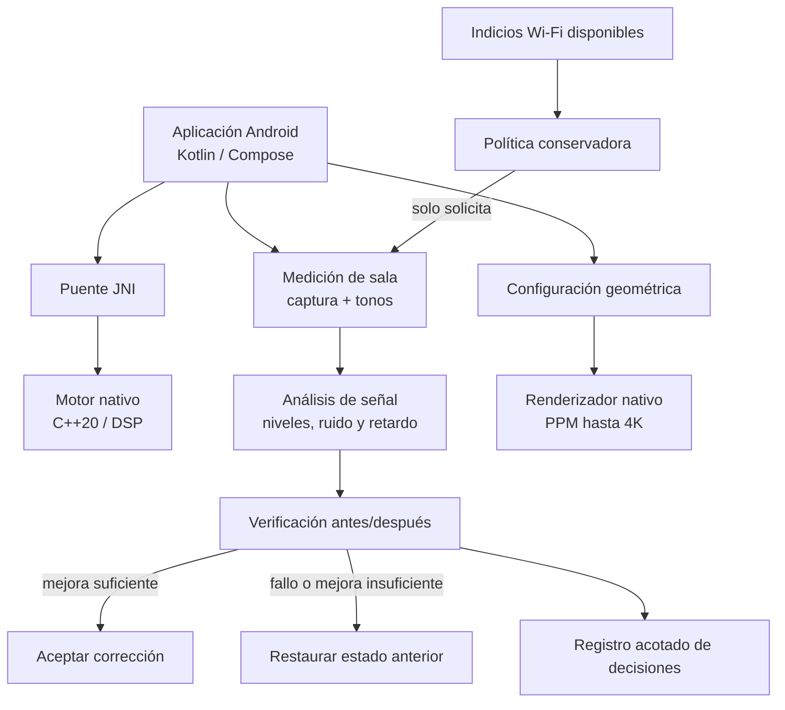

<div align="center">


# IVANNA OMEGA SUPREME

### Audio digital, calibración acústica y herramientas espaciales para Android

**Producto propietario en desarrollo. El acceso público a este repositorio no concede una licencia para reutilizar el código propio.**

[](https://github.com/luisurielpimentelperez814-design/IVANNA-OMEGA-SUPREME/actions/workflows/build.yml)
[](version.properties)
[](app/)
[](app/src/main/cpp/)

[LÉAME para público general](LEAME.md) · [Documentación técnica](docs/ENGINEERING.md) · [Cambios recientes](CHANGELOG.md) · [Versiones y paquetes](https://github.com/luisurielpimentelperez814-design/IVANNA-OMEGA-SUPREME/releases) · [Reportar un problema](https://github.com/luisurielpimentelperez814-design/IVANNA-OMEGA-SUPREME/issues)

</div>

---

## En pocas palabras

IVANNA OMEGA SUPREME es un proyecto para Android que combina una aplicación de control en Kotlin, un motor de procesamiento digital de audio escrito en C++ y herramientas para medir y visualizar aspectos de un entorno de escucha. Su objetivo es que los ajustes de audio puedan analizarse, probarse y —cuando hay mediciones suficientes— verificarse en lugar de depender únicamente de impresiones o de valores supuestos.

El repositorio contiene código de producción, módulos experimentales, pruebas automatizadas y documentación de los límites conocidos. **La presencia de una clase, modelo, dataset o pantalla no significa por sí sola que esa función esté conectada al sonido en tiempo real ni validada en un teléfono.** En este README distinguimos lo implementado, lo que necesita validación y lo que aún no está terminado.

## Qué incluye

<details>
<summary><strong>Captura espacial con cámara AR (experimental)</strong></summary>

La actividad **Captura espacial AR** usa ARCore para seguir el movimiento del teléfono y recopilar puntos 3D. Cuando el dispositivo admite la API de profundidad, toma muestras de profundidad y las proyecta al espacio; si no, conserva puntos dispersos de seguimiento. Al finalizar, permite exportar un ZIP con una nube de puntos PLY y metadatos JSON (poses, seguimiento, modo de profundidad y límites espaciales estimados).

**Límites:** no es una malla cerrada ni una medición certificada de las dimensiones de la habitación. Las superficies sin textura, el vidrio, la oscuridad, el movimiento rápido y los dispositivos sin profundidad reducen la calidad. La captura no mide RT60/RIR; la conexión acústica debe calibrarse por separado. ARCore requiere un dispositivo compatible y permiso de cámara.

</details>


<details open>
<summary><strong>Motor de audio y aplicación Android</strong></summary>

- Aplicación Android con interfaz Kotlin/Jetpack Compose.
- Motor nativo C++20 conectado mediante JNI y compilación dirigida a ARM64.
- Herramientas de procesamiento espacial y recursos acústicos, incluidos datos en formato SOFA.
- Controles y telemetría que deben distinguir los parámetros solicitados de los valores realmente confirmados por el motor.
- Rutas de integración que contemplan dispositivos con root/Magisk y escenarios sin root; la disponibilidad real depende del dispositivo, permisos, ruta de salida y configuración.

</details>

<details open>
<summary><strong>Medición de sala y calibración verificada</strong></summary>

El módulo `RoomMeasurement` reproduce y graba una secuencia de prueba usando el micrófono y la salida del teléfono. Emplea 27 tonos distribuidos aproximadamente entre 25 Hz y 12,7 kHz para estimar niveles, ruido y retardo. La corrección se diseña a partir de puntos considerados fiables, con un alcance tonal más conservador que el rango completo de la secuencia.

El flujo `runVerified` compara una medición inicial con otra posterior a la corrección. Si la medición falla, es poco fiable o no alcanza la mejora mínima definida por el código (0,25 dB en la métrica interna), vuelve a aplicar el estado anterior y registra la decisión. El historial se limita a los 50 registros más recientes.

**Límites:** el micrófono integrado de un teléfono no es un instrumento calibrado; la posición del teléfono, el volumen, el ruido, la sala y la salida utilizada afectan los resultados. Esta métrica interna no demuestra por sí sola una mejora perceptible para todas las personas ni sustituye una medición acústica de laboratorio.

</details>

<details open>
<summary><strong>Renderizador geométrico 3D</strong></summary>

El módulo nativo `SceneGeometryRenderer` dibuja una representación geométrica de la sala, la posición del oyente y las fuentes definidas en `RoomGeometryConfig`. Puede generar una imagen PPM de hasta 3840 × 2160 píxeles; el tamaño de la imagen y las dimensiones de sala están acotados para limitar el consumo de memoria. La vista previa Android reduce la imagen para mostrarla con un uso de memoria más moderado, mientras conserva el archivo renderizado en el almacenamiento privado de la aplicación.

**Qué significa y qué no:** es un renderizador geométrico real, pero la salida actual representa la configuración geométrica proporcionada. No debe interpretarse como un escaneo automático de una habitación, una reconstrucción física obtenida de CSI Wi-Fi ni una simulación acústica validada.

</details>

<details open>
<summary><strong>Wi-Fi como indicio de contexto</strong></summary>

La política de adaptación separa las observaciones de radio de las decisiones del procesador de audio: una variación Wi-Fi puede solicitar una nueva medición acústica, pero no autoriza directamente un cambio de DSP. Las API Wi-Fi estándar y Wi-Fi RTT no equivalen a CSI real.

La adquisición CSI depende de un proveedor compatible y de hardware y permisos específicos. **No se afirma compatibilidad CSI universal, detección fiable de ocupación en cualquier dispositivo ni reconstrucción anatómica.** La privacidad y el consentimiento deben mantenerse como condiciones explícitas para las funciones de sensado.

</details>

## Cómo encajan las piezas



El diagrama describe el diseño de los componentes presentes; no implica que toda función avanzada esté disponible en cualquier dispositivo o que cada ruta se haya probado físicamente.

## Estado de implementación y verificación

| Área | Qué podemos afirmar | Qué falta comprobar |
|---|---|---|
| Código del proyecto | Los módulos descritos están presentes en el repositorio. | Revisar cada ruta de ejecución y sus dependencias en la versión que se vaya a distribuir. |
| Renderizador geométrico | Existe un renderizador nativo con límites de dimensiones y memoria, además de una vista previa Android. | Rendimiento, consumo y visualización en distintos dispositivos reales. |
| Medición y reversión | El código implementa medición inicial, aplicación, segunda medición, criterio de aceptación, restauración y registro. | Pruebas físicas repetidas con distintos teléfonos, salas y salidas de audio. |
| Wi-Fi/CSI | Hay detección conservadora de capacidades y una política que no cambia DSP directamente. | Proveedor CSI real y compatible, adquisición fiable e integración completa con hardware concreto. |
| APK y módulo Magisk | La CI contiene pasos para compilar y comprobar artefactos. | La entrega debe corresponder al último commit, superar CI y las pruebas y verificarse por hash e instalación. |
| Calidad audible | El código y las pruebas pueden verificar comportamientos técnicos concretos. | Cualquier afirmación de mejora audible requiere pruebas A/B controladas y, cuando corresponda, medición independiente. |

### Estado de la compilación

El estado actualizado se muestra en el distintivo **CI** de la parte superior y en [GitHub Actions](https://github.com/luisurielpimentelperez814-design/IVANNA-OMEGA-SUPREME/actions). No se fija en el README un número de pruebas aprobadas ni una promesa de compilación exitosa: esos datos deben venir de una ejecución real y del commit correspondiente.

Los paquetes de [Releases](https://github.com/luisurielpimentelperez814-design/IVANNA-OMEGA-SUPREME/releases) pueden incluir borradores o artefactos de commits anteriores. Antes de instalar un APK o ZIP, comprueba su SHA/commit de origen y que sea la versión que quieres probar. Un archivo existente no prueba que proceda del último código.

## Empezar

### Requisitos

- Android Studio y JDK 17 para el proyecto Android.
- Android SDK 35 y NDK 26.1.10909125, según la configuración del proyecto.
- CMake 3.22.1 y Gradle Wrapper del repositorio.
- Node.js 22 y npm para compilar el paquete web FotoHolo integrado.
- Un entorno Linux compatible con los comandos de CI para reproducir la suite nativa completa.

### Compilar y probar

Clona el repositorio:

```bash
git clone https://github.com/luisurielpimentelperez814-design/IVANNA-OMEGA-SUPREME.git
cd IVANNA-OMEGA-SUPREME
```

Ejecuta las pruebas nativas en el host:

```bash
cmake -B build-tests -S app/src/main/cpp/tests -DCMAKE_BUILD_TYPE=Release
cmake --build build-tests -j4
ctest --test-dir build-tests --output-on-failure
```

Ejecuta las comprobaciones estáticas disponibles:

```bash
for s in scripts/check_*.py; do python3 "$s" || exit 1; done
```

Para reproducir la compilación Android, consulta el flujo de CI y usa el Gradle Wrapper del repositorio. La CI también prepara el paquete web FotoHolo antes de incorporarlo a los assets. **No se debe declarar una compilación válida hasta que los comandos terminen con código cero y se inspeccionen los artefactos resultantes.**

## Cómo revisar una entrega

Antes de distribuir una nueva versión, comprueba:

1. El SHA exacto de `main` que se está compilando.
2. El resultado de CI y de CTest para ese mismo SHA.
3. Que el APK y el ZIP Magisk se hayan generado en esa ejecución, no copiado de una compilación anterior.
4. La arquitectura de los binarios nativos, los hashes SHA-256 y el contenido del ZIP.
5. La instalación, el arranque, los permisos y las funciones clave en un dispositivo compatible.
6. El funcionamiento de la reversión ante mediciones fallidas o resultados insuficientes.
7. Los límites y errores visibles para el usuario, sin telemetría inventada.

Consulta [`docs/ENGINEERING.md`](docs/ENGINEERING.md) para el resumen técnico y [`CHANGELOG.md`](CHANGELOG.md) para el historial de cambios. El changelog contiene anotaciones históricas: cuando una nota y una prueba reciente discrepen, prevalecen el código actual y los resultados reproducibles de la ejecución pertinente.

## Privacidad y seguridad

- Solicita solo los permisos necesarios y explica por qué se requieren.
- Las mediciones de sala necesitan acceso al micrófono y deben ser iniciadas de forma consciente por la persona usuaria.
- No conviertas RSSI, Wi-Fi RTT o datos incompletos en afirmaciones de CSI o reconstrucción espacial.
- No afirmes identificación biométrica ni reconstrucción anatómica.
- La restauración automática de una corrección de audio no sustituye límites de seguridad del sistema, pruebas de permisos ni validación de todos los modos de fallo.
- Revisa las licencias de datasets, modelos y dependencias antes de redistribuirlos; consulta `NOTICE` y `THIRD_PARTY_NOTICES.md`.

## Contribuir y reportar problemas

Las contribuciones útiles incluyen informes reproducibles, pruebas de regresión, documentación de dispositivos y mejoras que mantengan la separación entre medición, decisión y aplicación.

Al abrir un issue, indica si puedes:

- reproducirlo en el último commit o en una versión publicada;
- compartir modelo de dispositivo, versión Android, ruta de audio y pasos de reproducción;
- adjuntar logs sin datos personales ni grabaciones privadas;
- distinguir un resultado medido de una impresión subjetiva.

[Crear un issue](https://github.com/luisurielpimentelperez814-design/IVANNA-OMEGA-SUPREME/issues) · [Consultar cambios](CHANGELOG.md) · [Ver código](app/src/main/cpp/)

## Propiedad intelectual y licenciamiento

© 2026 Luis Uriel Pimentel Pérez (GORE TNS). **IVANNA OMEGA SUPREME es un producto propietario y comercial. Todos los derechos sobre el código propio quedan reservados.** No se concede por este README una licencia para copiar, modificar, redistribuir ni explotar comercialmente el código propio. Para adquirir o negociar una licencia comercial, contacta al titular.

Esta declaración no modifica las licencias de bibliotecas, herramientas, modelos, datasets ni otros materiales de terceros; deben respetarse sus avisos y términos por separado. Las versiones anteriores que se hayan distribuido expresamente bajo Apache-2.0 y las copias cubiertas por esa concesión siguen sujetas a los términos aplicables a esas versiones.

La aspiración de este proyecto es que cada afirmación importante pueda rastrearse hasta código, pruebas o mediciones. **No se promete superioridad sonora universal, latencia cero ni compatibilidad universal: se documentan mecanismos, resultados verificables y trabajo pendiente.**
