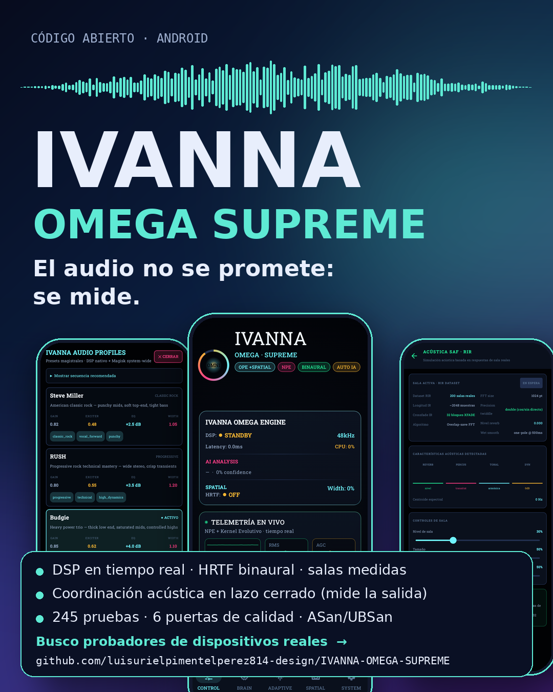

<picture>
  <source media="(prefers-color-scheme: dark)" srcset="docs/release_media/ivanna_omega_hero.svg">
  
</picture>

> **¿Tienes un teléfono Android?** Ayúdame a probarlo y [cuéntame cómo suena](https://github.com/luisurielpimentelperez814-design/IVANNA-OMEGA-SUPREME/issues/new?labels=device-report&title=Reporte+de+dispositivo). Si te gusta el proyecto, una ⭐ ayuda a que más gente lo encuentre.

# ⬡ IVANNA OMEGA SUPREME `v2.5.69` ⬡
### **Sistema Operativo de Supremacía Neuroacústica, Sincronía A/V Cero-Desfase y Reconstrucción Holográfica de Realidad Acústica en Lazo Cerrado para Android**
#### *Arquitectura Nativa en C++20 · SIMD ARM64 NEON · Inversión Biomecánica Coclear PINN · Blindaje $C^2$ Cero-Artefactos · Atlas de Escena Musical de 12 Estilos*

**Diseñado y Creado por [Luis Uriel Pimentel Pérez (GORE TNS)](https://github.com/luisurielpimentelperez814-design/IVANNA-OMEGA-SUPREME)**  
*Arquitecto Principal de Audio DSP & Especialista en TinyML a Nivel Kernel*

---

 

> **«No es un ecualizador cosmético ni un reproductor con plugins de Android. Es un sistema operativo neuroacústico integral compilado en C++20 con aceleración vectorial ARM64 NEON. Combina la física electrodinámica no-lineal de transductores, inversión activa biomecánica coclear basada en PINN, síntesis holográfica entrenada sobre mediciones anatómicas humanas reales, un Atlas de Escena Musical de 12 estilos con reconfiguración lock-free sin clics, blindaje matemático $C^2$ contra saturación digital y un cerebro de inteligencia acústica en lazo cerrado que evalúa cada muestra para entregar supremacía sonora absoluta.»**  
> — *Luis Uriel Pimentel Pérez (GORE TNS)*

---

> 🧑‍💻 **¿Evalúas el trabajo en 5 minutos?** Lee la [Ficha de ingeniería](docs/ENGINEERING.md): cifras medidas, decisiones de diseño, cómo verificarlo y límites honestos.

> 🔎 **Estado verificado (2026-10-18):** la puerta de tests host corre **406/406 (100 %)** en el commit `c93103e6` con esta rama. La HRTF que suena en tiempo de ejecución se **reconstruye desde la base maestra SOFA-PCA**; el archivo `.sofa` se valida por firma HDF5 pero sus mediciones **no se parsean en runtime** (ver `SofaHRTFLoader.hpp`, estado `VALID_NOT_PARSED`). La decodificación real de SOFA en el dispositivo sigue **pendiente**. La mejora audible y la latencia solo se pueden afirmar en hardware real.

### 🧭 Matriz de Navegación Rápida

| Área Arquitectónica | Módulos y Enlaces Directos |
| :--- | :--- |
| **I. Fundamentos & Métricas** | [**§1. Visión General & Tablero Ejecutivo v2.4.44**](#-1-visión-general-y-tablero-ejecutivo-v2444) · [**§2. Arquitectura de Sistema Dual (Ruta A $\leftrightarrow$ Ruta B)**](#-2-arquitectura-de-sistema-dual-ruta-a-sin-root--ruta-b-con-root) |
| **II. Cine & Sincronía A/V** | [**§3. Sincronía A/V Cero-Eco para Cine & Streaming**](#-3-sincronía-av-y-cero-eco-en-cine--streaming-amazon-prime-video-netflix-disney) · [**§4. Vástago Central de Diálogo & TOF Directo ($t = 0	ext{ ms}$)**](#-4-alineación-tof-rígida-y-vástago-central-de-diálogo-in-place) |
| **III. Física Matemática & Blindaje** | [**§5. Blindaje Acústico $C^2$ Cero-Artefactos (`SupremeAcousticStabilityGuard`)**](#-5-blindaje-acústico-cero-artefactos-y-cero-clipping-supremeacousticstabilityguard) · [**§6. Costura Hermite $C^1$ & Zero-Pop Atómico**](#-6-costura-polinomial-cúbica-de-hermite-c¹-y-reset-zero-pop) |
| **IV. Inteligencia & Atlas v2.4.44** | [**§7. Atlas de Escena Musical de 12 Estilos (`IVW1` 8 774 Parámetros)**](#-7-atlas-de-escena-musical-12-estilos-pesos-ivw1-y-motores-físicos-de-sala) · [**§8. Fusión en Lazo Cerrado (`OmniHolographicSingularityEngine`)**](#-8-fusión-maestra-en-lazo-cerrado-omniholographicsingularityengine--declarativeunifiedpipeline) |
| **V. Ejes Supremos & Biomecánica** | [**§9. Los 5 Ejes Supremos + Inversión Coclear PINN (0 lookahead)**](#-9-los-5-ejes-de-supremacía-cuántico-neuromórfica--inversión-coclear-pinn) · [**§10. Motor de Reconstrucción de Realidad (Fases 0–15)**](#-10-hipermotor-de-reconstrucción-de-realidad-acústica-fases-015) |
| **VI. Acústica Medida & Hardware** | [**§11. Datasets Reales: 255 SOFA · 7D SAF · 200 BRIR**](#-11-entrenamiento-conjunto-sofa-255-aes69--saf-manifold-7-d--rir-200-salas) · [**§12. Cadena DSP de 9 Etapas & DAC USB-C Directo**](#-12-cadena-dsp-de-9-etapas-ruta-isócrona-usb-c-dac-y-bluetooth-master-path) |
