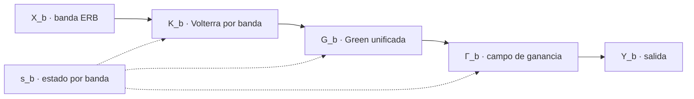

<div align="center">


# IVANNA OMEGA SUPREME

**Audio espacial Android · un solo motor, dos rutas, evidencia antes que promesas**

[](version.properties)
[](#5-holos--operador-único-de-campo-acústico-)
[](app/build.gradle.kts)
[](app/src/main/)
[](https://github.com/luisurielpimentelperez814-design/IVANNA-OMEGA-SUPREME/actions/workflows/build.yml)

[Guía sencilla](LEAME.md) · [Controles](docs/GUIA_CONTROLES_COMPLETA_ES.md) · [Ingeniería](docs/ENGINEERING.md) · [English](README.en.md)

</div>

---

## Estado actual · 7 de noviembre de 2026

| Rama / versión | Contenido | Estado |
|:---|:---|:---|
| `main` · **v2.5.364** (655) | **HOLOS** — Operador Único de Campo Acústico: las 12 funciones fusionadas en un solo operador, con UI en CONTROL, ABI v10 y release publicado | ✅ [Release público](https://github.com/luisurielpimentelperez814-design/IVANNA-OMEGA-SUPREME/releases/tag/v2.5.364) — APK + zip Magisk + `SHA256SUMS.txt` |
| `main` · **v2.5.363** (654) | **ORBE** — binaural esférico de campo cercano, con UI en CONTROL, ABI v9 y release publicado | ✅ [Release público](https://github.com/luisurielpimentelperez814-design/IVANNA-OMEGA-SUPREME/releases/tag/v2.5.363) — APK (210 MB) + zip Magisk (108 MB) + `SHA256SUMS.txt` |

> **Lee esto primero.** Todo lo nuevo (ORBE y HOLOS) nace **apagado por defecto** y no se enciende hasta que la **puerta auditiva** dé `GREEN` en el Moto G85: escucha ciega con niveles igualados. Nada en este README promete un efecto audible que no haya pasado esa puerta. Los números que verás son mediciones de host, no de teléfono: **la CPU y la latencia en dispositivo siguen sin medirse**.

**En esta página** · [Qué es](#1-qué-es-ivanna) · [Cadena](#2-la-cadena-de-señal) · [HOA + HRTF](#3-el-corazón-hoa--hrtf) · [ORBE](#4-orbe--binaural-esférico-de-campo-cercano-) · [HOLOS](#5-holos--operador-único-de-campo-acústico-) · [Rutas](#6-las-dos-rutas) · [Controles](#7-controles-en-control) · [Mediciones](#8-mediciones-reales) · [Puerta auditiva](#9-la-puerta-auditiva-y-el-índice-visceral) · [Límites](#10-límites-honestos) · [Compilar](#11-compilar-y-probar) · [Verificación](#12-verificación-y-evidencia) · [Documentación](#13-documentación)

---

## 1. Qué es IVANNA

IVANNA es un motor de audio espacial para Android: un reproductor propio, un motor DSP nativo en C++26, controles de efectos, herramientas de calibración y medición, un módulo Magisk para procesar el audio de todo el sistema y un dashboard web. Todo el audio pasa por un solo núcleo, `IvannaFusionCore`, en bloques de 128 muestras, de 8 a 384 kHz.

**Qué es, en una frase:** un renderizador binaural que reconstruye una escena espacial a partir de cualquier estéreo, sin necesitar metadata ni multicanal.

**Qué NO es:**

- **No es un invento de física nueva.** Sus componentes tienen precedentes en investigación (armónicos esféricos, Kirchhoff–Helmholtz, Volterra, Greenwood). Lo inédito es la combinación en un solo hilo en tiempo real sobre estéreo arbitrario. Quien busque la frontera real, lea la [sección 9](#9-la-puerta-auditiva-y-el-índice-visceral).
- **No es magia de un clic.** Cada función tiene un interruptor, un rango y un coste. La cadena legacy sigue intacta y bit-exacta cuando todo está apagado.
- **No es un laboratorio acreditado.** Las mediciones de este README son de host y de analizador propio; el teléfono no tiene calibración instrumental acreditada.

---

## 2. La cadena de señal

Orden real en `IvannaFusionCore::process()` ([`IvannaFusionCore.cpp:297`](app/src/main/cpp/IvannaFusionCore.cpp)). Cada etapa apagada es bit-exacta: la señal la atraviesa sin tocarla.


### Las doce funciones, en una línea cada una

| # | Función | Matemática en una línea | Estado por defecto |
|:---|:---|:---|:---|
| 1 | **HOA orden 2 + HRTF** | Codificación SN3D/ACN → 8 altavoces virtuales, decoder max-rE, convolución HRTF | ✅ Activa (la ganadora del veredicto) |
| 2 | **WFS** | Kirchhoff–Helmholtz: 7 altavoces de 16 en producción, 2 objetos L/R, sala 6.5×8.2×3.4 m | ✅ Activa (gobernada por `g_wfs_enabled`) |
| 3 | **RIR** | Convolución particionada, 200 salas medidas (RT60 T20 real) | ⏸️ Bypass (`wetDry = 0`) |
| 4 | **ORBE** | Cabeza esférica en campo cercano, STFT por banda ERB | ⏸️ Off (`amount = 0`) hasta GREEN |
| 5 | **HOLOS** | Un solo operador `G ⊛ [K·X] · Γ` por banda ERB | ⏸️ Off (`amount = 0`) hasta GREEN, en desarrollo |
| 6 | **GoldenEar / HarmonicExciter** | Chebyshev T2+T3 con oversampling 2×; H2 **apagado** (solo corre el soft-knee) | ✅ Activa en Ruta A (H2 off) |
| 7 | **Volterra H2** | Kernel con memoria (K=64), contenedor IVK1 con puerta de carga | ⏸️ Identidad: **sin kernel medido cargado** |
| 8 | **Compresor 2 etapas + SafetyLimiter** | Detector rápido/lento, techo de seguridad | ✅ Activo |
| 9 | **Coclear** | Bandas Greenwood + OHC, resta (no invierte) | ⏸️ Off (`g_cochlearEnabled = false`) |
| 10 | **Crossfeed ITD de graves** | Woodworth: retardo interaural en graves | ⏸️ Off por defecto |
| 11 | **EQ paramétrico / evolutivo** | 512 bandas calibradas en hilo propio (Ruta A), FIR 256 taps en legacy | ✅ Activo |
| 12 | **NHO / PDEngine + NPE** | `tanh` Padé + LIF + banco coclear + inhibición lateral | ✅ Activo (wet ≈ 0.20 en Ruta A) |

Las etapas 6–12 no desaparecen con HOLOS: HOLOS las **absorbe** matemáticamente (son casos degenerados del mismo operador), y el SafetyLimiter queda como guarda independiente por diseño.

---

## 3. El corazón: HOA + HRTF

El análisis del código (`VEREDICTO.md`) deja un ranking claro, y todo lo nuevo se construye sobre el ganador:

1. **HOA orden 2 + decodificación binaural HRTF con 8 altavoces virtuales** — activa por defecto en ambas rutas, con autoridad de arbitraje (neutraliza el widener M/S). Es la función más fuerte del motor.
2. WFS · 3. RIR (200 salas) · 4. GoldenEar/HarmonicExciter · 5. Compresor de 2 etapas + SafetyLimiter.

Cómo funciona: el estéreo se codifica en armónicos esféricos (SN3D/ACN, plano horizontal), se reconstruye un campo con 8 altavoces virtuales en ±30°/±90°/centro con pesos max-rE, y cada altavoz se convoluciona con su HRTF (FIR de 128 taps, o `HRTFConvolver` FFT 1024 con HRIR sintética o dataset medido IHR1/SOFA). Un detector de transitorios estrecha el ancho en ataques. Coste despreciable frente al resto de la cadena, latencia 0.

---

## 4. ORBE · Binaural Esférico de Campo Cercano ✅

**Publicado en v2.5.363.** ORBE ataca el punto débil del ganador: el HOA+HRTF clásico trabaja en campo lejano, a distancia fija. ORBE coloca **cada banda ERB (24) a un azimut y una distancia continuos (0.15–2.0 m)** con un modelo de cabeza esférica (radio 0.0875 m, c = 343 m/s): ILD que crece al acercarse, ITD por Woodworth, parallax por head-tracking. La escena se estima de la propia grabación, por banda (ILD, IPD→ITD, coherencia, DRR). No necesita metadata.

```
entrada estéreo → STFT (hop 128 / FFT 512, escalable con SR)
               → por banda: estimar (θ, r, coherencia, DRR)
               → Green esférica de campo cercano por banda
               → ISTFT overlap-add → mezcla wet/dry, crossfade 15 ms
```

| Parámetro (CONTROL · tarjeta "ORBE · CAMPO CERCANO") | Rango | Default |
|:---|:---:|---:|
| Cantidad ORBE | 0–1 | **0 (off)** |
| Distancia | 0.15–2.0 m | 0.35 m |
| Apertura | 0–1.5 | 1.0 |
| Proximidad (graves) | 0–6 dB | 3 dB |
| Difuso → sala | 0–1 | 0.5 |
| Seguimiento de cabeza | on/off | on si hay pose |

6 valores persistentes en `ParameterStore`, restaurados al abrir. Ruta B lo recibe por snapshot ABI v9; el governor térmico puede bajarlo a 12 bandas o apagarlo (a 384 kHz, y en tier ≥ LIMITED).

**Mediciones en host (48 kHz, −3 dBFS):** THD+N apagado **−153.45 dB** @1 kHz (bypass bit-exacto) · encendido **−139.33 dB** @1 kHz, −138.47 dB @100 Hz · IMD −156.04 dB · latencia 512 muestras = **10.7 ms** · throughput host **23× RT** (dato a vigilar en teléfono). 21 tests host nuevos, sin regresión en vecinos; los tests encontraron y corrigieron 5 bugs reales (el grave: la COLA fija inflaba la salida 2×/4×/8× a 96/192/384 kHz).

**Limitación declarada:** no modela la magnitud de la pinna; solo parallax de rotación (yaw). La traslación y la pinna por transporte óptimo son fase 2.

**Estado:** implementado, testeado, publicado — pero **apagado por defecto hasta que la puerta auditiva dé GREEN** en el Moto G85. Sin GREEN, ORBE es código que existe, no un efecto que suene.

---

## 5. HOLOS · Operador Único de Campo Acústico ✅

**Publicado en v2.5.364.** Implementado, testeado y cableado — pero **apagado por defecto hasta que la puerta auditiva dé GREEN** en el Moto G85. Sin GREEN, HOLOS es código que existe, no un efecto que suene.

La tesis, en un párrafo: las doce funciones no son doce matemáticas distintas. Son **tres operadores** escritos doce veces con constantes distintas, en dominios distintos y en serie, peleándose entre ellos. El operador espacial es en todos los casos una evaluación de la **función de Green acústica** (HOA, WFS, RIR, HRTF, ORBE y crossfeed son la misma física). El operador no lineal es en todos los casos un **término de una serie de Volterra** (Chebyshev T2, `2x²`, Padé/tanh y la OHC coclear son el mismo monomio con o sin memoria). El operador de dinámica/EQ/ancho es en todos los casos un **campo de ganancia** por banda e instante. HOLOS evalúa los tres en un solo dominio (STFT hop 128 / FFT 512, 24 bandas ERB) a partir de un solo vector de estado por banda `s_b = (θ, r, coherencia, DRR, envolvente, nivel, transitorio)`, y cada módulo legacy es un caso degenerado suyo (ORBE *es* HOLOS con K = identidad y Γ = 1).



$$Y_b(t) = G_b(s_b) \;\circledast\; \big[\, K_b(s_b) \cdot X_b(t) \,\big] \cdot \Gamma_b(s_b)$$

- `G_b` — Green unificada: HOA + WFS + RIR + HRTF + ORBE + crossfeed en una sola evaluación (ITD, ILD, pinna medida, distancia `(1/r)^γ`, difuso).
- `K_b` — kernel de Volterra por banda: Chebyshev, GoldenEar, Padé/tanh y OHC coclear como el mismo monomio; el Volterra H2 con memoria es su generalización.
- `Γ_b` — campo de ganancia único: EQ, compresor, limiter, M/S, trims y tilts como multiplicaciones puntuales por banda e instante.

| Parámetro (CONTROL · tarjeta "HOLOS · OPERADOR ÚNICO") | Rango | Default |
|:---|:---:|---:|
| Cantidad HOLOS | 0–1 | **0 (off)** |
| Distancia | 0.15–2.0 m | 0.35 m |
| Apertura | 0–1.5 | 1.0 |
| Proximidad (graves) | 0–6 dB | 3 dB |
| Difuso → sala | 0–1 | 0.5 |
| Armónicos (K) | 0–1 | 0.32 |
| Calidez (par/impar) | 0–1 | 0.5 |
| Dinámica (Γ) | 0–1 | 1.0 |
| Ancho (Γ) | 0–1.5 | 1.0 |
| Divergencia γ | 0.5–1.0 | 1.0 |
| Sala RT60 | 0.18–1.8 s | 0.34 s |
| Seguimiento de cabeza | on/off | on si hay pose |
| 12 bandas (ahorro CPU) | on/off | off (24 bandas) |

13 parámetros, todos off por defecto (`holos_amount = 0`) hasta GREEN. El EQ estático de Γ va plano en v1, sin controles en UI (los 6 atomics `g_holos_eq_*` existen en nativo, sin cablear). Entra en `FusionCore` tras el blend WFS, antes del M/S; `amount = 0` es la cadena legacy bit-exacta, con crossfade de 15 ms y fail-closed por término. Shed térmico en 4 tiers (24→12 bandas → H3 off → difuso sin convolución → HOLOS off). Cero alloc en el callback.

**Mediciones en host (48 kHz) — con las banderas rojas incluidas:**

| Medida | HOLOS off | HOLOS on (defaults) |
|:---|:---:|---:|
| THD+N @1 kHz | **−153.5 dB** (bit-exacto) | **−31.5 dB** ⚠️ |
| THD+N @1 kHz, sin término K | — | −87.9 dB |
| IMD | — | −28.2 dB |
| Latencia | — | 512 muestras = 10.7 ms |
| Throughput host | cadena 136.7× RT | **3.5× RT** (HOLOS solo) |

Las dos banderas rojas son honestas y están en el informe de diseño: **los defaults de HOLOS distorsionan mucho por diseño** (el término armónico K aporta ~56 dB de distorsión; hay que retunear antes de cualquier escucha) y **la viabilidad en el Moto G85 está en cuestión** hasta medir CPU/XRuns en dispositivo — 3.5× RT en host está muy por debajo de la estimación de diseño (15–25× RT). 38/38 tests HOLOS pasan (green 10, gain 6, volterra 9, operator 8, chain 5); los tests encontraron y corrigieron 2 bugs reales (escala Parseval del estimador, coherencia tipo Welch). Recortes ya decididos: Manifold B eliminado, difuso con una sola IR (sala estimada, no las 200), EvoEQ por magnitud por bin (se pierde fase lineal), sin interpolación OT de pinna en v1, sin kernel Volterra por banda sin kernel medido.

**Honestidad:** no hay física nueva en HOLOS. Lo inédito como producto es la unificación en un solo hilo RT fail-closed sobre estéreo arbitrario. La física nueva, si existe, está en la [sección 9](#9-la-puerta-auditiva-y-el-índice-visceral).

---

## 6. Las dos rutas

| | **Ruta A — APK** | **Ruta B — Magisk + daemon** |
|:---|:---|:---|
| Qué procesa | El audio del reproductor propio de IVANNA | Todo el audio del sistema (Spotify, YouTube…) vía AudioFlinger + `omega_effect` |
| Requisitos | Instalar el APK | Root + Magisk + el zip **de la misma versión** (un snapshot v9/v10 viejo se rechaza y deja la Ruta B en defaults) |
| Parámetros | Atomics nativos directos (`g_orbe_*`, `g_holos_*`) | Snapshot ABI: app → `SET_PERCEPTUAL_STATE` → daemon → efecto |
| Snapshot ABI | — | **v10 · 616 B** ([`OmegaDspSnapshot.h:12`](app/src/main/cpp/daemon/core/OmegaDspSnapshot.h), fijado por test); v9 era 536 B |
| Shed térmico | Manual (pendiente de cablear) | Automático por tiers en el daemon |
| Para probar ORBE/HOLOS | Basta el APK | Solo si quieres system-wide |

**⚠️ Firma del APK:** sin el secreto `ANDROID_KEYSTORE_B64` en la CI, el APK se firma con llave efímera y **no puede actualizar una instalación previa**: hay que desinstalar la versión anterior antes de instalar la nueva. Los hashes de cada release están en `SHA256SUMS.txt`.

El daemon publica un beacon tras cada bloque DSP completado (`applied_control_generation`); la app solo muestra `applied = true` cuando la generación aplicada alcanza la publicada. Sin beacon, el sistema informa "evidencia no disponible" — no inventa confirmación.

---

## 7. Controles en CONTROL

La pestaña CONTROL es la superficie de mando. Todo persiste en `ParameterStore` y se restaura al abrir (`PersistedStateRestorer`).

| Tarjeta | Controles | Nota |
|:---|:---|:---|
| **ORBE · CAMPO CERCANO** | 6 (cantidad, distancia, apertura, proximidad, difuso, head-tracking) | v2.5.363 |
| **HOLOS · OPERADOR ÚNICO** | 13 (ver tabla §5) | En desarrollo, v2.5.364 |
| **WAVE FIELD SYNTHESIS** | Apertura WFS | Array virtual de 16 altavoces |
| **NHO / ESPACIAL** | Ganancia armónica NHO | PDEngine |
| **CRUCE DE GRAVES** | Crossfeed ITD | Off por defecto |
| Perfiles, EQ, SAF, FotoHolo… | Ver [Guía completa de controles](docs/GUIA_CONTROLES_COMPLETA_ES.md) | — |

---

## 8. Mediciones reales

Todas en host a 48 kHz salvo indicación. **Ninguna es una medición en teléfono.**

| Medida | Valor | Fuente |
|:---|:---|:---|
| ORBE off, THD+N @1 kHz | −153.45 dB (bit-exacto) | `test_orbe_chain` |
| ORBE on, THD+N @1 kHz / @100 Hz | −139.33 dB / −138.47 dB | `test_orbe_chain` |
| ORBE on, IMD | −156.04 dB | `test_orbe_chain` |
| ORBE, throughput host | 23× RT | `test_orbe_chain` |
| HOLOS off, THD+N @1 kHz | −153.5 dB (bit-exacto) | `test_holos_chain` |
| HOLOS on, THD+N @1 kHz (defaults) | −31.5 dB ⚠️ (retunear antes de escuchar) | `test_holos_chain` |
| HOLOS on, sin K | −87.9 dB | `test_holos_chain` |
| HOLOS, IMD | −28.2 dB | `test_holos_chain` |
| HOLOS, throughput host | 3.5× RT ⚠️ | `test_holos_chain` |
| Latencia ORBE / HOLOS | 512 muestras = 10.7 ms @48 kHz | diseño STFT |
| Cadena completa, throughput host | 136.7× RT | baseline |
| CPU / XRuns en Moto G85 | **Sin medir** | pendiente |

Regla de trabajo: si HOLOS mide < 2× RT en dispositivo es viable; entre 1–2×, viable con shed; < 1×, no viable y se recorta. La estimación host (15–25× RT) ya quedó desmentida por la medición (3.5× RT): la estimación no es un dato.

---

## 9. La puerta auditiva y el Índice VISCERAL

Ninguna función nueva se enciende por defecto sin `GREEN`. La puerta está implementada en [`scripts/ivanna_auditory_gate.py`](scripts/ivanna_auditory_gate.py): exige checks explícitos, rutas requeridas, evidencia del dispositivo y **escucha ciega con niveles igualados**. Ausencia de evidencia no pasa como éxito.

El objetivo perceptual — eso visceral que se siente en el cuerpo, no solo se escucha — se define en cinco dimensiones medibles, resumidas en un **Índice VISCERAL** con regla anti-trampa (no sube si alguna dimensión baja más de 10 puntos):

| Dimensión | Proxy objetivo (host) | Medida subjetiva (Moto G85) |
|:---|:---|:---|
| **Envolvencia** | IACC tardía (80–350 ms) por banda ERB, objetivo 0.4–0.6 en 0.5–4 kHz | Escala SAQI "envelopment" |
| **Anchura aparente** | IACC temprana (0–80 ms) 0.6–0.8; dispersión angular σ(θ_b) | Escala SAQI "width" |
| **Externalización** | Error ITD/ILD vs objetivo (< 20 µs / < 1 dB); DRR coherente | % "fuera de la cabeza" |
| **Impacto de graves** | Factor de cresta por banda < 250 Hz preservado sin subir RMS | Juicio de impacto |
| **Claridad sin fatiga** | Umbral de enmascaramiento predicho por el modelo coclear; planitud 2–8 kHz ±2 dB | Fatiga tras escucha larga |

Decisión por **ABX ciego con niveles igualados** (LUFS ±0.2 LU): ≥ 12/16 aciertos y preferencia ≥ +15 puntos, replicado en dos sesiones. Sin GREEN replicado, la función se queda en rama y la cadena legacy sigue intacta. El enemigo número uno es el sesgo: subir 1 dB o saber que "esto es lo nuevo" produce más "wow" que cualquier algoritmo.

### La frontera: qué podría ser física nueva de verdad

HOLOS es nuevo como producto, no como física. Tres direcciones tienen probabilidad real de ser física nueva (informe `FRONTERA.md`):

1. **GENEZY — kernel de Volterra por banda medido del hardware real.** La única que mide algo que hoy no existe en ningún sitio: la no-linealidad con memoria, por banda ERB, del transductor concreto del Moto G85. Falsable: el kernel medido debe predecir la THD/IMD de una señal no usada en la identificación con error < 1 dB por armónico.
2. **La ley psicofísica de la envolvencia.** Nadie tiene una ley cuantitativa que prediga la envolvencia percibida de música estéreo procesada por banda. Una ley con R² > 0.7 contra juicios de oyentes nuevos sería un resultado publicable.
3. **Modelo cabeza + torso en campo cercano.** `G = G_cabeza · G_torso · G_hombro`: distancia por torso y elevación por hombro en graves (< 3 kHz, donde la pinna no ayuda). Coste RT < 5% de HOLOS.

Transporte óptimo de pinna y HRTF personal por BEM son prometedores como ingeniería, no como física nueva. Nada de esto existe aún en código.

---

## 10. Límites honestos

- **Sin medición en dispositivo:** no hay CPU, latencia extremo a extremo, XRuns ni SPL medidos en el Moto G85. Todo lo de host es una pista, no una prueba.
- **Sin ABX todavía:** no hay medición perceptual ni ABX en el repo para ORBE ni HOLOS.
- **Volterra sin kernel medido:** la puerta de carga (contenedor IVK1) rechaza por causa y hace bypass ante error; en producción el Volterra sigue en identidad.
- **GoldenEar H2 apagado por defecto:** solo corre su soft-knee como protección anti-clip. El HRTF de dataset medido no tiene crossfeed de 0.12 (la ruta sintética sí).
- **Tres defaults de compresor en conflicto** en la cadena legacy (−12/4:1, −15/2.995:1, −16/2.4:1); HOLOS los resuelve por decreto en Γ.
- **Código muerto conocido:** `fast_tanh`/`makeupGain_`/banda 2 del paramétrico y otros símbolos sin uso, documentados en el informe de fusión.
- **Shed térmico de Ruta A manual:** hoy solo la Ruta B lo tiene automático.
- **La arquitectura documentada no es la arquitectura real:** `ARCHITECTURE_OMEGA_SUPREME.md` es aspiracional y describe cosas que no existen. Este README documenta el código; los contratos de ingeniería viven en `docs/`.
- **El teléfono no tiene calibración instrumental acreditada.** La medición de sala depende de señal, ruido, posición, volumen y micrófono.
- **FotoHolo/AR:** la nube de puntos es parcial; no acredita malla cerrada ni mediciones RT60/RIR. Declarar satélites/subwoofer no crea canales físicos.
- **Wi-Fi/CSI:** el Wi-Fi común no proporciona CSI; no hay base para declarar reconstrucción anatómica.
- **Reloj HAL/PAL:** el actuador ASRC físico sigue sin identificar/enlazar; la inyección en el HAL sigue bloqueada (init_boot).

---

## 11. Compilar y probar

### Aplicación Android

La [configuración Android](app/build.gradle.kts) declara **SDK mínimo 28**, **compile/target SDK 35**, **NDK 27.2.12479018** y **JDK 17**. El [workflow de entrega](.github/workflows/build.yml) configura CMake 3.30.3 y documenta el ensamblado completo.

```bash
./gradlew :app:assembleDebug
```

La instalación Magisk requiere root y una ruta compatible. Consulta [la guía sencilla](LEAME.md) y verifica los artefactos de la versión antes de instalar.

### Motor nativo en host

```bash
bash scripts/run_ctest.sh
```

Compila el DSP en host (g++ frente a C++26 en este entorno; la validación NDK/Kotlin la hace la CI) y ejecuta CTest: unitarias de DSP, degeneraciones legacy↔HOLOS, cadena medida (THD+N/IMD/latencia/throughput) y contratos de control. Los tests de HOLOS viven en `app/src/main/cpp/tests/test_holos_*.cpp` (38 checks); los de ORBE en `test_orbe_*.cpp` (21 checks).

### Dashboard web

Usa **Node 24.21.0 o posterior dentro de la serie 24** y **npm 11.19.0**, según [package.json](package.json).

```bash
npm ci
npm run dev        # http://localhost:3000 (PORT cambia el puerto)
npm run build && NODE_ENV=production npm start
```

Las funciones remotas de chat y FotoHolo de [server.ts](server.ts) usan `GEMINI_API_KEY`; sin ella responden con indisponibilidad. Configura `DASHBOARD_AUTH_TOKEN` para exigir autenticación al exponer el servidor. La clave del proveedor permanece en el servidor.

### Puerta auditiva y banco sintético

```bash
# Puerta de evidencia física: exige checks, rutas y escucha con niveles igualados
python3 scripts/ivanna_auditory_gate.py

# Analizador WAV + inyección sintética de fallos (cribado, no percepción)
python3 -m unittest discover -s tests -p 'test_ivanna_audio_certify.py' -v
python3 -m unittest discover -s tests -p 'test_ivanna_synthetic_audio_suite.py' -v
python3 scripts/ivanna_audio_certify.py captura.wav --tone-hz 1000 --json-out informe.json
```

El analizador informa RMS/pico por canal, DC, clipping, desequilibrio y THD+N residual de un tono. Son heurísticas de cribado: no miden la ruta Android en vivo, el códec Bluetooth negociado, el ASRC del proveedor, la latencia extremo a extremo, SPL ni THD de laboratorio.

---

## 12. Verificación y evidencia

| Capa | Cómo se comprueba | Qué establece |
|:---|:---|:---|
| Web | `npm run test:web`, `npm run lint`, `npm run build` | Pruebas web, tipos y compilación del dashboard |
| FotoHolo web | `npx vite build --config vite.fotoholo.config.ts` | Compilación de la entrada web incrustada |
| Nativo | `bash scripts/run_ctest.sh` | Pruebas host de DSP y contratos; [workflow host](.github/workflows/tests-host.yml) incluye sanitizadores |
| Cableado y contratos | Bucle `scripts/check_*.py` | Puertas estáticas sobre el código y las afirmaciones documentales |
| Datasets | [CI de entrega](.github/workflows/build.yml), [validador HDF5](scripts/validate_sofa_hdf5.py) | Paridad/empaquetado, estructura de datos y comprobaciones específicas |
| APK y módulo | [CI de entrega](.github/workflows/build.yml) | Construcción, integridad y publicación según las condiciones del workflow |
| Cadena de suministro | [Supply Chain Security](.github/workflows/supply-chain.yml) | SBOM + firma + SLSA por release |
| Dispositivo | [Plan Moto G85](docs/PLAN_10D_MOTO_G85_ACCEPTANCE.md) | Aceptación física pendiente por ruta, con evidencias registradas |

```bash
for gate in scripts/check_*.py; do
  python3 "$gate" || exit 1
done
```

El distintivo CI consulta el estado de GitHub. Los resultados de una ejecución se interpretan junto con su commit, entorno y artefactos; las pruebas sintéticas no acreditan latencia, SPL, calidad audible ni control del reloj físico.

### Aceptación en el dispositivo

- Instalar APK y módulo procedentes del **mismo commit** y registrar sus hashes.
- Probar salida integrada, USB-C y Bluetooth por separado cuando estén disponibles.
- Comprobar reproducción, controles restaurados, clics, cambios de tono y underruns.
- Verificar cámara, seguimiento, pausa/reanudación y exportación de FotoHolo.
- Registrar modelo, Android, ruta y logs depurados. Para HAL/PAL, identificar fuente, actuador y lectura de retorno antes de declarar control físico.

---

## 13. Documentación

| Para empezar | Para investigar |
|:---|:---|
| [Guía sencilla en español](LEAME.md) | [Ficha de ingeniería](docs/ENGINEERING.md) |
| [Guía completa de controles](docs/GUIA_CONTROLES_COMPLETA_ES.md) | [Contrato matemático SAF/SAFMUS](docs/SAF_SAFMUS_UNIFIED_MATHEMATICAL_CONTRACT.md) |
| [Inicio rápido en inglés](README.en.md) | [Plan de aceptación Moto G85](docs/PLAN_10D_MOTO_G85_ACCEPTANCE.md) |
| [Registro de cambios](CHANGELOG.md) | [Cadena Moto G85 → estéreo](docs/AUDIO_CHAIN_MOTO_G85_STEREO.md) |
| [Cómo contribuir](CONTRIBUTING.md) | [Notas de reparación](docs/REPAIR_RELEASE_NOTES.md) |

Los informes de análisis que fundamentan este README — `VEREDICTO.md` (ranking de funciones), `IMPLEMENTACION_ORBE.md`, `UI_RELEASE_ORBE.md`, `FUSION.md` (diseño HOLOS) y `FRONTERA.md` (física nueva e Índice VISCERAL) — viven en el workspace de análisis, fuera del repositorio. Este README es su resumen fiel y verificado contra el código; si una afirmación de aquí contradice el código, manda el código.

---

## Contribuir y reportar problemas

Consulta [cómo contribuir](CONTRIBUTING.md). Para reportar un fallo, incluye versión/commit, dispositivo, Android, ruta de audio, pasos y registros sin credenciales ni datos personales. Cámara, micrófono y funciones remotas deben evaluarse según el flujo utilizado.

[Abrir un issue](https://github.com/luisurielpimentelperez814-design/IVANNA-OMEGA-SUPREME/issues) · [Seguridad](SECURITY.md) · [Avisos de terceros](THIRD_PARTY_NOTICES.md)

## Licencia y propiedad intelectual

IVANNA OMEGA SUPREME se presenta como un producto propietario. La visibilidad pública del repositorio no concede por sí sola permiso para reutilizar el código propio. Los componentes, bibliotecas, modelos y datasets de terceros conservan sus licencias y avisos; revisa los archivos de licencia y avisos antes de redistribuir. Las concesiones expresas aplicables a versiones anteriores siguen rigiendo esas versiones según sus términos.

---

<div align="center">

**La forma invita a explorar. La evidencia permite confiar.**

<sub>Ilustraciones conceptuales del repositorio · sin representación de mediciones acústicas. Los números de este README son mediciones de host o estados verificados en código; donde falta la medición en dispositivo, lo dice.</sub>

</div>
