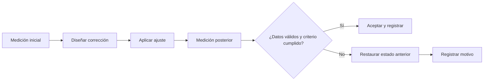
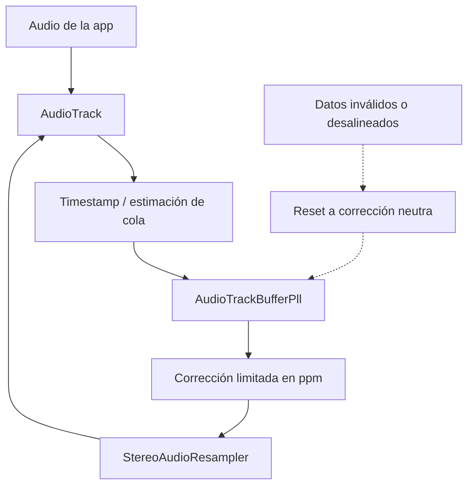

<div align="center">


# IVANNA OMEGA SUPREME

### Audio digital · herramientas espaciales · medición y verificación

<p>
  <a href="LEAME.md">Guía en español sencillo</a> ·
  <a href="docs/ENGINEERING.md">Ficha de ingeniería</a> ·
  <a href="CHANGELOG.md">Registro de cambios</a> ·
  <a href="docs/PLAN_10D_MOTO_G85_ACCEPTANCE.md">Aceptación Moto G85</a>
</p>

[](https://github.com/luisurielpimentelperez814-design/IVANNA-OMEGA-SUPREME/actions/workflows/build.yml)
[](app/)
[](app/src/main/)
[](app/src/main/cpp/)
[](version.properties)

**Un proyecto de ingeniería en desarrollo.** Documentamos lo que existe en el código, qué evidencia hay y qué todavía requiere validación real.

</div>

---

## Navegación del proyecto

<div align="center">

| **Visión general** | **Ingeniería** | **Validación** | **Historial** |
|:---:|:---:|:---:|:---:|
| [Áreas del producto](#en-una-mirada) | [Componentes y estado](#componentes-y-estado-real) | [Aceptación Moto G85](docs/PLAN_10D_MOTO_G85_ACCEPTANCE.md) | [Changelog](CHANGELOG.md) |
| [Mapa de arquitectura](#mapa-visual-de-la-arquitectura) | [Ficha de ingeniería](docs/ENGINEERING.md) | [Issues](https://github.com/luisurielpimentelperez814-design/IVANNA-OMEGA-SUPREME/issues) | [Acciones CI](https://github.com/luisurielpimentelperez814-design/IVANNA-OMEGA-SUPREME/actions) |

</div>

> **Principio rector:** la estética presenta el proyecto; el código y la evidencia determinan lo que podemos afirmar.

## Sincronización del estado del código — 2026-10-26

Estado contrastado directamente con `main`, `version.properties`, `CHANGELOG.md` y el workflow `.github/workflows/build.yml`.

- **HEAD consultado:** [`ce48bd9`](https://github.com/luisurielpimentelperez814-design/IVANNA-OMEGA-SUPREME/commit/ce48bd94cd54b5b2323f401588761f5fb6315b5e).
- **Versión declarada:** `2.5.142`, `versionCode=433`. La insignia del README refleja esta versión del árbol; no significa que ya exista un release publicado.
- **Último cambio funcional documentado:** SAFMUS Bluetooth endurece la identificación de códecs: Opus solo se reconoce con API 33 o posterior; IDs ambiguos o de proveedor usan el perfil conservador. No se infieren bitrate, pasabanda ni buffering del receptor y no se promete transparencia sin evidencia.
- **Correcciones inmediatamente anteriores en `main`:** reparación de la compilación host del productor de reloj HAL y correcciones de sintaxis/alcance en el daemon. Esto confirma que hubo reparaciones recientes, no que el build completo actual esté verde.
- **Validación de release:** `.github/workflows/build.yml` contiene etapas para pruebas nativas, APK/binarios, validación de artefactos y publicación condicionada. El estado de CI y la existencia de un release real deben comprobarse en [Actions](https://github.com/luisurielpimentelperez814-design/IVANNA-OMEGA-SUPREME/actions) y [Releases](https://github.com/luisurielpimentelperez814-design/IVANNA-OMEGA-SUPREME/releases); no se declaran exitosos aquí sin un resultado de ejecución verificable.
- **Límite de hardware:** la detección de códecs Bluetooth no conecta por sí sola un ASRC físico ni demuestra control global de PAL/AGM. La correlación del reloj HAL, el DAC USB-C y cada ruta Bluetooth siguen requiriendo logs y pruebas en el dispositivo.
- **Criterio de documentación:** las funciones, pruebas host, artefactos CI y validación física son niveles distintos de evidencia. No se equiparan entre sí.

## En una mirada

IVANNA OMEGA SUPREME combina una aplicación Android en Kotlin, componentes nativos de procesamiento de audio en C++, herramientas de medición acústica y módulos de visualización espacial. El propósito es construir rutas de procesamiento y calibración que se puedan inspeccionar y probar, sin convertir una intención de diseño en una promesa de resultado.

<table>
<tr>
<td width="33%" valign="top">

### 🎚️ Audio

Reproducción y procesamiento desde la aplicación, resampling y un control software de cola de AudioTrack en la ruta propia del reproductor.

</td>
<td width="33%" valign="top">

### 📐 Medición

Herramientas para reproducir tonos de prueba, registrar la respuesta del micrófono y comparar una medición antes y después de un ajuste.

</td>
<td width="33%" valign="top">

### 🧭 Espacio

Renderizador geométrico y una ruta de captura AR experimental que puede recopilar puntos espaciales y exportar datos.

</td>
</tr>
</table>

> **Regla de lectura:** que un módulo, modelo, dataset, control o contrato esté presente en el repositorio no demuestra por sí solo que esté conectado al audio activo, que funcione en todos los dispositivos ni que haya sido validado físicamente.

## Atlas visual de la arquitectura

<div align="center">


<sub>PLANO 01 · RELACIONES FUNCIONALES · LOS ENLACES NO SUSTITUYEN LAS PRUEBAS DE EJECUCIÓN</sub>

</div>

El diagrama representa las relaciones generales del código. En particular, el bloque HAL/PAL es un punto de integración documentado: no es evidencia de que exista control físico del reloj o del ASRC del proveedor en el Moto G85.

## Componentes y estado real

<table>
<thead><tr><th>Área</th><th>Qué contiene el proyecto</th><th>Estado y límites</th></tr></thead>
<tbody>
<tr>
<td><strong>Aplicación Android</strong></td>
<td>Interfaz Kotlin/Jetpack Compose, servicios y puentes hacia componentes nativos.</td>
<td>Código presente; la funcionalidad concreta debe evaluarse por ruta y por versión.</td>
</tr>
<tr>
<td><strong>Motor DSP nativo</strong></td>
<td>Código C++ y enlace JNI para las funciones nativas que llaman desde la app.</td>
<td>La existencia del motor no prueba que cada etapa experimental participe en toda reproducción.</td>
</tr>
<tr>
<td><strong>PLL software de AudioTrack</strong></td>
<td><code>AudioTrackBufferPll</code> estima la ocupación de la cola del reproductor de la app y ajusta el resampler dentro de límites de software.</td>
<td>Implementación a nivel de código. No controla el reloj físico del DAC, Bluetooth ni el HAL global; necesita pruebas de reproducción reales para evaluar estabilidad, clics, latencia y underruns.</td>
</tr>
<tr>
<td><strong>Cadena de reproducción del reproductor propio</strong></td>
<td><code>IvannaBridgePlayer</code> decodifica, procesa y escribe en <code>AudioTrack</code>. Si el DSP nativo (<code>DSPBridge</code>) está cargado, ejecuta la cadena maestra y la ruta Kotlin no apila procesadores duplicados; si no, se usan NPE, Volterra, modo concierto y motor espacial según sus interruptores.</td>
<td>Aplica solo al audio que reproduce IVANNA. No procesa el audio de otras apps ni de todo el sistema por sí mismo. Qué etapas se oyen y con qué efecto debe comprobarse con escucha y registros en el Moto G85.</td>
</tr>
<tr>
<td><strong>Motor predictivo (Módulo 1)</strong></td>
<td><code>predictive_audio_engine</code> analiza el audio en C++ y publica confianza, ganancia estimada y transitorios por JNI hacia la interfaz y las métricas.</td>
<td>Es un <strong>observador</strong>: el reproductor le entrega el bloque ya procesado y no lo modifica. Hoy produce telemetría, no cambia la señal de salida. La ventana de predicción de 5–10 ms es un objetivo de diseño sin medición en dispositivo registrada.</td>
</tr>
<tr>
<td><strong>HRTF / SOFA / SAF</strong></td>
<td>Cargadores y convolucionador HRTF, bases PCA y paquetes de datos. La puerta <code>check_datasets_deploy.py</code> verifica que los 239 <code>.sofa</code>, 12 HRTF y 200 RIR del APK coincidan con los del módulo Magisk y que los archivos HDF5 estén íntegros.</td>
<td>La integridad y la coherencia de los archivos están comprobadas de forma automática. Que la espacialización binaural resulte audible, correcta y cómoda en el teléfono no está demostrado por esa puerta y requiere escucha controlada. Una HRTF genérica no equivale a la HRTF personal de cada oyente.</td>
</tr>
<tr>
<td><strong>Anti-Dolby / clasificador de contenido</strong></td>
<td>Modelo <code>anti_dolby_crnn.tflite</code> que clasifica el contenido en voz, música, bajos y silencio, y lógica nativa que usa esa clasificación.</td>
<td>Es un clasificador de contenido, no un modelo entrenado de política acústica universal. Las decisiones de orquestación son deterministas y acotadas. No se afirma un desprocesamiento verificado frente a ningún códec concreto sin mediciones con material de referencia.</td>
</tr>
<tr>
<td><strong>Medición y corrección de sala</strong></td>
<td>Secuencia de tonos, captura de micrófono, comparación antes/después y lógica de restauración cuando el resultado no cumple el criterio interno.</td>
<td>El micrófono del teléfono no es un instrumento calibrado. La métrica interna no equivale a una mejora audible universal ni a una certificación acústica.</td>
</tr>
<tr>
<td><strong>FotoHolo / captura AR</strong></td>
<td>Actividad de captura con ARCore, seguimiento espacial, puntos 3D y flujo de exportación.</td>
<td>Experimental. No debe confundirse una nube de puntos con una malla completa, un plano certificado ni una medición RT60/RIR. Requiere probar permisos, seguimiento, pausa/reanudación y exportación en el equipo.</td>
</tr>
<tr>
<td><strong>Renderizador geométrico</strong></td>
<td><code>SceneGeometryRenderer</code> genera imágenes a partir de una configuración geométrica; el código contempla hasta 3840 × 2160 píxeles.</td>
<td>Renderiza la geometría configurada. No es por sí solo una reconstrucción automática de la habitación ni una simulación acústica validada.</td>
</tr>
<tr>
<td><strong>Reloj de hardware (productor HAL)</strong></td>
<td><code>daemon/hal_clock_producer</code> lee la muestra del driver con <code>SNDRV_PCM_IOCTL_STATUS</code> sobre <code>/dev/snd/pcmC*D*p</code>, que devuelve <code>hw_ptr</code> (frames presentados) y <code>tstamp</code> (CLOCK_MONOTONIC) en una sola consulta, y publica el snapshot compartido <code>IVHC</code> solo si la muestra es correlacionada.</td>
<td>Desde 2.5.130 el primer tramo de la cadena existe en la ruta Magisk: productor → mmap → lector del efecto → JNI → fila «Reloj hardware». La prueba de extremo a extremo del contrato IPC está en host (9/9). Que el driver del Moto G85 entregue muestras dentro de tolerancia solo se comprueba en el dispositivo, leyendo las líneas <code>HAL-CLOCK</code> del log del daemon.</td>
</tr>
<tr>
<td><strong>Bocinas declaradas (estéreo/surround + subwoofer)</strong></td>
<td><code>SpeakerLayoutPolicy</code> (lógica pura, 9 pruebas JVM) y el panel <code>SpeakerLayoutPanel</code> dejan declarar modo (estéreo/surround), número de satélites y si hay subwoofer activo. Generaliza el mismo mecanismo que ya conectaba el perfil Genezy MHCPZ1.</td>
<td>El único actuador real al final de la cadena sigue siendo <code>spatial_width</code> → <code>StereoWidener</code>. El campo <code>high_cut_hz</code> del daemon se guarda y se lee de vuelta, pero ningún código del efecto lo aplica a la señal (confirmado por lectura directa de <code>omega_effect.cpp</code>). Por eso esta función solo matiza el ancho estéreo (±15 % máx.) según lo declarado; <strong>no</strong> enruta canales discretos ni gestiona graves/LFE reales — el motor no tiene un crossover conectado.</td>
</tr>
<tr>
<td><strong>Renderizador binaural de objetos</strong></td>
<td><code>ivanna_object_renderer.hpp</code> amplió sus posiciones virtuales de 12 a 16, con cuatro satélites laterales adicionales sobre el renderer HRTF/VBAP existente.</td>
<td>Son fuentes virtuales renderizadas en binaural estéreo (auriculares o los dos altavoces del teléfono), no canales físicos independientes; no implica reenrutamiento multicanal real.</td>
</tr>
<tr>
<td><strong>SAFMUS / ACSR / HAL-PAL</strong></td>
<td>Hay lógica, adaptadores y contratos de integración en distintas partes del repositorio.</td>
<td>La documentación de integración no demuestra una unión de extremo a extremo con el hardware del fabricante. No afirmamos un actuador PAL/ASRC operativo ni control físico de reloj en el Moto G85 sin lectura de retorno y pruebas. El actuador ASRC físico sigue sin identificar y sin enlazar: el productor queda <strong>fail-closed</strong> y declara el motivo.</td>
</tr>
<tr>
<td><strong>Wi-Fi / CSI</strong></td>
<td>Políticas conservadoras para tratar observaciones de radio como indicios de contexto.</td>
<td>Las API Wi-Fi comunes no equivalen a CSI. La disponibilidad depende de hardware y proveedor compatibles; no se afirma reconstrucción anatómica ni compatibilidad universal.</td>
</tr>
</tbody>
</table>

## Flujos que importan

### Medición: medir, decidir y verificar



Este flujo describe la lógica implementada en la ruta de medición. La fiabilidad depende de la señal, el ruido, la posición, el volumen, la salida y las características del micrófono. La reversión de un ajuste no sustituye las pruebas de seguridad de todas las rutas de audio.

### Reproducción: alcance del PLL software



El PLL trabaja sobre el resampler del reproductor propio de IVANNA. No puede inferir ni escribir automáticamente el reloj físico de un DAC, una ruta Bluetooth o un módulo HAL. El funcionamiento auditivo y la estabilidad deben comprobarse en el teléfono con cada salida que se quiera declarar compatible.

## FotoHolo y visualización 3D

- **Captura AR:** usa las capacidades que ARCore y el dispositivo expongan; la disponibilidad de profundidad no es universal.
- **Nube de puntos:** es una representación parcial de las observaciones de captura, no una reconstrucción cerrada de toda la habitación.
- **Renderizado 3D:** la imagen se deriva de la geometría configurada en el módulo; la resolución de salida no garantiza realismo fotorrealista.
- **Acústica:** la geometría visual no es una medición de respuesta al impulso, reverberación ni absorción de materiales.

## Privacidad y claves de API

El procesamiento local que no requiere servicios externos debe poder operar sin una clave de Google. Una clave solo es necesaria para una función opcional cuando esa función invoque realmente un servicio externo que la exija. No se debe interpretar la presencia de una interfaz o configuración de proveedor como prueba de que la integración remota esté activa.

La cámara y el micrófono deben solicitarse cuando una función los necesita. Antes de compartir diagnósticos, elimina credenciales, tokens, datos personales y grabaciones privadas.

## Compilar y ejecutar comprobaciones

### Requisitos

Consulta las versiones exactas configuradas por el proyecto y por CI. La configuración actual utiliza Android SDK, NDK, CMake, Gradle Wrapper y Node.js para los componentes correspondientes. La reproducción completa de CI puede requerir Linux y dependencias adicionales.

### Pruebas nativas en host

Desde la raíz del repositorio:

```bash
cmake -B build-tests -S app/src/main/cpp/tests -DCMAKE_BUILD_TYPE=Release
cmake --build build-tests -j4
ctest --test-dir build-tests --output-on-failure
```

### Puertas estáticas

```bash
for s in scripts/check_*.py; do
  python3 "$s" || exit 1
done
```

Estos comandos no sustituyen la compilación Android, las pruebas instrumentadas ni la validación del teléfono. Para reproducir exactamente la entrega, revisa [el flujo de GitHub Actions](.github/workflows/build.yml).

## Estado de CI, versiones y pruebas físicas

- [Ver ejecuciones de CI](https://github.com/luisurielpimentelperez814-design/IVANNA-OMEGA-SUPREME/actions)
- [Ver versiones publicadas](https://github.com/luisurielpimentelperez814-design/IVANNA-OMEGA-SUPREME/releases)
- [Ver código de la versión indicada](version.properties)
- [Plan de aceptación para Moto G85 / Android 15](docs/PLAN_10D_MOTO_G85_ACCEPTANCE.md)

El distintivo CI refleja el estado del flujo configurado en GitHub; no es una certificación acústica ni demuestra que se haya probado el teléfono. Antes de considerar una versión lista, verifica que la compilación, los tests, el APK y el ZIP Magisk procedan del mismo commit, inspecciona sus hashes y prueba la instalación en el dispositivo de destino.

### El pipeline de release no publicaba (corregido en 2.5.132)

Hasta 2.5.131, el job `publish-release` se disparaba comparando el **texto literal** del mensaje de
commit contra `"release:"` / `"— v"`. Los commits de bump reales usaban formatos como
`chore(release): v2.5.130 (421) — …`, que no calzan con ese patrón (el paréntesis rompe el match). Resultado
verificado contra la API de GitHub: **v2.5.129, v2.5.130 y v2.5.131 nunca se publicaron** como release real
pese a estar en `main` con `version.properties`/`module.prop` correctamente bumpeados; `update.json` seguía
apuntando a `v2.5.130`, un tag que nunca existió, y el OTA del módulo Magisk llevaba varias versiones
apuntando a un asset inexistente. El repositorio acumuló cientos de drafts `staging-<sha>-<run>` (el bundle
intermedio que sí se publica siempre) sin barrer, porque la limpieza de esos drafts vive dentro del mismo job
que nunca se ejecutaba.

Desde 2.5.132, un job `detect-release` decide si publicar comparando `version.properties` contra el commit
padre con `git diff` — ya no depende de cómo se redacte el mensaje. Verifica tú mismo que una versión quedó
publicada de verdad en <https://github.com/luisurielpimentelperez814-design/IVANNA-OMEGA-SUPREME/releases>
(debe aparecer como release, no como draft `staging-*`) antes de confiar en el ZIP que ofrece el updater del
módulo.

### Reloj de hardware: qué quedó enlazado en 2.5.130

Hasta 2.5.129 la cadena de reloj existía de extremo a extremo **menos en su primer tramo**: el efecto leía el snapshot (`HardwareClockReader`), el JNI lo exponía (`nativeGetClockTelemetryJni`) y el panel «Reloj hardware» lo mostraba, pero nadie lo publicaba en la ruta Magisk. La versión 2.5.130 añade ese productor.

| Pieza añadida | Qué hace | Evidencia |
|---|---|---|
| `daemon/hal_clock_producer.hpp` (167 líneas) | `ProducerState` con siete estados honestos, `PcmDevice`, `PairedSample`, `CorrelationGate` y `HalClockProducer` | Compila con `g++ 13 -std=c++20 -O2 -Wall -Wextra`, 0 avisos |
| `daemon/hal_clock_producer.cpp` (302 líneas) | Descubrimiento por `/proc/asound`, lectura por ioctl, puerta de correlación y publicación en el mmap `IVHC` | 9/9 pruebas host |
| `daemon/ivanna_daemon.cpp` (+45) | `--hal-clock` / `--no-hal-clock` (activo por defecto) e hilo de sondeo a 250 ms con registro solo al cambiar de estado | Sintaxis verificada en host con cabecera `android/log.h` simulada |
| `tests/test_hal_clock_producer.cpp` (192 líneas) | 9 pruebas, incluida la de extremo a extremo Publisher → mmap → Reader | `[ PASSED ] 9 tests` |

La puerta de correlación rechaza rate nominal ausente, timestamp no positivo, Δt ≤ 1 µs, Δt > 500 ms (PCM parado), frames que retroceden y tasa implícita fuera de 0,80–1,20 × la nominal; exige tres pares coherentes consecutivos antes de publicar. Todo rechazo se declara con motivo legible.

Lo que **no** cambia con esta versión: el actuador ASRC físico del Moto G85 sigue sin identificar. `hal_integration/MOTO_G85_PAL_CLOCK_INTEGRATION.md` documenta que `pal_get_timestamp` no entrega un par frames + CLOCK_MONOTONIC, así que no puede alimentar al tracker ni al servo; adivinar el nodo produciría la telemetría falsa que la Fase 0 del plan 10D ordena eliminar. Tampoco se ha verificado aquí la compilación Kotlin/APK ni la ejecución de CTest en el runner.

### Lista de aceptación en hardware

- [ ] Instalar APK y módulo generados desde el mismo commit aprobado.
- [ ] Probar la salida integrada, USB-C DAC/adaptador y Bluetooth por separado cuando estén disponibles.
- [ ] Confirmar que el reproductor propio avanza, que la corrección permanece dentro de sus límites y que no aparecen clics, cambios de tono o underruns anómalos.
- [ ] Abrir FotoHolo, confirmar cámara en vivo, seguimiento, pausa/reanudación y exportación.
- [ ] Registrar el modelo, versión Android, ruta, SHA del commit, hashes de artefactos y resultados.
- [ ] No declarar HAL/PAL conectado sin identificar el callback real, unidades del parámetro, actuador, lectura de retorno y prueba en hardware.
- [ ] Leer las líneas `HAL-CLOCK` del log del daemon durante reproducción real y anotar el estado observado (`publishing`, `rejected`, `no-devices`, `no-source`) junto con el motivo y la deriva en ppm.

## Contribuir y reportar problemas

Los informes más útiles incluyen el commit o versión probados, modelo de dispositivo, versión de Android, ruta de audio, pasos para reproducir y registros depurados de datos personales.

- [Abrir un issue](https://github.com/luisurielpimentelperez814-design/IVANNA-OMEGA-SUPREME/issues)
- [Revisar cambios](CHANGELOG.md)
- [Consultar documentación de ingeniería](docs/ENGINEERING.md)

## Licencia y propiedad intelectual

IVANNA OMEGA SUPREME se presenta como un producto propietario. La visibilidad pública del repositorio no concede por sí sola permiso para reutilizar el código propio. Los componentes, bibliotecas, modelos y datasets de terceros conservan sus licencias y avisos; revisa los archivos de licencia y avisos antes de redistribuir. Las concesiones expresas aplicables a versiones anteriores siguen rigiendo esas versiones según sus términos.

---

<div align="center">

**Construir con rigor. Medir cuando sea posible. Declarar solo lo que la evidencia respalda.**

<sub>La arquitectura y las funciones evolucionan; el código, las pruebas reproducibles y la validación física tienen prioridad sobre cualquier etiqueta de marketing.</sub>

</div>
