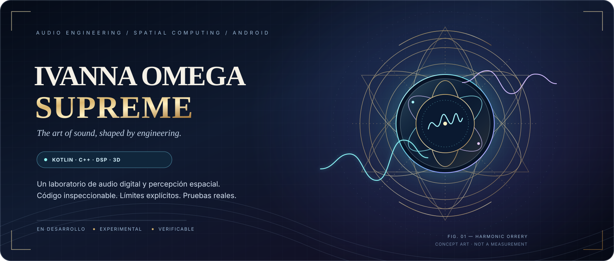

<div align="center">



# IVANNA OMEGA SUPREME

**Audio espacial Android · evidencia antes que promesas**

[](version.properties)
[](app/build.gradle.kts)
[](app/src/main/)
[](https://github.com/luisurielpimentelperez814-design/IVANNA-OMEGA-SUPREME/actions/workflows/build.yml)

[Guía sencilla](LEAME.md) · [Controles](docs/GUIA_CONTROLES_COMPLETA_ES.md) · [Ingeniería](docs/ENGINEERING.md) · [English](README.en.md)

</div>

---

> **IVANNA OMEGA SUPREME es un motor de audio espacial para cualquier Android 13 en adelante, dentro de la app (Ruta A).** Convierte cualquier estéreo en una escena espacial con 8 altavoces virtuales, externalización y graves coherentes, en un solo hilo en tiempo real.

> **Propiedad intelectual — NO es código abierto.** Software propietario de Luis Uriel Pimentel Pérez. Todos los derechos reservados. El repositorio es público (visible), sin licencia open source. Prohibida su reproducción, distribución, modificación o uso sin autorización expresa del autor.

## Estado actual · 12 de noviembre de 2026

**Versión vigente: v2.5.414 (705).** Solo APK (Ruta A). Sin módulo Magisk, sin riesgo de brick.

**Las dos rutas:** la **Ruta A** (APK, capture) procesa el audio del reproductor propio (Tidal, YouTube Music) con el ASRC magistral nativo + Ψ activa; si algo falla, solo cae la app. La **Ruta B** (Magisk + HAL, todo el sistema) está **MUERTA desde el 2026-11-11** — la historia completa, sin maquillar, en [docs/HISTORIA_RUTA_B.md](docs/HISTORIA_RUTA_B.md). No instalar ningún zip; la v2.5.403 lleva el wrapper roto y la **v2.5.384 está RETIRADA** (brickeó el teléfono 2 veces).

**Defaults activos por directiva del propietario (2026-11-08):** ORBE (1.0), HOLOS (0.5, harmonics 0), Φ (0.5) y Volterra arrancan ACTIVOS. No hay puerta de escucha que los detenga: la puerta GREEN quedó anulada por decisión explícita del propietario y no forma parte de esta narrativa. Lo activo se valida con mediciones y escucha (§14).

### Evidencia medida en dispositivo (Moto G85, v2.5.406, Tidal, 2026-11-11 ~17:41 CST; método: Termux + ESTADO DE MOTORES)

| Medida | Valor |
|:---|:---|
| CPU de la app | **130%** (más de un núcleo) · 43:55 min de CPU acumulado · RSS 289 MB |
| XRuns (USB OTG 384 kHz / 32-bit) | **0** |
| ASRC nativo + Ψ | Cargados sin errores (logcat de los 3 tags vacío) |
| Escucha | Impresión de Esse: **los efectos se sienten** — impresión, no resultado (sin ABX no es evidencia perceptual; ver §14) |
| HRTF / 5 ejes / loop / cognición | Renderer activo (tu_berlin_kemar, head tracking ROTATION_VECTOR) · 5/5 ejes · loop 50 ms · Realismo 71–75%, Juez 85–88%, Homeostasis 96–98% |

**⚠️ Riesgo principal: 130% de CPU con todo activo.** El teléfono aguanta la cadena completa en tiempo real (xruns=0), pero a ese ritmo el coste es batería y calor en sesiones largas. La temperatura en uso sigue sin medirse y puede obligar a reducir defaults (§14).

### Versiones recientes (1 línea; historial completo en [CHANGELOG.md](CHANGELOG.md))

| Versión | Qué trae |
|:---|:---|
| **v2.5.414** (705) | Integración magistral completa en captura + reproductor: Reality (pase microExtractor) ahora corre también en el BridgePlayer (antes solo en captura), crossfeed por paridad en el reproductor, y StageTimings (Hoa/Orbe/Holos/Phi/Volterra/Npe) ahora se registran también en captura. Medido en host: Reality 5.8 µs/bloque (p99 12.6 µs), THD+N −68.8 dB en tono 1 kHz; 4 tests nuevos; CTest 974/974. Solo APK. Ruta B en pausa. |
| **v2.5.413** (704) | Fix scroll de la pantalla principal: el panel de controles (fillMaxSize + scroll interno) se comía toda la altura y la tarjeta "IVANNA BRIDGE PLAYER" quedaba con 0 px, inalcanzable. Ahora panel + tarjeta bajan con un solo scroll vertical (encabezado y navegación fijos arriba; el panel desactiva su scroll interno solo en el Dashboard). Sin cambios de sonido ni de funcionalidad. |
| **v2.5.412** (703) | ASRC magistral + Ψ portados a la captura (antes solo micro-slips; telemetría asrc/psi ahora vivos en captura), mezcla de captura ajustable con slider (0.20–1.00, default 0.60 = valor vivo actual; corrección: el target vivo era 0.60, no 0.40), telemetría con `mix=`. Medido en host: THD+N −138.8 dB a ratio 1.0 / −95.0 dB a +100 ppm en bloques de 320 frames; ASRC+Ψ 46/46; CTest en verde. |
| **v2.5.411** (702) | Guarda de armónicos HOLOS (el valor vivo 0.298 se lee como 0.002: THD+N −41 dB medido → dentro de −70 dB), defaults de fábrica en una sola fuente con 3 perfiles (Limpio / Espacial / Completo), auditoría de parámetros, telemetría con tiempos por etapa y contador de xruns, diagnóstico de underruns. Fix CI: tests-host usa g++-14 (clang-18 + libstdc++15 rompía `<format>`). |
| **v2.5.410** (701) | Firma acústica refinada con datos reales del teléfono (captura 2026-11-11, Tidal): presupuesto del gobernador 70%→85% (shed crónico 4.7%→0% medido), OmniField en bypass por distorsión medida (residuo −3.7/−6.1 dB en estéreo), telemetría 1 Hz ya en captura en vivo, logs de shed/Magisk throttled. ORBE/HOLOS/Φ siguen activos. |
| **v2.5.409** (700) | README recortado a ~40% según segunda crítica externa (historia de Ruta B a docs, cada dato en un solo lugar, tensiones resueltas, CPU 130% como riesgo principal). |
| **v2.5.408** (699) | README reescrito según primera crítica + fix CI: `tests-host.yml` instala clang-18 (causa raíz del CTest rojo desde la 402). |

---

## 1. Qué es IVANNA

Un renderizador binaural que reconstruye una escena espacial a partir de cualquier estéreo, sin necesitar metadata ni multicanal. Un reproductor propio, un motor DSP nativo en C++26, controles de efectos y herramientas de medición. Todo el audio pasa por un solo núcleo, `IvannaFusionCore`, en bloques de 128 muestras, de 8 a 384 kHz.

**Qué NO es:** no es física nueva (sus componentes tienen precedentes: armónicos esféricos, Kirchhoff–Helmholtz, Volterra, Greenwood; lo inédito es la combinación en un solo hilo RT sobre estéreo arbitrario). No es magia de un clic (cada función tiene interruptor, rango y coste; todo apagado, la cadena legacy sigue bit-exacta). No es "sin PCM" ni "sin Fourier por bloques" (la señal sigue siendo PCM en bloques de 128 y HOLOS trabaja en STFT hop 128 / FFT 512). Donde dice "campo unificado acústico-neural" o "bucle neuro", léase modelo: el bucle neuro es identidad sin sensor real conectado, y el sensor real es el micrófono del teléfono (§11).

---

## 2. La cadena de señal

Orden real en `IvannaFusionEngine::process()` (`app/src/main/cpp/IvannaFusionCore.cpp:333`). Cada etapa apagada es bit-exacta. El bucle neuro corre 1× por bloque antes de HOLOS/ORBE.

`IN → EvoEQ → HOA → HRTF → WFS → Neuro → ORBE → HOLOS → OmniField → Φ → AUX → T4D → EQ usuario → NPE → Corrección sala → XTC → Compresor/limitador → GoldenEar → OUT` (micrófono → Φ)

**Activos:** HOA orden 2 + HRTF (8 altavoces virtuales, max-rE) · WFS · ORBE (1.0) · HOLOS (0.5, harmonics 0) · AUX Genezi (XTC + campo AUX) · GoldenEar (H2 apagado, solo soft-knee) · Volterra H2 (kernel PZ1D) · compresor/limitador (umbral −12 dB, ratio 1:1, sin reducción hasta configurar) · EQ paramétrico/evolutivo (512 bandas) · NPE · Φ (0.5, Harman 2018) · sensor acústico · curvas objetivo élite. **Bypass/off:** RIR (wetDry 0) · bucle neuro (identidad sin frames) · coclear · crossfeed ITD. **No cableados:** Fusión Phi (367) y pilares (368) — clases con tests que no suenan. HOLOS absorbe matemáticamente las etapas 8–14 (son casos degenerados del mismo operador); el limitador queda como guarda independiente.

---

## 3. ORBE · Binaural Esférico de Campo Cercano ✅

**v2.5.363.** El HOA+HRTF clásico trabaja en campo lejano, a distancia fija. ORBE coloca **cada banda ERB (24) a un azimut y una distancia continuos (0.15–2.0 m)** con un modelo de cabeza esférica (radio 0.0875 m): ILD que crece al acercarse, ITD por Woodworth, parallax por head-tracking. La escena se estima de la propia grabación, por banda (ILD, IPD→ITD, coherencia, DRR). Sin metadata. Defaults: cantidad 1.0, distancia 0.35 m, apertura 1.0, proximidad 3 dB, difuso 0.5, head-tracking on si hay pose. **Host (48 kHz):** THD+N apagado −153.45 dB @1 kHz (bit-exacto) · encendido −139.37 dB @1 kHz · IMD −156.04 dB · latencia 10.7 ms · throughput 23× RT. 21 tests host; los tests corrigieron 5 bugs reales (el grave: la COLA fija inflaba la salida 2×/4×/8× a 96/192/384 kHz). **Limitación:** no modela la magnitud de la pinna; solo parallax de rotación (yaw). **ACTIVO por defecto.**

---

## 4. HOLOS · Operador Único de Campo Acústico ✅

**v2.5.364.** Las doce funciones no son doce matemáticas distintas: el operador espacial es en todos los casos una evaluación de la **función de Green acústica**; el no lineal es un **término de una serie de Volterra**; la dinámica/EQ/ancho es un **campo de ganancia** por banda e instante. HOLOS evalúa los tres en un solo dominio (STFT hop 128 / FFT 512, 24 bandas ERB) a partir de un solo vector de estado por banda. Cada módulo legacy es un caso degenerado suyo (ORBE *es* HOLOS con K = identidad y Γ = 1).

$$Y_b(t) = G_b(s_b) \;\circledast\; \big[\, K_b(s_b) \cdot X_b(t) \,\big] \cdot \Gamma_b(s_b)$$

`G_b` Green unificada · `K_b` kernel de Volterra por banda · `Γ_b` campo de ganancia único. Defaults: cantidad 0.5, distancia 0.35 m, apertura 1.0, proximidad 3 dB, difuso 0.5, **armónicos 0.0 (K apagado por retuneo)**, calidez 0.5, dinámica 1.0, ancho 1.0, γ 1.0, RT60 0.34 s. `amount = 0` es la cadena legacy bit-exacta, crossfade 15 ms, fail-closed por término. Shed térmico en 4 tiers.

**Retuneo v2.5.369 (medido):** el término armónico K domina la distorsión — cualquier harmonics > 0 incumple −70 dB (0.5 / 0.05 → −53.7 dB). Solo harmonics = 0 cumple. **Default: amount 0.5, harmonics 0.0.** Con K = 0 el render espacial G y el campo Γ siguen activos y limpios (efecto espacial medible: −44.0 dB vs bypass).

| Medida (host, 48 kHz) | HOLOS off | Defaults viejos | Default retuneado |
|:---|:---:|---:|---:|
| THD+N @1 kHz / @100 Hz | −153.5 dB / — | −31.5 / −33.2 dB ⚠️ | **−94.0 / −79.6 dB** ✅ |
| IMD (SMPTE) | — | −28.2 dB ⚠️ | **−159.5 dB** ✅ |

La estimación de diseño (15–25× RT) quedó desmentida por la medición (3.5× RT): la estimación no es un dato. Viabilidad en el G85: ver Estado actual. 38/38 tests HOLOS + 2 de retuneo; los tests encontraron 2 bugs reales (escala Parseval, coherencia tipo Welch). **Honestidad:** no hay física nueva en HOLOS. Lo inédito es la unificación en un solo hilo RT fail-closed sobre estéreo arbitrario.

---

## 5. Bucle cerrado neural y NPE

**Bucle: cableado, apagado por defecto, fail-closed.** `ClosedLoopController` + `NeuroBandEq` (8 biquads peaking Greenwood) corren 1× por bloque **antes** de HOLOS/ORBE. Sin frames, el bucle es identidad bit-exacta. El ingest solo acepta EEG/ABR/fNIRS reales (el sensor simulado está eliminado) — pero **no hay driver de sensor real enchufado todavía**: sin frames, no hace nada audible. Los tiempos corticales son lentos (ABR: 1000–2000 ensayos; fNIRS pica a los 6–8 s): el diseño real es un observador lento (100 ms–4 s) en hilo no-RT, nunca una corrección muestra a muestra del cerebro. 11 tests host. Diseño en `docs/NEURO_ACOUSTIC_CLOSED_LOOP.md`. **NPE (motor neuromórfico, cableado en la cadena):** `NpeStereoCore` implementa modelos de células ciliadas e integración con fuga (LIF): banco coclear + pool LIF + envolventes + OHC + AGC + inhibición lateral. Sus "spikes" los dispara la **envolvente de audio**, no el cerebro: hoy no hay ninguna entrada biométrica. El NPE modela el oído interno, no mide la respuesta cerebral del oyente. Es el componente neuro **on-device**: corre en el procesador del teléfono, sin hardware externo.

---

## 6. Ruta AUX Genezi

**Cableada en Ruta A.** Presets `GeneziRoom` / `CarCabin` con geometría XTC + campo AUX de graves coherentes en fase (LR4); `AuxVolterraGate` solo deja pasar el kernel IVK1 medido (GENEZY01, K=64) — sin kernel medido, el Volterra es identidad. Veredicto honesto: Volterra K=4096 inviable en O(K²); Back-EMF por Aux imposible (la salida 3.5 mm es solo salida); DSD por Aux imposible; el colapso de paredes imposible (la apertura es la del par de altavoces). 6/6 tests host. Con AUX activo, el HRTF se fuerza a 0 por diseño.

---

## 7. Fusión Homogénea Phi · v2.5.367

**Existe como clase con tests. NO está cableada a la cadena de audio.** `HomogeneousFusion` fusiona bucle neuro + ruta AUX Genezi + HOLOS en **un solo coordinador con un solo estado** (un solo `update()` por bloque). Composición `Φ = Γ ∘ K ∘ G ∘ XTC ∘ AUX ∘ N`, con los operadores reales que ya existen y en el orden en que ya corren. Estado honesto: **S_neuro** real cuando hay driver (sin driver, N es identidad) · **Z_emf NO DISPONIBLE** (Back-EMF por Aux imposible; interfaz con `available = false` siempre) · **W(r,θ) real y acotado** (geometría XTC + campo AUX; no colapsa paredes). No es un tensor continuo sin discretizar: la señal sigue siendo PCM en bloques de 128. 7/7 tests host.

---

## 8. Pilares pendientes · v2.5.368

**Existen como componentes con tests que pasan. NO están cableados a la cadena de audio.** Que un componente tenga tests en verde no significa que suene. 11/11 tests host.

| Pilar | Componente | Estado real |
|:---|:---|:---|
| Volterra diagonal K=4096 | `DiagonalVolterra` — polinomio de memoria O(K) en lugar del O(K²) | Header + tests; **no usado** |
| DoP v1.1 | `DopPacketizer` — empaquetado DSD-over-PCM | Header + tests; **no usado** |
| Pinna-EQ Blauert | `PinnaElevationEq` — ecualización de elevación por bandas de Blauert | Header + tests; **no usado** |
| Estimador EMF | `EmfEstimator` — modelo Thiele-Small del altavoz (modelo, no medición) | Header + tests; **no usado** |

---

## 9. Las dos rutas

| | **Ruta A — APK (capture) · VIVA** | **Ruta B — Magisk + HAL · MUERTA** |
|:---|:---|:---|
| Qué procesa | El audio del reproductor propio (Tidal, YouTube Music) | Nada. Retirada el 2026-11-11 |
| Requisitos | Instalar solo el APK · `ThermalGovernor` → tiers nativos | No instalar ningún zip de ninguna versión |

**⚠️ Firma del APK:** sin el secreto `ANDROID_KEYSTORE_B64` en la CI, el APK se firma con llave efímera y **no puede actualizar una instalación previa**: hay que desinstalar la versión anterior antes de instalar la nueva. Hashes en `SHA256SUMS.txt`. Historia completa de la vía muerta: [docs/HISTORIA_RUTA_B.md](docs/HISTORIA_RUTA_B.md).

---

## 10. ASRC en Ruta A

El ASRC vive en la app desde la v2.5.404: **ASRC nativo v6** (FIR 319 taps + Catmull-Rom + Ψ 64 taps/oído, tabla 2048 fases × 319) alimentado por el servo `AudioTrackBufferPll` (Theil-Sen, ±500 ppm), reemplazando el remuestreador Kotlin de 64 taps, con fallback Kotlin si el nativo no carga. Ψ activa desde la 405 (la app diseña los taps con `PsiCore`); telemetría en vivo 1 Hz desde la 407 (tag `IVANNA.Telemetry`). **13/13 tests** (404) y **31/31 tests** (405, Ψ) en host standalone. AudioFlinger ya resamplea a 48 kHz antes de la app, así que el ASRC es corrección fina de ppm, no resampleo 44.1→48. La vía HAL del ASRC está muerta con la Ruta B — su historia (sonda PAL, deriva −6.25 ppm medida en vivo, ASRC v5) en [docs/HISTORIA_RUTA_B.md](docs/HISTORIA_RUTA_B.md).

---

## 11. Hiper-Operador Φ · v2.5.369

**Código completo, verificado en host y cableado — publicado en v2.5.369.** Un solo operador muestra a muestra, **sin FFT por bloques ni STFT**, que fusiona tres vectores de estado en una sola ganancia unificada: `Y(t) = x(t) + wet · [Φ(s_neuro, s_emf, s_field) · x(t) − x(t)]`. **ACTIVO por defecto (`amount = 0.5`, target Harman 2018)** desde la 369, por directiva del propietario.

Un solo `wet` (`hyper_amount`), una sola ganancia, una sola guarda de pico. `amount = 0` es **identidad bit-exacta**. Fail-closed: NaN o estado inválido → bypass; nunca silencia, nunca sube el nivel. La salida nunca supera el pico de entrada. **No hay física nueva:** lo inédito es la unificación en un solo hilo RT fail-closed, con el estado vivo viniendo de mediciones reales (micrófono) y del NPE on-device.

**Los tres vectores:** **S_neuro(t)** — NPE on-device (modelo coclear + LIF sobre el audio real) + interfaz EEG/ABR/fNIRS; el NPE es un **modelo**, no una medición del cerebro. **Z_emf(t)** — solo medición real; sin fuente real es **identidad** (en un teléfono no hay vía eléctrica: el Aux 3.5 mm es solo salida). **W_acústico(r,θ)** — campo medido por el micrófono: `error_db` por banda gobierna Γ; `coherence` es el peso de confianza.

**Modos:** **MEDIDO (2)** — `SensorFrame` válido y fresco (<500 ms): Γ por `error_db` medido × coherencia, ±9 dB/banda. **APROXIMADO (1)** — sin `SensorFrame`: balance espectral sobre la propia señal, hacia el target, **solo corte [−3, 0] dB**, lento (200 ms); audible en Ruta A hoy y **no es una medición de sala**. **Apagado (0)** — identidad bit-exacta.

**Sensor acústico real (micrófono):** AudioRecord UNPROCESSED, 48 kHz mono → FFT 8192 → 24 bandas ERB → `SensorFrame` por cola SPSC sin cerrojo; converge en ~0.5–1 s. **Limitaciones:** micrófono **no calibrado** (balance tonal relativo, no SPL absoluto); mide el punto del teléfono, **no los oídos**; poco fiable bajo ~80 Hz; más fiable de ~100 Hz a ~6 kHz. Throughput host 280× RT; 10/10 tests.

**Curvas objetivo élite — y la advertencia que importa:** el target por defecto es la **curva Harman AE/OE 2018** (Olive, Welti & Khonsaripour, AES 2018). Pero Harman 2018 **es una curva de auriculares**: para medir altavoz en sala, el preset físicamente correcto es el **3 (altavoces en sala)**. Corregir hacia un target equivocado con un micrófono sin calibrar **puede empeorar el sonido** — y eso es exactamente lo que el default hace hoy con altavoces hasta tener ABX que lo valide. El default no se cambia en esta versión (decisión de producto pendiente del propietario); queda escrito aquí, sin tibieza. Presets: **0 · Harman 2018 (default)** · 1 · Harman élite-lean (−3 dB graves <100 Hz) · 2 · Campo difuso H&M (referencia, no recomendado) · **3 · Altavoces en sala** (plano anecoico +6.6 dB <105 Hz, −2.4 dB >2.5 kHz). **Graves ±3 dB** (`bassTrimDb`): la preferencia varía mucho (Olive 2025: el 90% central eligió entre +0.8 y +12.6 dB). El valor Harman a 20 kHz (−17.1 dB) es un artefacto y **no se usa**.

---

## 12. Controles

La pestaña CONTROL es la superficie de mando. Todo persiste en `ParameterStore` y se restaura al abrir.

| Tarjeta | Controles | Nota |
|:---|:---|:---|
| **ORBE · CAMPO CERCANO** | 6 (cantidad, distancia, apertura, proximidad, difuso, head-tracking) | v2.5.363 |
| **HOLOS · OPERADOR ÚNICO** | 13 (§4) + 6 de EQ de Γ | v2.5.364 |
| **HYPER · ESTADO Φ** | 5 (cantidad, ruta/geometría, XTC, curva objetivo, graves ±3 dB) | v2.5.369 |
| **WAVE FIELD SYNTHESIS** / **NHO** / **CRUCE DE GRAVES** | Apertura WFS · ganancia armónica NHO · crossfeed ITD (off) | — |

---

## 13. Mediciones

Todas en host a 48 kHz. Mediciones en dispositivo: **ver Estado actual (único lugar)**.

| Medida | Valor | Fuente |
|:---|:---|:---|
| ORBE (host) | THD+N off −153.45 / on −139.37 dB @1 kHz · IMD −156.04 dB · 23× RT | `test_orbe_chain` |
| HOLOS (host) | THD+N off −153.5 / on retuneado −94.0 dB @1 kHz · IMD −159.5 dB · 3.5× RT ⚠️ | `test_holos_chain` / `test_holos_retune_sweep` |
| Cadena completa, throughput host | 136.7× RT · latencia ORBE/HOLOS 512 muestras = 10.7 ms (algorítmica) | baseline / diseño STFT |
| Φ, throughput host | 41–42× RT (33–34× con Volterra K=64) | `test_hyper_state_operator` |
| Sensor, throughput host | 280× RT | `test_real_acoustic_sensor` |
| ASRC v5 (host) | THD+N @1 kHz −90.4 dB banda ancha / −92.1 dB en banda · rechazo alias @23 kHz −156…−162 dB | validación host ASRC v5 (103 de 103 checks) |

**Tests — tres conteos distintos, no confundirlos:** **CTest (suite DSP host): 974/974 en host local (v2.5.414)** — la cifra subió de 954 (v2.5.406) a 970 (v2.5.411) y a 974 (v2.5.414) por los tests nuevos de la 410/411 (StageTimings, guarda de armónicos, costes/firma de cadena) y los 4 de Reality de la 414. **ASRC magistral + Ψ (Ruta A): 46/46 en binario host standalone** (31/31 hasta la 411; +15 checks de captura en la 412: THD+N a 320 frames, bloques variables 320/319, Ψ viva a 320 frames, coste por bloque) (verificado 2026-11-11); NO forma parte de CTest, por eso coexiste con el 974 sin sumarse. **Telemetría 1 Hz (v2.5.407): 6 tests Kotlin** (los corre la CI en `testReleaseUnitTest`). Además +18 tests unitarios Kotlin y 3 de HeadMeasureMath (los corre la CI). **CI host:** la run "Tests host (CTest)" estuvo en `failure` desde la v2.5.402 porque el workflow ponía `CC: clang-18` sin instalar clang-18. **Corregido en v2.5.408:** `tests-host.yml` instala clang-18. Si la CI vuelve a ponerse roja, es una regresión real — no se normaliza.

---

## 14. Validación pendiente y el Índice VISCERAL

**Lo que falta, en un solo lugar:** la escucha ciega **ABX** (16 ensayos, niveles igualados, LUFS ±0.2 LU: ≥ 12/16 aciertos y preferencia ≥ +15 puntos, replicado en dos sesiones) y la **temperatura en uso** con todo activo. Hasta el ABX, "los efectos se sienten" es una impresión registrada, no un resultado. El enemigo número uno es el sesgo: subir 1 dB o saber que "esto es lo nuevo" produce más "wow" que cualquier algoritmo. Sin ABX replicado, ninguna preferencia se declara.

El objetivo perceptual se define en cinco dimensiones medibles, resumidas en un **Índice VISCERAL** con regla anti-trampa (no sube si alguna dimensión baja más de 10 puntos): **Envolvencia** (IACC tardía 0.4–0.6 en 0.5–4 kHz) · **Anchura aparente** (IACC temprana 0.6–0.8) · **Externalización** (error ITD/ILD < 20 µs / < 1 dB; % "fuera de la cabeza") · **Impacto de graves** (factor de cresta < 250 Hz preservado) · **Claridad sin fatiga** (planitud 2–8 kHz ±2 dB; fatiga tras escucha larga).

**La frontera — qué podría ser física nueva de verdad:** (1) **GENEZY** — kernel de Volterra por banda medido del hardware real (falsable: debe predecir THD/IMD de una señal no usada en la identificación con error < 1 dB por armónico). (2) **La ley psicofísica de la envolvencia** — una ley con R² > 0.7 contra juicios de oyentes nuevos sería publicable. (3) **Modelo cabeza + torso en campo cercano** (`G = G_cabeza · G_torso · G_hombro`, coste RT < 5% de HOLOS). Nada de esto existe aún en código — salvo el primer paso: el `PinnaElevationEq` (Blauert) de la 368, sin cablear. Informe `FRONTERA.md` (workspace de análisis).

---

## 15. Límites honestos

- **Medición en dispositivo, parcial:** CPU y XRuns medidos (Estado actual); faltan temperatura y latencia extremo a extremo. **Sin ABX todavía** (§14): no hay medición perceptual en el repo para ORBE, HOLOS ni Φ. Todo lo de host es una pista, no una prueba.
- **Phi (367) y pilares (368) no suenan:** componentes con tests en verde, no cableados. No confundir "test que pasa" con "efecto audible".
- **Ruta B MUERTA:** ver §9 y [docs/HISTORIA_RUTA_B.md](docs/HISTORIA_RUTA_B.md). No instalar ningún zip.
- **Bucle neuro sin sensor:** cableado pero sin frames de ningún EEG/ABR/fNIRS. Sin sensor, es identidad.
- **Sensor sin calibrar:** mide balance tonal relativo, no SPL absoluto; mide el punto del teléfono, no los oídos; poco fiable bajo ~80 Hz. La medición de sala depende de señal, ruido, posición, volumen y micrófono. Harman 2018 es curva de auriculares; el preset correcto para altavoz en sala es el 3 (§11).
- **El producto está protegido contra piratería;** los detalles no se documentan públicamente.
- **Defaults que no actúan:** Volterra sin kernel medido (IVK1 rechaza por causa y hace bypass; en producción sigue en identidad) · GoldenEar H2 apagado (solo soft-knee anti-clip; el HRTF de dataset medido no tiene crossfeed de 0.12) · compresor en no-op (umbral −12 dB, ratio 1:1; no reduce nada hasta configurar; HOLOS resuelve la dinámica en Γ).
- **Código muerto y arquitectura aspiracional:** `fast_tanh`/`makeupGain_`/banda 2 del paramétrico y otros símbolos sin uso (informe de fusión); `ARCHITECTURE_OMEGA_SUPREME.md` describe cosas que no existen — este README documenta el código; los contratos viven en `docs/`.
- **FotoHolo/AR y Wi-Fi/CSI:** la nube de puntos es parcial (no acredita malla cerrada ni RT60/RIR; declarar satélites/subwoofer no crea canales físicos); el Wi-Fi común no proporciona CSI (no hay base para declarar reconstrucción anatómica).

---

## 16. Compilar y probar

La [configuración Android](app/build.gradle.kts) declara **SDK mínimo 28**, **compile/target SDK 35**, **NDK 27.2.12479018** y **JDK 17**. **Alcance soportado: Android 13 en adelante** — minSdk 28 es el piso de compilación, no el alcance (el Moto G85 corre Android 15 / SDK 35). El [workflow de entrega](.github/workflows/build.yml) configura CMake 3.30.3 y documenta el ensamblado completo.

```bash
./gradlew :app:assembleDebug
bash scripts/run_ctest.sh   # DSP en host (C++26); CTest en verde en CI (v2.5.414)
```

---

## 17. Verificación y evidencia

| Capa | Cómo se comprueba | Qué establece |
|:---|:---|:---|
| Host | `npm run test:web`, `npm run lint`, `npm run build` · `bash scripts/run_ctest.sh` | Pruebas web, tipos y compilación del dashboard · pruebas host de DSP y contratos ([workflow host](.github/workflows/tests-host.yml), con sanitizadores) |
| Cableado y contratos | Bucle `scripts/check_*.py` | Puertas estáticas sobre el código y las afirmaciones documentales |
| Entrega | [CI de entrega](.github/workflows/build.yml) · [validador HDF5](scripts/validate_sofa_hdf5.py) · [Supply Chain Security](.github/workflows/supply-chain.yml) | Construcción, integridad y publicación · paridad/empaquetado de datasets · SBOM + firma + SLSA por release |
| Dispositivo | [Plan Moto G85](docs/PLAN_10D_MOTO_G85_ACCEPTANCE.md) | Aceptación física pendiente por ruta, con evidencias registradas |

---

## 18. Documentación

| Para empezar | Para investigar |
|:---|:---|
| [Guía sencilla en español](LEAME.md) | [Ficha de ingeniería](docs/ENGINEERING.md) |
| [Guía completa de controles](docs/GUIA_CONTROLES_COMPLETA_ES.md) | [Historia de la Ruta B (vía HAL muerta)](docs/HISTORIA_RUTA_B.md) |
| [Inicio rápido en inglés](README.en.md) | [Plan de aceptación Moto G85](docs/PLAN_10D_MOTO_G85_ACCEPTANCE.md) |
| [Registro de cambios](CHANGELOG.md) | [Cadena Moto G85 → estéreo](docs/AUDIO_CHAIN_MOTO_G85_STEREO.md) |
| [Cómo contribuir](CONTRIBUTING.md) | [Notas de reparación](docs/REPAIR_RELEASE_NOTES.md) |

---

## Licencia y propiedad intelectual

**IVANNA OMEGA SUPREME es software propietario de Luis Uriel Pimentel Pérez. Todos los derechos reservados. NO es código abierto.** El repositorio es público en GitHub (visible), pero no tiene licencia open source: el código propio no puede reproducirse, distribuirse, modificarse ni usarse sin autorización expresa del autor. Los componentes, bibliotecas, modelos y datasets de terceros conservan sus licencias y avisos; revisa los archivos de licencia y avisos antes de redistribuir.

---
