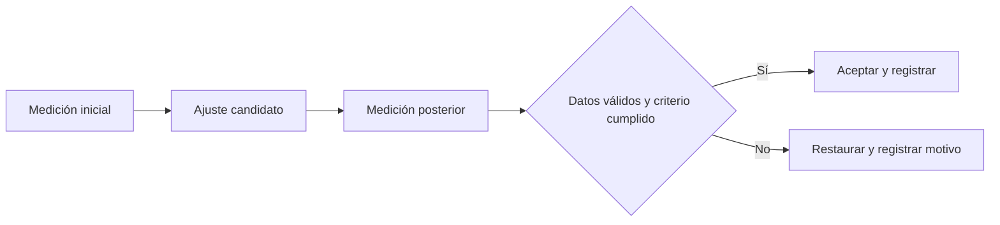

<div align="center">


# IVANNA OMEGA SUPREME

**Audio Android · procesamiento espacial · herramientas de medición**

[](version.properties)
[](app/build.gradle.kts)
[](app/src/main/)
[](https://github.com/luisurielpimentelperez814-design/IVANNA-OMEGA-SUPREME/actions/workflows/build.yml)

[Guía sencilla](LEAME.md) · [Controles](docs/GUIA_CONTROLES_COMPLETA_ES.md) · [Ingeniería](docs/ENGINEERING.md) · [English](README.en.md)

</div>

---

## Un atlas del sonido, con evidencia

IVANNA reúne un reproductor Android, un motor DSP nativo, controles de efectos, herramientas de calibración y exploración espacial. El repositorio incluye también un módulo Magisk y un dashboard web. Cada ruta tiene su propio alcance y sus requisitos.

**Estado documental · 29 de octubre de 2026 · v2.5.196 / código 487.** La versión se declara en [version.properties](version.properties). Los artefactos disponibles se consultan en [Releases](https://github.com/luisurielpimentelperez814-design/IVANNA-OMEGA-SUPREME/releases); la versión del código, por sí sola, no confirma una publicación.

| 01 · Escuchar | 02 · Medir | 03 · Explorar |
|:---|:---|:---|
| Reproductor propio, DSP y ajuste de efectos según la ruta disponible. | Tonos, captura de micrófono y comparación de ajustes con criterios internos. | Captura AR, nube de puntos, geometría configurada y renderizado espacial. |
| [Cadena de reproducción](app/src/main/java/com/ivanna/omega/audio/IvannaBridgePlayer.kt) | [Medición de sala](app/src/main/java/com/ivanna/omega/audio/RoomMeasurement.kt) | [Captura AR](app/src/main/java/com/ivanna/omega/fotoholo/RoomArCaptureActivity.kt) |

**En esta página** · [Arquitectura](#arquitectura) · [Capacidades](#capacidades-y-límites) · [Cambios actuales](#qué-cambia-en-v25195) · [Ejecutar](#compilar-y-ejecutar) · [Verificación](#verificación-y-evidencia) · [Documentación](#biblioteca-del-proyecto)

## Arquitectura


### Elige la ruta que corresponde a tu uso

| Ruta | Qué ejecuta | Requisitos y alcance |
|:---|:---|:---|
| **Reproductor propio** | Decodificación → procesamiento → resampler → AudioTrack. Usa la cadena nativa cuando está cargada y una alternativa Kotlin según los interruptores. | Funciona dentro de la aplicación. Procesa el audio reproducido por IVANNA; requiere validar cada salida en el dispositivo. |
| **Efectos Android** | Ecualización y controles mediante las capacidades expuestas por el dispositivo. | El número de bandas y la disponibilidad de efectos dependen de Android/OEM y de la sesión de audio. [Implementación](app/src/main/java/com/ivanna/omega/audio/IvannaGlobalEffectManager.kt). |
| **Módulo Magisk** | Daemon, efecto nativo y comunicación de parámetros/telemetría. | Requiere root e instalación compatible. La integración con la ruta del fabricante y el actuador ASRC físico necesita verificación en hardware. [Módulo](magisk_module/) y [daemon](app/src/main/cpp/daemon/). |
| **Dashboard web** | Interfaz React y servidor Express; demostración seleccionada explícitamente. | La configuración local y los datos de ejemplo se identifican en la interfaz. Abrir la web no establece telemetría DSP global. [Interfaz](src/App.tsx) y [servidor](server.ts). |

El PLL software del reproductor y la telemetría del productor HAL pertenecen a relojes de streams distintos. Su separación está documentada en el [contrato SAF/SAFMUS](docs/SAF_SAFMUS_UNIFIED_MATHEMATICAL_CONTRACT.md).

## Capacidades y límites

La columna de implementación describe código presente. La validación acústica requiere reproducción, captura y escucha sobre la ruta física correspondiente.

| Área | Implementación actual | Alcance que respalda el código |
|:---|:---|:---|
| **DSP y reproducción** | Cadena nativa por `DSPBridge`, con alternativa Kotlin en el reproductor. | Las etapas activas dependen de la ruta y de sus interruptores. La presencia de un módulo experimental no demuestra que intervenga en toda reproducción. [Reproductor](app/src/main/java/com/ivanna/omega/audio/IvannaBridgePlayer.kt). |
| **Perfiles y ecualización** | Quince perfiles, adaptación a las frecuencias reales de las bandas y composición de perfil, ISO, ajustes en vivo y SAF. | Los objetivos combinados de EQ se limitan a 0 mB como máximo; esto no garantiza el pico acústico ni la respuesta real del equipo. [Política](app/src/main/java/com/ivanna/omega/audio/EffectTuningPolicy.kt). |
| **PLL de AudioTrack** | Estimación de cola a partir de timestamps y corrección acotada del resampler. | Control software de la reproducción propia. La estabilidad, los clics y los underruns se evalúan en el dispositivo; el PLL no actúa sobre el reloj físico del DAC. [Controlador](app/src/main/java/com/ivanna/omega/audio/AudioTrackBufferPll.kt). |
| **HRTF y datasets** | Convolución binaural, bases PCA, paquetes IHR1 y archivos SOFA. CI incluye apertura y validación HDF5 real de SOFA. | La validación de archivos y su uso en ejecución son pasos diferentes: `SofaHRTFLoader` comprueba la firma y reconstruye desde PCA; no interpreta las mediciones del SOFA seleccionado. La ruta IHR1 dispone de su propio verificador. Una HRTF genérica requiere evaluar comodidad y resultado por oyente. [Loader](app/src/main/cpp/SofaHRTFLoader.cpp), [validador SOFA](scripts/validate_sofa_hdf5.py), [verificador IHR1](tools/hrtf/verify_dataset.py). |
| **SAF y medición de sala** | Tonos, captura, comparación antes/después, persistencia validada y restauración ante resultados rechazados. | La medición depende de señal, ruido, posición, volumen y micrófono. El teléfono carece de calibración instrumental acreditada en esta entrega. [Medición](app/src/main/java/com/ivanna/omega/audio/RoomMeasurement.kt) y [notas de reparación](docs/REPAIR_RELEASE_NOTES.md). |
| **Escena y bocinas** | Fuentes virtuales binaurales y política de ancho estéreo según la disposición declarada. | La salida binaural es estéreo. Declarar satélites/subwoofer no crea canales físicos independientes; `high_cut_hz` se almacena, pero el efecto no implementa un crossover conectado. [Política de bocinas](app/src/main/java/com/ivanna/omega/fotoholo/SpeakerLayoutPolicy.kt) y [efecto](app/src/main/cpp/omega_effect.cpp). |
| **Predicción y clasificación** | El motor predictivo observa bloques ya procesados; el clasificador distingue categorías de contenido. | La predicción publica telemetría sin modificar ese bloque. La clasificación no demuestra un desprocesamiento acústico universal. [Código nativo](app/src/main/cpp/). |
| **Reloj HAL/PAL** | Productor de muestras correlacionadas de frames/timestamp, snapshot compartido y lector del efecto. | La disponibilidad de muestras válidas depende del driver. El actuador ASRC físico sigue sin identificar/enlazar; la ruta rechaza condiciones inválidas con motivo. [Productor](app/src/main/cpp/daemon/hal_clock_producer.cpp) e [integración Moto G85](hal_integration/MOTO_G85_PAL_CLOCK_INTEGRATION.md). |
| **FotoHolo / AR** | Cámara con ARCore, seguimiento, puntos espaciales, exportación y renderizador de geometría. | La nube de puntos es parcial. No acredita una malla cerrada ni mediciones RT60/RIR. La profundidad depende de ARCore y del dispositivo. [Captura](app/src/main/java/com/ivanna/omega/fotoholo/RoomArCaptureActivity.kt) y [renderer](app/src/main/cpp/spatial/SceneGeometryRenderer.hpp). |
| **Wi-Fi / CSI** | Políticas para tratar observaciones de radio como contexto. | El Wi-Fi común no proporciona CSI. Hace falta un proveedor y hardware compatibles; no hay base para declarar reconstrucción anatómica o compatibilidad universal. [Ficha de ingeniería](docs/ENGINEERING.md). |

### Una medición debe cerrar el ciclo



El criterio interno permite decidir sobre un ajuste bajo esas condiciones de captura. La mejora audible y la seguridad de la ruta requieren pruebas físicas adicionales.

## Qué cambia en v2.5.196

- **Reloj de salida USB:** el estimador de deriva del AudioTrack pasa de una regresión de ~2 s a la mediana de pendientes por pares sobre ~30 s. Con el jitter de timestamp medido en la captura del Moto G85 + DAC USB, la simulación muestra desviación de 34–54 ppm (anterior) frente a ~2 ppm (actual); en el dispositivo falta una captura larga que lo confirme.
- **ABI:** los binarios nativos propios se enlazan con alineación de 16 KB (Android 15+); el CI mide ahora la alineación en los artefactos publicados y el Release incluye `SHA256SUMS.txt`.
- **RIR:** nueva columna `RT60_T20_measured_s` medida sobre los 200 WAV. El `RT60_s` histórico es nominal: el WAV mide 2,28 veces ese valor (sin cambiar la selección de salas).
- **SELinux:** `adb_data_file` como `mlstrustedobject` para que la app pueda escribir `omega_shm` (validado en campo por el usuario).
- **Telemetría:** el Profiler recibe beacon y estado ASRC por el daemon (la app no puede leer esos archivos) y la razón ASRC nativa corrige su signo (razón = 1/(1 + deriva)).

### Cambios de v2.5.195

- **Instalación Magisk:** la validación de librería y UUID reconoce atributos repartidos entre líneas, conserva la configuración OEM y rechaza registros incompatibles. Las pruebas de instalación usan XML sintético; la aceptación del HAL y el procesamiento en el teléfono siguen pendientes de verificación física.

### Base funcional de v2.5.194

- **SAF:** calibración ligada a reproducción efectiva, rechazo de captura insuficiente, pasos de corrección acotados y lectura estricta de registros persistidos. Los registros antiguos parciales se rechazan y requieren recalibración.
- **Controles de audio:** perfiles adaptados a las bandas reales del dispositivo y composición de ajustes sin acumular repetidamente la misma corrección.
- **Inicio y restauración:** se conservan las elecciones persistidas de ruta/espacialización; la restauración considera el destino y evita duplicar ajustes fijos del daemon.
- **Cadena estéreo externa:** documentación contrastada con el manual Sony MHC-PZ1D. AUX transporta L/R; los controles físicos del equipo conservan su propio papel.

Detalles, compatibilidad y pruebas de origen: [notas de reparación](docs/REPAIR_RELEASE_NOTES.md) · [cadena Moto G85 → estéreo](docs/AUDIO_CHAIN_MOTO_G85_STEREO.md) · [historial](CHANGELOG.md).

## Compilar y ejecutar

### Dashboard web

Usa **Node 24.21.0 o posterior dentro de la serie 24** y **npm 11.19.0**, según [package.json](package.json).

```bash
npm ci
npm run dev
```

Abre `http://localhost:3000`. La variable `PORT` permite cambiar el puerto. Para servir el build de producción:

```bash
npm run build
NODE_ENV=production npm start
```

Las funciones remotas de chat y FotoHolo del [servidor](server.ts) usan `GEMINI_API_KEY`; sin ella responden con indisponibilidad. Configura `DASHBOARD_AUTH_TOKEN` para exigir autenticación en esas API al exponer el servidor. La clave del proveedor permanece en el servidor.

### Aplicación Android

La [configuración Android](app/build.gradle.kts) declara **SDK mínimo 28**, **compile/target SDK 35**, **NDK 27.2.12479018** y **JDK 17**. El [workflow de entrega](.github/workflows/build.yml) configura CMake 3.30.3 y documenta el ensamblado y empaquetado completos.

Para desarrollo con JDK/SDK y dependencias preparados:

```bash
./gradlew :app:assembleDebug
```

La instalación Magisk requiere root y una ruta compatible. Consulta [la guía sencilla](LEAME.md) y verifica los artefactos de la versión antes de instalar.

### Motor nativo en host

El script del repositorio configura, compila y ejecuta CTest:

```bash
bash scripts/run_ctest.sh
```

Requisitos y reglas de contribución: [CONTRIBUTING.md](CONTRIBUTING.md). La compilación host y la compilación Android tienen entornos diferentes.

## Verificación y evidencia

| Capa | Cómo se comprueba | Qué establece |
|:---|:---|:---|
| Web | `npm run test:web`, `npm run lint`, `npm run build` | Pruebas web, tipos y compilación del dashboard. |
| FotoHolo web | `npx vite build --config vite.fotoholo.config.ts` | Compilación de la entrada web incrustada. |
| Nativo | `bash scripts/run_ctest.sh` | Pruebas host de DSP y contratos; [workflow host](.github/workflows/tests-host.yml) incluye sanitizadores. |
| Cableado y contratos | Bucle `scripts/check_*.py` mostrado debajo | Puertas estáticas sobre el código y las afirmaciones documentales. |
| Datasets | [CI de entrega](.github/workflows/build.yml) y [validador HDF5](scripts/validate_sofa_hdf5.py) | Paridad/empaquetado, estructura de datos y comprobaciones específicas; cada verificador tiene alcance propio. |
| APK y módulo | [CI de entrega](.github/workflows/build.yml) | Construcción, integridad y publicación según las condiciones del workflow. |
| Dispositivo | [Plan Moto G85](docs/PLAN_10D_MOTO_G85_ACCEPTANCE.md) | Aceptación física pendiente por ruta, con evidencias registradas. |

```bash
for gate in scripts/check_*.py; do
  python3 "$gate" || exit 1
done
```

El distintivo CI consulta el estado de GitHub. Los resultados de una ejecución se interpretan junto con su commit, entorno y artefactos; las pruebas sintéticas no acreditan latencia, SPL, calidad audible ni control del reloj físico.

<details>
<summary><strong>Banco sintético · análisis WAV y diagnósticos</strong></summary>

### Banco sintético de audio y diagnósticos accionables

El banco de pruebas de Python tiene tres piezas separadas. Sus resultados deben interpretarse según el alcance de cada una:

1. **Analizador WAV** — [`scripts/ivanna_audio_certify.py`](scripts/ivanna_audio_certify.py): lee PCM entero sin compresión de 8, 16, 24 o 32 bits; informa RMS y pico por canal, offset DC, clipping y desequilibrio entre canales. Opcionalmente estima el residuo de un tono conocido y compara una captura contra un WAV de referencia.
2. **Inyección sintética de fallos** — [`scripts/ivanna_synthetic_audio_suite.py`](scripts/ivanna_synthetic_audio_suite.py): genera siete estímulos de control y verifica que el analizador detecte los defectos inyectados sin marcar determinados casos limpios como defectuosos.
3. **Puerta de evidencia física** — [`scripts/ivanna_auditory_gate.py`](scripts/ivanna_auditory_gate.py): exige checks explícitos, las rutas requeridas, evidencia del dispositivo y escucha con niveles igualados para devolver `GREEN`. Ausencia de evidencia no pasa como éxito.

#### Estímulos sintéticos cubiertos

| Estímulo | Comportamiento esperado |
|---|---|
| `clean_sine` | Sin clipping, desequilibrio ni DC detectados; sin THD+N residual crítico. |
| `clipping` | Debe informar `PCM_CLIPPING`. |
| `dc_offset` | Debe informar `DC_OFFSET`. |
| `channel_imbalance` | Debe informar `CHANNEL_IMBALANCE`. |
| `harmonic_distortion` | Debe informar `TONE_THDN_HIGH`. |
| `near_full_scale` | Debe avisar `LOW_PEAK_HEADROOM` sin confundirlo con clipping. |
| `silent` | No debe producir las alarmas de clipping, DC ni desequilibrio definidas para la prueba. |

#### Ejecutar el banco

Desde la raíz del repositorio:

```bash
python3 -m unittest discover -s tests -p 'test_ivanna_audio_certify.py' -v
python3 -m unittest discover -s tests -p 'test_ivanna_synthetic_audio_suite.py' -v
python3 -m unittest discover -s tests -p 'test_ivanna_auditory_gate.py' -v
python3 scripts/ivanna_synthetic_audio_suite.py --output-dir /tmp/ivanna-synthetic-report
```

Para analizar una captura real, el archivo debe ser WAV PCM entero sin compresión:

```bash
python3 scripts/ivanna_audio_certify.py captura.wav --tone-hz 1000 --json-out informe.json
python3 scripts/ivanna_audio_certify.py despues.wav --reference antes.wav --json-out comparacion.json
```

La comparación de referencia requiere la misma frecuencia de muestreo y el mismo número de canales; el SNR residual también penaliza desalineación temporal y diferencia de ganancia. No recortes muestras arbitrariamente para ocultar latencia: alinea ventanas equivalentes y mide la latencia por separado.

Los hallazgos del analizador pueden ser `CRITICAL`, `WARNING` o inexistentes, y el resumen puede ser `RED`, `AMBER` o `NO_SCREENING_FLAGS`. Son heurísticas de cribado, no límites universales de percepción. La puerta física usa `RED`/`AMBER`/`GREEN` con otra semántica; no son intercambiables.

**Límite esencial:** el banco sintético comprueba el comportamiento del analizador ante señales generadas. No mide la ruta Android en vivo, el códec Bluetooth realmente negociado, el ASRC del proveedor, la latencia extremo a extremo, SPL acústico ni THD de laboratorio. Para eso se requieren capturas de la ruta física, equipo adecuado y escucha controlada con niveles igualados.


</details>

### Aceptación en el dispositivo

- Instalar APK y módulo procedentes del mismo commit y registrar sus hashes.
- Probar salida integrada, USB-C y Bluetooth por separado cuando estén disponibles.
- Comprobar reproducción, controles restaurados, clics, cambios de tono y underruns.
- Verificar cámara, seguimiento, pausa/reanudación y exportación de FotoHolo.
- Registrar modelo, Android, ruta y logs depurados. Para HAL/PAL, identificar fuente, actuador y lectura de retorno antes de declarar control físico.

## Biblioteca del proyecto

| Para empezar | Para investigar |
|:---|:---|
| [Guía sencilla en español](LEAME.md) | [Ficha de ingeniería](docs/ENGINEERING.md) |
| [Guía completa de controles](docs/GUIA_CONTROLES_COMPLETA_ES.md) | [Contrato matemático SAF/SAFMUS](docs/SAF_SAFMUS_UNIFIED_MATHEMATICAL_CONTRACT.md) |
| [Inicio rápido en inglés](README.en.md) | [Plan de aceptación Moto G85](docs/PLAN_10D_MOTO_G85_ACCEPTANCE.md) |
| [Registro de cambios](CHANGELOG.md) | [Notas de reparación v2.5.194](docs/REPAIR_RELEASE_NOTES.md) |

## Contribuir y reportar problemas

Consulta [cómo contribuir](CONTRIBUTING.md). Para reportar un fallo, incluye versión/commit, dispositivo, Android, ruta de audio, pasos y registros sin credenciales ni datos personales. Cámara, micrófono y funciones remotas deben evaluarse según el flujo utilizado.

[Abrir un issue](https://github.com/luisurielpimentelperez814-design/IVANNA-OMEGA-SUPREME/issues) · [Seguridad](SECURITY.md) · [Avisos de terceros](THIRD_PARTY_NOTICES.md)

## Licencia y propiedad intelectual

IVANNA OMEGA SUPREME se presenta como un producto propietario. La visibilidad pública del repositorio no concede por sí sola permiso para reutilizar el código propio. Los componentes, bibliotecas, modelos y datasets de terceros conservan sus licencias y avisos; revisa los archivos de licencia y avisos antes de redistribuir. Las concesiones expresas aplicables a versiones anteriores siguen rigiendo esas versiones según sus términos.


---

<div align="center">

**La forma invita a explorar. La evidencia permite confiar.**

<sub>Ilustraciones conceptuales del repositorio · sin representación de mediciones acústicas.</sub>

</div>
