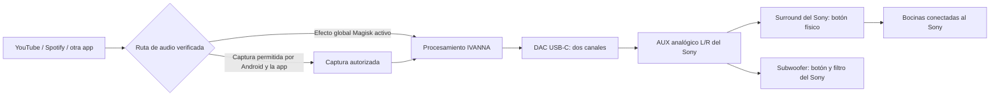

# Moto G85 → USB DAC → auxiliar estéreo → Sony

## Contrato de salida

La entrada auxiliar analógica transporta L/R. Un conjunto de seis bocinas más subwoofer no transforma esa conexión en siete canales independientes. El surround, la amplificación y el filtro del subwoofer pertenecen al Sony. Modelo comunicado: «ghzp1d», pendiente de confirmar en la etiqueta; también faltan modelo del DAC y estado root/Magisk del teléfono. No se infieren capacidades a partir de ese nombre.

Las rutas global y captura no deben procesar simultáneamente la misma señal. Una conexión USB detectada no prueba el endpoint realmente utilizado por AudioPolicy ni la inserción del efecto global. Algunas aplicaciones impiden captura; no se garantiza cobertura de cualquier plataforma sin comprobar su ruta real.

## Perfil añadido

En **Bocinas declaradas**, seleccionar **Equipo estéreo externo (Sony u otro)**. Se guarda la declaración independientemente del número de bocinas. En USB/AUX, RouteDspCalibrator desactiva la HRTF del procesador legacy, elige el arquetipo de altavoces y no añade la sala sintética/optimización de sala por defecto. La pantalla deja de publicar un layout WFS multicanal al activar el surround declarado sobre esta conexión estéreo.

Esto no es una calibración del Sony ni una certificación de todos los renderers. Los otros paneles permiten configurar motores adicionales; hay que verificar el estado efectivo del pipeline global antes de escuchar. El subwoofer declarado no crea LFE, crossover ni control remoto del equipo. El perfil de auriculares sigue siendo independiente.

## Aceptación física pendiente

1. Identificar DAC/Sony y confirmar entrada AUX, altavoces conectados y disponibilidad de Magisk.
2. Confirmar el endpoint USB en reproducción; L/R correctos y canales sin invertir.
3. Confirmar inserción del efecto con cada aplicación y ausencia de captura duplicada.
4. Comparar bypass frente a procesamiento con volumen igualado: primero surround Sony apagado y luego encendido; no atribuir al software el efecto del Sony.
5. Medir clipping, ruido, latencia y estabilidad al reconectar USB; evaluar localización frontal/lateral, profundidad y fatiga desde la posición de escucha.
6. Probar subwoofer apagado/encendido y medir integración con las bocinas. No asumir que más graves significan mejor localización.

«Holofonía 4D» es aquí un objetivo perceptual de espacialidad, profundidad y movimiento. La matemática validada y el cableado de controles son condiciones necesarias; no garantizan una experiencia universal ni superioridad frente a otros productos.
