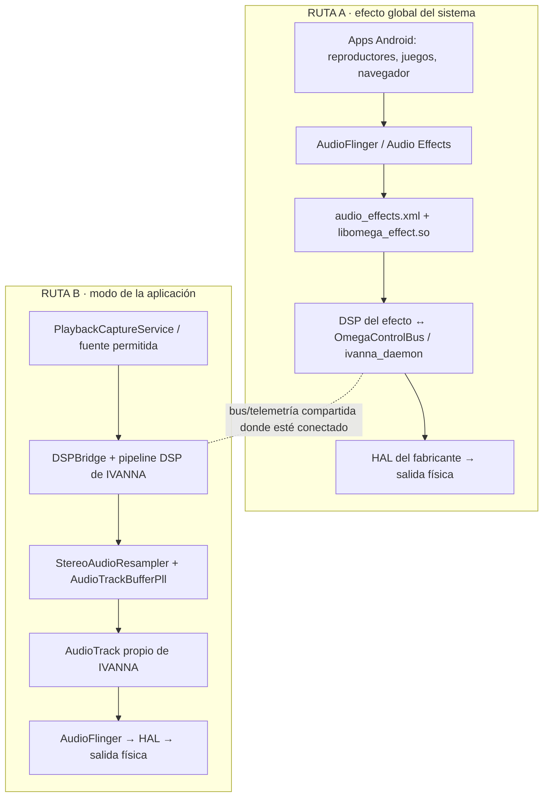

# IVANNA — dos rutas de audio, una arquitectura

Este documento fija la distinción operativa entre la ruta de efecto del sistema (A) y la ruta de captura/reproducción propia de la app (B). Que ambas estén implementadas en el repositorio no significa que estén activas simultáneamente en todos los dispositivos: cada ruta tiene su propio gate de verificación en ejecución.

## Diagrama

## Ruta A — efecto insertado por AudioFlinger

**Archivos principales**
- `app/src/main/cpp/omega_effect.cpp`: implementación del efecto nativo y procesamiento por bloques.
- `app/src/main/cpp/include/omega_effect_beacon.h`: señal de estado para distinguir daemon vivo de efecto realmente procesando.
- `magisk_module/system/vendor/etc/audio_effects.xml`: declaración vendor del efecto.
- `magisk_module/service.sh`: arranque del daemon y preparación de estado del módulo.

**Qué significa:** esta es la vía objetivo para afectar audio de aplicaciones ajenas a IVANNA cuando Android/OEM inserta y ejecuta el efecto. La declaración XML o la existencia de `libomega_effect.so` no prueban por sí solas que AudioFlinger haya cargado el efecto ni que esté procesando frames. Usar el beacon/estado del efecto y logs del dispositivo como gate.

## Ruta B — captura y reproducción propiedad de IVANNA

**Archivos principales**
- `app/src/main/java/com/ivanna/omega/audio/PlaybackCaptureService.kt`: captura de reproducción que Android permite capturar, según política de la app origen, permisos y sesión de captura.
- `app/src/main/java/com/ivanna/omega/audio/IvannaBridgePlayer.kt`: reproducción propia de IVANNA.
- `app/src/main/java/com/ivanna/omega/audio/AudioCallbackManager.kt`: foco de audio.
- `app/src/main/java/com/ivanna/omega/audio/AudioTrackBufferPll.kt` y `StereoAudioResampler.kt`: control de cola y corrección de tasa en el AudioTrack propio.

**Qué significa:** es una ruta de app; no equivale a un efecto global de sistema. Playback Capture está sujeto a las restricciones Android y no captura necesariamente todas las apps. El PLL de AudioTrack solo corrige el remuestreador de la ruta propia; no gobierna directamente el reloj físico USB, Bluetooth ni el HAL OEM.

## Contrato de reloj / ASRC

- No mezclar timestamps, posiciones de frames ni tasas estimadas de Ruta A (HAL/PAL/ALSA) con los de Ruta B (AudioTrack propio).
- El componente C++ `VariableAsrc` compilado no debe considerarse activo hasta que el call graph demuestre que procesa los frames de la ruta elegida y las pruebas lo verifiquen.
- La telemetría `localSR=48000.2 Hz` da una estimación condicional de +4.17 ppm frente a 48 kHz; no es un ajuste que deba aplicarse directamente a la Ruta B.
- El beacon del efecto confirma actividad del efecto solo si se puede leer correctamente en el dispositivo. Si está `UNAVAILABLE`, no inferir que está procesando.

## Matriz mínima de validación

| Caso | Evidencia exigida | Criterio |
|---|---|---|
| Ruta A inactiva | Beacon `NO_EFFECT`/sin frames y logs de audioserver | No afirmar procesamiento global |
| Ruta A activa | Beacon `PROCESSING`, contador de frames creciente y salida audible | Confirmar inserción en ese dispositivo |
| Ruta B activa | Captura permitida + AudioTrack propio + timestamps válidos | Medir corrección y estabilidad de cola |
| DAC USB | Identidad de ruta y muestras del mismo flujo | No atribuir el PLL de Ruta B al reloj del DAC |
| Bluetooth | Ruta BT y métricas separadas | No extrapolar resultados USB |
| ASRC nativo | Pruebas ratio ±, slew, clamp, continuidad, NaN/Inf, underrun/overrun | No habilitar sin pasar tests y comprobar conexión real |

## Release de prueba

El release debe producir APK y ZIP Magisk mediante el workflow de GitHub Actions. Un release publicado no reemplaza la validación en el Moto G85: después de instalar, comprobar primero Ruta A con el beacon y después Ruta B por separado. No declarar «global» si solo se verificó la reproducción propia de IVANNA.
